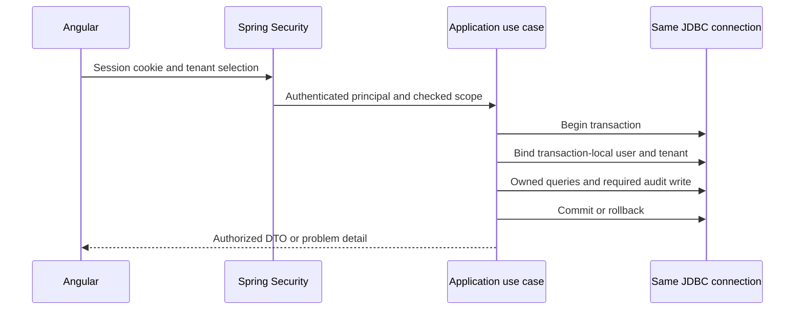

# Backend Architecture

**Decision status:** APPROVED bounded L02 structure and tooling design ([2026-11-18 approval](../00-GOVERNANCE/DECISION-MANAGEMENT.md#l02-skeleton-decisions--2026-11-18), [pins: ADR-0010](../adr/ADR-0010-java-spring-versions.md)); integrated contracts below remain PROPOSED.
**Implementation status:** L02 no-database skeleton IMPLEMENTED / TESTED only;
see [execution evidence](../PACK-INVENTORY.md#l02-execution-evidence--2026-11-18).
No functional identity, tenancy, access, audit or inventory APIs are implemented;
no PostgreSQL operations, frontend, business feature, release or deployment are claimed.

## Purpose and non-scope

A Spring Boot foundation with enforceable internal platform boundaries. No business modules, custom generic bus, plugin host or independent microservices are included.

## Package discovery and ownership

Approved L02: one artifact with application root `com.authoritypro.platform.AuthorityProApplication` and exactly five immediate module roots: `identity`, `tenancy`, `access`, `audit` and `runtime`. Spring Modulith 2.1.2 and ArchUnit 1.4.2 enforce boundaries, without an event registry. Verification must discover those exact modules from real application classes/metadata before checking dependencies; empty directories, a hard-coded list or class-linkage probes are not discovery evidence.

The L02 intermodule dependency graph is EMPTY. Do not fabricate APIs or services to make the skeleton appear implemented. Private `domain`, `application` and `infrastructure` packages are introduced only as needed; named `api` exports and their consumption require explicit later approval. HTTP controllers are adapters, not cross-module contracts. Repositories and persistence entities remain private; application ports belong to their consuming module. Versioned test-only negative fixtures must prove that forbidden edges/private imports and incorrect discovery are rejected, without contaminating production modules.

A future business application composition root needs its own reviewed module-discovery configuration. There is no empty `modules/` tree implying business functionality today.

## Future authentication proposal (L05, not L02)

L02 provisions no datasource, session, credentials, account or login; its local-only surface is defined in [API architecture](API-ARCHITECTURE.md#bounded-l02-http-design). The following is the later integrated design.

Use Spring Security and Spring Session JDBC, not custom token cryptography. A same-origin browser receives an HttpOnly session cookie. Secure is mandatory over HTTPS; any localhost HTTP exception is confined to the development profile. SameSite and CSRF protection apply to login, logout and all state-changing endpoints. Rotate session identity on login; invalidate on logout and account disablement. API clients/OIDC are separate future decisions.

Initial account provisioning is an operator-only, disabled-by-default local command using framework password encoding, an atomic one-time database guard and an audit record. No public bootstrap controller and no password passed on the command line.

## Future integrated request and transaction sequence (L03–L06)

This sequence and the database/session/audit failure contracts below do not run in the no-database L02 skeleton; they remain integration requirements for their respective slices.

1. Framework session processing authenticates the user; client-provided user identifiers cannot establish identity.
2. The access contract queries only that authenticated user's active memberships.
3. A tenant-scoped request supplies a tenant UUID as a selection hint; membership and company/site grants authorize it.
4. A transactional application operation obtains its actual JDBC connection after transaction begin.
5. On that same connection, set validated user and tenant context with bound `set_config(..., true)` calls before the first tenant query.
6. Execute module-owned persistence and required audit writes; commit or roll back together.
7. Clear request/thread context in `finally`. Transaction-local database settings end with the transaction.

Do not rely on a transaction synchronization that allegedly runs before transaction creation. A proof-of-concept must test transaction advice ordering, connection binding, nested transactions, read-only queries, `REQUIRES_NEW`, pooled connection reuse and exceptions. Disable Open EntityManager in View; no lazy database work after the transaction.

## Security and failure contracts

The runtime role is not a table owner, superuser or BYPASSRLS role. Migration credentials are unavailable to the serving process. No global setting grants platform access through RLS. Unknown session yields 401; missing/malformed tenant selection yields 400; inaccessible scope yields 403. Database unavailability yields sanitized 503 and failed readiness, not raw SQL or credentials.

Security audit failure rolls back sensitive writes. Failed-login audit uses an independent bounded path because the authentication attempt itself may fail; telemetry failure cannot turn a rejected login into a success.

## Observability and tests

Server-generated trace IDs connect sanitized logs and errors. Account and tenant identifiers follow the logging data-classification policy; never log cookies, CSRF secrets, passwords or request bodies by default. Probes reveal no infrastructure details publicly.

**L02 bounded verification passed:** clean verify completed 65 unit tests and 4 packaged integration tests with no failures or skips on project-portable Temurin 21.0.13+9, Boot 4.1.2, Maven 3.9.16 and Wrapper 3.3.4. Evidence covers the exact five compiled `package-info` closed roots with zero edges and effective negative fixtures; real main startup on loopback port 8080, invalid-config and occupied-port refusal; only exact GET liveness 200/UP and readiness 503/OUT_OF_SERVICE, other requests denied, retained CSRF and sanitized RFC 9457 errors. No database/driver/session path, default user, event registry or external-call path is delivered; OpenAPI is test-only and excluded from the production JAR. See [local-mode acceptance](DEPLOYMENT-ARCHITECTURE.md#acceptance) and the canonical execution evidence above. The offline clean repeat also passed.

**Later integration gates:** L03 would add migrated-database startup, runtime-role RLS and proof that no tenant read escapes its scoped transaction; L04 would add critical-audit atomicity; L05 would add session fixation/CSRF/revocation and authentication integration. The next step is qualified L03 facts/design and approval, not automatic database access or implementation. L02 exit does not satisfy these gates or close full G2.

## Related

- [Database](DATABASE-ARCHITECTURE.md)
- [API](API-ARCHITECTURE.md)
- [Session ADR](../adr/ADR-0005-sessions.md)
- [Architecture governance](../00-GOVERNANCE/ARCHITECTURE-GOVERNANCE.md)
