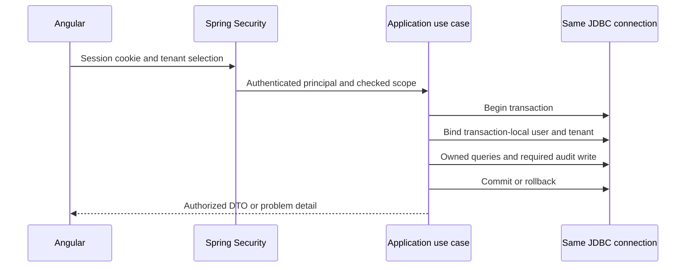

# Backend Architecture

**Decision status:** PROPOSED implementation design.
**Implementation status:** NOT IMPLEMENTED.

## Purpose and non-scope

A Spring Boot foundation with enforceable internal platform boundaries. No business modules, custom generic bus, plugin host or independent microservices are included.

## Package discovery and ownership

Proposed application root: `com.authoritypro.platform.AuthorityProApplication`. Its immediate child packages `identity`, `tenancy`, `access`, `audit` and `runtime` are candidate Spring Modulith module roots. The verification test must assert the discovered module names before checking dependencies; otherwise a nested package mistake could verify only one large module.

Each module uses `api`, `domain`, `application` and `infrastructure` packages as required. Its `api` export is explicitly declared with the supported Modulith named-interface mechanism. HTTP controllers are adapters, not cross-module API contracts. Repositories and persistence entities are private. Application ports belong to their consuming module.

A future business application composition root needs its own reviewed module-discovery configuration. There is no empty `modules/` tree implying business functionality today.

## Authentication proposal

Use Spring Security and Spring Session JDBC, not custom token cryptography. A same-origin browser receives an HttpOnly session cookie. Secure is mandatory over HTTPS; any localhost HTTP exception is confined to the development profile. SameSite and CSRF protection apply to login, logout and all state-changing endpoints. Rotate session identity on login; invalidate on logout and account disablement. API clients/OIDC are separate future decisions.

Initial account provisioning is an operator-only, disabled-by-default local command using framework password encoding, an atomic one-time database guard and an audit record. No public bootstrap controller and no password passed on the command line.

## Request and transaction sequence

1. Framework session processing authenticates the user; client-provided user identifiers cannot establish identity.
2. The access contract queries only that authenticated user's active memberships.
3. A tenant-scoped request supplies a tenant UUID as a selection hint; membership and company/site grants authorize it.
4. A transactional application operation obtains its actual JDBC connection after transaction begin.
5. On that same connection, set validated user and tenant context with bound `set_config(..., true)` calls before the first tenant query.
6. Execute module-owned persistence and required audit writes; commit or roll back together.
7. Clear request/thread context in `finally`. Transaction-local database settings end with the transaction.

Do not rely on a transaction synchronization that allegedly runs before transaction creation. A proof-of-concept must test transaction advice ordering, connection binding, nested transactions, read-only queries, `REQUIRES_NEW`, pooled connection reuse and exceptions. Disable Open EntityManager in View; no lazy database work after the transaction.

## Security and failure contracts

The runtime role is not a table owner, superuser or BYPASSRLS role. Migration credentials are unavailable to the serving process. No global setting grants platform access through RLS. Unknown session yields 401; missing/malformed tenant selection yields 400; inaccessible scope yields 403. Database unavailability yields sanitized 503 and failed readiness, not raw SQL or credentials.

Security audit failure rolls back sensitive writes. Failed-login audit uses an independent bounded path because the authentication attempt itself may fail; telemetry failure cannot turn a rejected login into a success.

## Observability and tests

Server-generated trace IDs connect sanitized logs and errors. Account and tenant identifiers follow the logging data-classification policy; never log cookies, CSRF secrets, passwords or request bodies by default. Probes reveal no infrastructure details publicly.

Gate: context starts on a migrated database; module discovery is nonempty and exact; prohibited imports fail; session fixation/CSRF/revocation tests pass; RLS tests use the runtime role; no tenant read occurs outside the scoped transaction.

## Related

- [Database](DATABASE-ARCHITECTURE.md)
- [API](API-ARCHITECTURE.md)
- [Session ADR](../adr/ADR-0005-sessions.md)
- [Architecture governance](../00-GOVERNANCE/ARCHITECTURE-GOVERNANCE.md)
