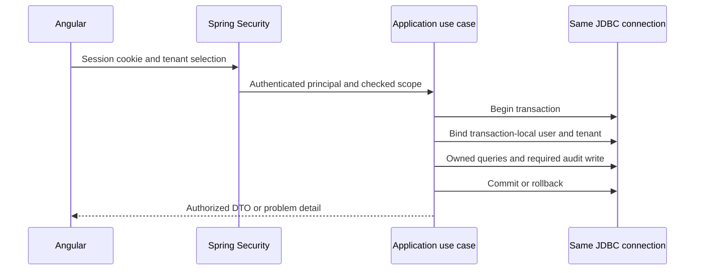

# Backend Architecture

**Decision status:** APPROVED bounded L02 structure and tooling design ([2026-11-18 approval](../00-GOVERNANCE/DECISION-MANAGEMENT.md#l02-skeleton-decisions--2026-11-18), [pins: ADR-0010](../adr/ADR-0010-java-spring-versions.md)); integrated contracts below remain PROPOSED.
**Implementation status:** L02 skeleton and bounded closed L03 JDBC/RLS integration locally IMPLEMENTED / TESTED; see [main recovery evidence](../PACK-INVENTORY.md#l03-main-recovery-evidence--2026-11-20). V1 contains four empty technical tenancy tables under restricted runtime access. No authenticated identity, membership authorization, audit, inventory API, frontend or business feature is implemented; full G2 and production acceptance remain open.

## Purpose and non-scope

A Spring Boot foundation with enforceable internal platform boundaries. No business modules, custom generic bus, plugin host or independent microservices are included.

## Package discovery and ownership

Approved L02: one artifact with application root `com.authoritypro.platform.AuthorityProApplication` and exactly five immediate module roots: `identity`, `tenancy`, `access`, `audit` and `runtime`. Spring Modulith 2.1.2 and ArchUnit 1.4.2 enforce boundaries, without an event registry. Verification must discover those exact modules from real application classes/metadata before checking dependencies; empty directories, a hard-coded list or class-linkage probes are not discovery evidence.

The L02 intermodule dependency graph is EMPTY. Do not fabricate APIs or services to make the skeleton appear implemented. Private `domain`, `application` and `infrastructure` packages are introduced only as needed; named `api` exports and their consumption require explicit later approval. HTTP controllers are adapters, not cross-module contracts. Repositories and persistence entities remain private; application ports belong to their consuming module. Versioned test-only negative fixtures must prove that forbidden edges/private imports and incorrect discovery are rejected, without contaminating production modules.

A future business application composition root needs its own reviewed module-discovery configuration. There is no empty `modules/` tree implying business functionality today.

## Module internals and dependency direction

The [architectural foundations and twelve logical layers](TARGET-ARCHITECTURE.md#architectural-foundations-and-logical-layers) describe complementary views. DDD organizes cohesive responsibilities; ports and adapters keep module policy independent of technical mechanisms. The product PBC is a governed capability boundary, not an instruction to create a Maven module or process for each catalogue label.

Illustrative layout for a future authorized module, not a directory-creation checklist:

```text
<module>/
  api/                         named public contract exports only
  domain/                      model, aggregates, value objects, rules, domain events
  application/                 use cases, commands/queries, handlers and policies
    ports/inbound/             use-case interfaces when needed
    ports/outbound/            required persistence/integration interfaces
  infrastructure/
    adapters/inbound/          HTTP or messaging entry points
    adapters/outbound/         persistence, messaging and external integrations
    configuration/             composition-root wiring
```

The supplied richer module tree maps onto the same responsibilities without creating additional runtime layers:

| Supplied folder | Role | Adopted convention |
|---|---|---|
| `domain/model`, `entities`, `value-objects`, `aggregates`, `domain-services`, `domain-events`, `repositories` | Model, invariants, domain events, owned repository interfaces | Same responsibilities; subfolders only when real code justifies them |
| `application/commands`, `queries`, `handlers`, `use-cases`, `policies` | Use cases and coordination | May be consolidated; no ceremonial class per label |
| `ports/inbound`, `ports/outbound` | Dependency-inversion interfaces | Kept under `application/ports` in the consuming module |
| `adapters/inbound/{rest,messaging}`, `adapters/outbound/{persistence,messaging,integrations}` | Technical entry points and implementations | `infrastructure/adapters`; controllers and framework entities never cross module boundaries |
| `contracts/{commands,queries,events}` | Named public command, query and event definitions | Compiled into reviewed `api/` exports; `api` and `contracts` are not two parallel publication channels |
| `infrastructure/configuration` | Composition-root wiring | Retained |
| `tests` | Verification | Maven test source tree; tests do not become production dependencies |

Tests remain under Maven's test source tree, mirroring responsibilities as needed. The source's separate `ports`, `adapters`, `contracts` and `tests` folders express roles, not mandatory additional layers or adopted paths. `api` is the reviewed named export convention, not a publicly accessible copy of every application handler. Separate entities/aggregates/value-objects/domain-services folders only when actual code benefits; technical modules need no invented rich business model. Repository interfaces belong to the consuming domain or application, never duplicated in both; their implementations remain private outbound adapters. Avoid a catch-all shared kernel containing mutable entities or module repositories.

| Dependency | Rule |
|---|---|
| Domain -> application/infrastructure/frameworks | Forbidden; domain policy must be testable without Spring, JDBC, Angular, Redis, devices or remote APIs |
| Application -> own domain and owned ports | Allowed; application coordinates use cases and transaction requirements without concrete adapter dependencies |
| Incoming adapter -> inbound/application contract | Authenticate, validate and construct trusted context before the guarded use case |
| Outgoing adapter -> owned outbound port | Implements persistence/integration behavior; mapping does not expose framework entities across module boundaries |
| Composition root -> ports and adapters | Wires implementations; framework bootstrapping is not domain logic |
| Another module -> explicitly exported `api` | Only under reviewed named exports and declared consumption, never private domain/application/adapter packages |

A future Orders capability requesting an Inventory reservation calls the Inventory-owned command contract; it cannot import Inventory entities/repositories or change stock tables. This is a design example only: neither module is authorized now. In-process typed calls preserve the modular monolith; a broker, dynamic registry or generic dispatcher is not required to make every call. Ports are dependency abstractions, not a promise of runtime adapter interchangeability.

Architecture acceptance must discover real modules and reject deliberate fixtures for domain-to-framework dependence, private intermodule imports, undeclared exports and cycles. Later declared API dependencies replace the empty graph only through their approved slice; the twelve-layer view does not authorize them. Such new acceptance cases are requirements, not tests executed by this documentation update.

## Future authentication proposal (L05, not L02)

L02 provisions no datasource, session, credentials, account or login; its local-only surface is defined in [API architecture](API-ARCHITECTURE.md#bounded-l02-http-design). The following is the later integrated design.

Use Spring Security and Spring Session JDBC, not custom token cryptography. A same-origin browser receives an HttpOnly session cookie. Secure is mandatory over HTTPS; any localhost HTTP exception is confined to the development profile. SameSite and CSRF protection apply to login, logout and all state-changing endpoints. Rotate session identity on login; invalidate on logout and account disablement. API clients/OIDC are separate future decisions.

Initial account provisioning is an operator-only, disabled-by-default local command using framework password encoding, an atomic one-time database guard and an audit record. No public bootstrap controller and no password passed on the command line.

## Future integrated request and transaction sequence (L03–L06)

This sequence and the database/session/audit failure contracts below do not run in the no-database L02 skeleton; they remain integration requirements for their respective slices.

1. Framework session processing authenticates the user; client-provided user identifiers cannot establish identity.
2. The access contract queries only that authenticated user's active memberships.
3. A tenant-scoped request supplies a tenant UUID as a selection hint; membership and company/site grants authorize it.
4. A transactional application operation obtains its actual JDBC connection after transaction begin.
5. On that same connection, set validated user and tenant context with bound `set_config(..., true)` calls before the first tenant query.
6. Execute module-owned persistence and required audit writes; commit or roll back together.
7. Clear request/thread context in `finally`. Transaction-local database settings end with the transaction.

Do not rely on a transaction synchronization that allegedly runs before transaction creation. A proof-of-concept must test transaction advice ordering, connection binding, nested transactions, read-only queries, `REQUIRES_NEW`, pooled connection reuse and exceptions. Disable Open EntityManager in View; no lazy database work after the transaction.



## Security and failure contracts

The runtime role is not a table owner, superuser or BYPASSRLS role. Migration credentials are unavailable to the serving process. No global setting grants platform access through RLS. Unknown session yields 401; missing/malformed tenant selection yields 400; inaccessible scope yields 403. Database unavailability yields sanitized 503 and failed readiness, not raw SQL or credentials.

Security audit failure rolls back sensitive writes. Failed-login audit uses an independent bounded path because the authentication attempt itself may fail; telemetry failure cannot turn a rejected login into a success.

## Observability and tests

Server-generated trace IDs connect sanitized logs and errors. Account and tenant identifiers follow the logging data-classification policy; never log cookies, CSRF secrets, passwords or request bodies by default. Probes reveal no infrastructure details publicly.

**L02 bounded verification passed:** clean verify completed 65 unit tests and 4 packaged integration tests with no failures or skips on project-portable Temurin 21.0.13+9, Boot 4.1.2, Maven 3.9.16 and Wrapper 3.3.4. Evidence covers the exact five compiled `package-info` closed roots with zero edges and effective negative fixtures; real main startup on loopback port 8080, invalid-config and occupied-port refusal; only exact GET liveness 200/UP and readiness 503/OUT_OF_SERVICE, other requests denied, retained CSRF and sanitized RFC 9457 errors. No database/driver/session path, default user, event registry or external-call path is delivered; OpenAPI is test-only and excluded from the production JAR. See [local-mode acceptance](DEPLOYMENT-ARCHITECTURE.md#acceptance) and the canonical execution evidence above. The offline clean repeat also passed.

**Current and later integration gates:** the [bounded closed L03 recovery](../PACK-INVENTORY.md#l03-main-recovery-evidence--2026-11-20) now establishes local migrated-database startup, restricted-role RLS and transaction-scope evidence with four empty technical tables. It does not establish authenticated membership enforcement or full G2 clean-machine acceptance. The detailed L04 critical-audit contract is drafted in [Audit Engine §9](../04-PLATFORM-ENGINES/AUDIT-ENGINE.md#9-l04-detailed-contract-proposal--2026-11-21) with D1–D6 approved; a separate implementation authorization remains, followed by L05 session fixation/CSRF/revocation and authorization integration under their own approvals. L04 extends the existing technical `audit` root, not a business module. These functions are not yet delivered.

## Related

- [Database](DATABASE-ARCHITECTURE.md)
- [API](API-ARCHITECTURE.md)
- [Session ADR](../adr/ADR-0005-sessions.md)
- [Architecture governance](../00-GOVERNANCE/ARCHITECTURE-GOVERNANCE.md)
