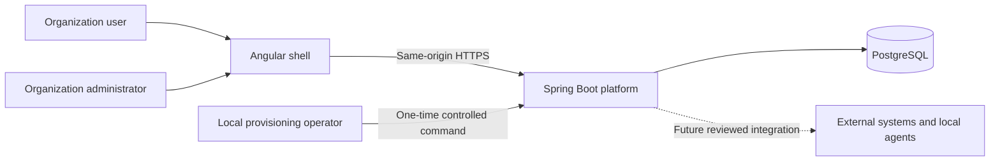

# System Context

**Decision status:** PROPOSED decomposition of the approved blueprint.
**Implementation status:** NOT IMPLEMENTED.

## Actors and authority

The platform owner operates technical/commercial services but has no implicit customer-data access. Organization administrators govern their tenants and company/site grants. Users act only within assigned scopes. Support operators require future explicit customer-approved grants; that feature is absent now. External publishers, providers and device agents belong to later work, not the current socle.

## System boundary

Initial target: browser shell, one backend process, PostgreSQL and reviewed migration/provisioning tooling. Not included: external identity provider, mail, payments, marketplace, local device control, AI provider, business domain or synchronization service.

## Trust boundaries and limitations

- Browser inputs, tenant selection and future package manifests are untrusted.
- Database network access is restricted and authenticated; a private network is not a substitute for authorization.
- Session/account control-plane data is separate from tenant-owned data access.
- Module boundaries prevent accidental code coupling; a shared JVM does not sandbox malicious code.
- Database administrators may access underlying storage. Excluding them cryptographically requires a separate key-management decision.

## Assumptions and failure behavior

Initial topology is single-region. Store UTC instants and format per locale; no offline write guarantee. Dependency failure makes readiness fail and returns bounded errors rather than falsely healthy status. Optional future services must not become required for login or tenant safety without an approved ADR.

## Acceptance and related documents

The architecture review must map every external connection to a declared trust boundary. No external connection is provisioned by this document.

- [Target architecture](TARGET-ARCHITECTURE.md)
- [Deployment](DEPLOYMENT-ARCHITECTURE.md)
- [Risk register](../13-IMPLEMENTATION/RISK-REGISTER.md)
