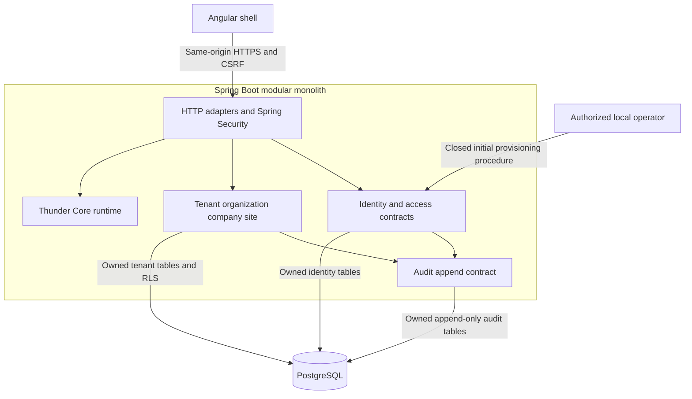

# Target Architecture

**Decision status:** PROPOSED detail; Angular, Spring Boot, modular monolith, DDD, hexagonal architecture and business-neutral Core are owner requirements.
**Implementation status:** NOT IMPLEMENTED. This diagram is a target, not a running deployment.

## Purpose and scope

Provide the platform foundation only. No ERP, CRM, inventory, payroll or other business module is authorized in the current scope. The archived blueprint remains the long-term catalogue, not a current delivery promise.

## Responsibility boundaries

| Owner | Owns | Does not own |
|---|---|---|
| Identity | Global accounts, credentials and sessions; calls Tenancy for own-membership discovery | Customer business data or platform-wide data access |
| Tenancy | Organization isolation boundary, companies, sites, memberships and scope validation | Accounting rules or licenses |
| Access | Permission decisions from current grants and scope | Session transport or domain repositories |
| Audit | Durable security and administrative records | General debug logs or permission grants |
| Runtime | Compiled module descriptors, declared capability inventory, lifecycle status | Business functions or arbitrary code loading |
| Thunder Control | Administrative API/UI using the above contracts | Direct database access or privileged bypasses |

Utilities and configuration are not automatically separate engines. Add a module only when ownership and dependencies justify it. The future 42-engine catalogue must map onto these owners rather than duplicate them.

## Hexagonal structure

Within each module: domain rules and value objects, application use cases and ports, incoming HTTP adapters, outgoing persistence adapters. Framework entities stay in persistence; public contracts expose immutable DTOs and interfaces. Keep layers proportional to actual behavior; do not manufacture empty wrappers.

Cross-module reads use a published query contract, writes use a command, and durable facts use a versioned event. In-process calls do not require a message broker. Acyclic dependencies and exports must be verified against actual discovered modules, not an empty architecture test.

## Trust and failure boundaries

The shared JVM is not a sandbox. Initially only reviewed first-party compiled code is trusted. Untrusted executable packages require a separately approved out-of-process design. Tenant RLS protects against omitted predicates, not a fully compromised application or database administrator.

A database or migration failure blocks readiness. Sensitive changes require their audit record to commit with the change. Background work receives an explicit validated tenant scope; it cannot inherit thread state implicitly.

## Acceptance

A fresh build must discover the expected internal platform modules, reject prohibited dependencies, serve a minimal shell and prove authenticated tenant isolation with the actual application database role. None of these acceptance tests has run yet.

## Related

- [Backend architecture](BACKEND-ARCHITECTURE.md)
- [Multi-tenancy](MULTI-TENANCY-ARCHITECTURE.md)
- [System context](SYSTEM-CONTEXT.md)
- [Thunder Control](../03-CORE/THUNDER-CONTROL.md)
- [Validation gates](../13-IMPLEMENTATION/VALIDATION-GATES.md)
