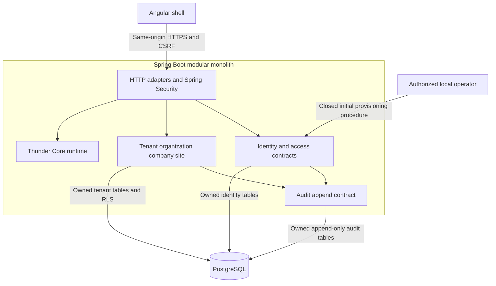

# Target Architecture

**Decision status:** PROPOSED detail; Angular, Spring Boot, modular monolith, DDD, hexagonal architecture and business-neutral Core are owner requirements.
**Implementation status:** Bounded L02 five-module backend structure IMPLEMENTED / TESTED only. L03 JDBC/RLS application integration is IN PROGRESS, not delivered; isolated scratch qualification is not application acceptance. This diagram and the future composition below remain targets, not a running deployment.

## Purpose and scope

Provide the platform foundation only. No ERP, CRM, inventory, payroll or other business module is authorized in the current scope. The archived blueprint remains the long-term catalogue, not a current delivery promise.

## Responsibility boundaries

| Owner | Owns | Does not own |
|---|---|---|
| Identity | Global accounts, credentials and sessions; calls Tenancy for own-membership discovery | Customer business data or platform-wide data access |
| Tenancy | Organization isolation boundary, companies, sites, memberships and scope validation | Accounting rules or licenses |
| Access | Permission decisions from current grants and scope | Session transport or domain repositories |
| Audit | Durable security and administrative records | General debug logs or permission grants |
| Runtime | Compiled module descriptors, declared capability inventory, lifecycle status | Business functions or arbitrary code loading |
| Thunder Control | Administrative API/UI using the above contracts | Direct database access or privileged bypasses |

Utilities and configuration are not automatically separate engines. Add a module only when ownership and dependencies justify it. The future 42-engine catalogue must map onto these owners rather than duplicate them.

## Hexagonal structure

Within each module: domain rules and value objects, application use cases and ports, incoming HTTP adapters, outgoing persistence adapters. Framework entities stay in persistence; public contracts expose immutable DTOs and interfaces. Keep layers proportional to actual behavior; do not manufacture empty wrappers.

Cross-module reads use a published query contract, writes use a command, and durable facts use a versioned event. In-process calls do not require a message broker. Acyclic dependencies and exports must be verified against actual discovered modules, not an empty architecture test.

## Trust and failure boundaries

The shared JVM is not a sandbox. Initially only reviewed first-party compiled code is trusted. Untrusted executable packages require a separately approved out-of-process design. Tenant RLS protects against omitted predicates, not a fully compromised application or database administrator.

A database or migration failure blocks readiness. Sensitive changes require their audit record to commit with the change. Background work receives an explicit validated tenant scope; it cannot inherit thread state implicitly.

## Future semantic application model and clients

**PROPOSED / NOT IMPLEMENTED — documentation consolidation of AP-ARCH-EVOL-001 and AP-MASTER-CONSTITUTION-001 only.** The [documentation authorization](../00-GOVERNANCE/DECISION-MANAGEMENT.md#visual-composition-documentation-authorization--2026-11-20) and decisions O20–O25 do not approve implementation, new permissions or changes to the constitution, blueprint or foundation manifest. See the [coverage refinement](../PACK-INVENTORY.md#visual-composition-coverage-refinement).

A future Universal Application Model (UAM) is a versioned semantic description of an application: owned data-contract references, UI bindings, process definitions and required capabilities. It is distinct from editor layout (positions, zoom and presentation preferences), persisted business data and execution state. Moving a node is not a domain transition; publishing a model is not executing it or migrating a database.

Studios, SDK consumers, API/headless clients and AI assistants use the same versioned contracts, validation, authorization and publication gates. Studios are optional clients, not the exclusive route to platform capabilities. AI may propose drafts, never self-approve publication or acquire broader rights. A visualizer is an authorized projection of declared contracts and actually observed state, not reverse engineering of Java internals, an independent business-state store or a privileged discovery channel.

The five Core owners (`identity`, `tenancy`, `access`, `audit`, `runtime`), approved dependency boundaries and compiled-first-party architecture remain unchanged. Providers retain their data and capability semantics; composition references published contracts rather than reaching into repositories. The UAM does not introduce a sixth Core module, a universal execution engine, runtime code loading or business functionality into the foundation. Future ownership and dependency edges still require explicit review.

Node/composite contracts and coherent immutable publication are refined in [future visual composition](../03-CORE/MODULE-RUNTIME.md#10-future-visual-composition-contracts). UI layout, configuration values, semantic development and database migration remain separate change channels with their own approvals.

## Acceptance

A fresh build must discover the expected internal platform modules, reject prohibited dependencies, serve a minimal shell and prove authenticated tenant isolation with the actual application database role. [L02 evidence](../PACK-INVENTORY.md#l02-execution-evidence--2026-11-18) covers bounded discovery/boundary checks only. [Isolated L03 qualification](../PACK-INVENTORY.md#l03-isolated-qualification-evidence--2026-11-19) is real scratch evidence, not delivered JDBC/RLS integration, shell acceptance or closure of application isolation gates. Future composition requires the separate [visual-composition acceptance](../11-QUALITY-AND-TESTING/TEST-STRATEGY.md#visual-composition-acceptance); no such capability is claimed here.

## Related

- [Backend architecture](BACKEND-ARCHITECTURE.md)
- [Multi-tenancy](MULTI-TENANCY-ARCHITECTURE.md)
- [System context](SYSTEM-CONTEXT.md)
- [Thunder Control](../03-CORE/THUNDER-CONTROL.md)
- [Validation gates](../13-IMPLEMENTATION/VALIDATION-GATES.md)
