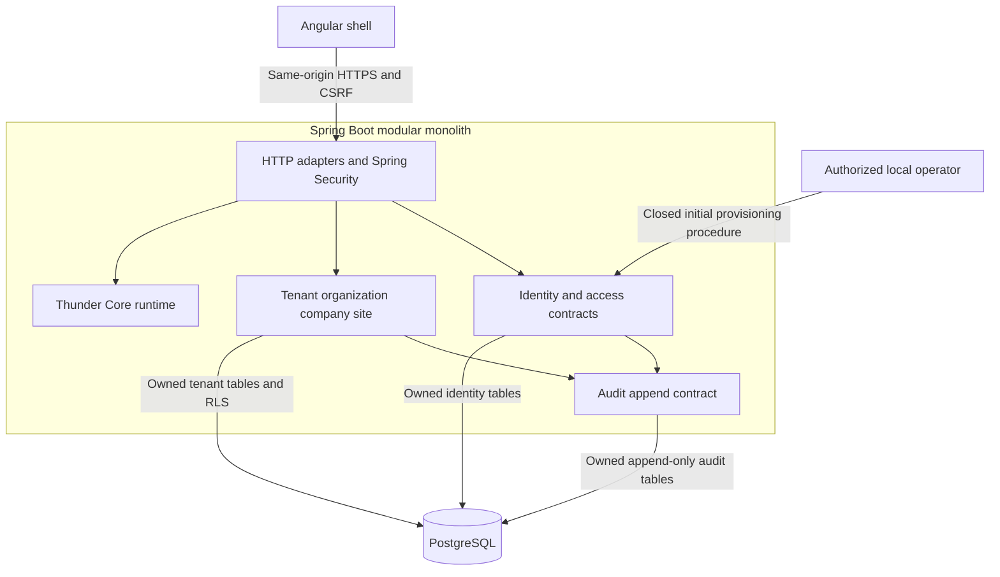

# Target Architecture

**Decision status:** PROPOSED detail; Angular, Spring Boot, modular monolith, DDD, hexagonal architecture and business-neutral Core are owner requirements.
**Implementation status:** Bounded L02 structure and closed L03 JDBC/RLS integration are locally IMPLEMENTED / TESTED; [main recovery evidence](../PACK-INVENTORY.md#l03-main-recovery-evidence--2026-11-20) records V1, four empty technical tables and the closed HTTP surface. Identity, audit, authenticated membership checks, Angular and composition remain NOT IMPLEMENTED. This diagram is a target, not a running full-platform deployment; full G2–G5 remain open.

## Purpose and scope

Provide the platform foundation only. No ERP, CRM, inventory, payroll or other business module is authorized in the current scope. The archived blueprint remains the long-term catalogue, not a current delivery promise.

## Architectural foundations and logical layers

The [2026-11-21 integration instruction](../00-GOVERNANCE/DECISION-MANAGEMENT.md#catalogue-and-layer-integration-authorization--2026-11-21) reaffirms complementary architecture views, not competing architectures. The [required catalogue](../PACK-INVENTORY.md#required-target-catalogue--2026-11-21) traces every supplied capability; the table below groups responsibilities, not executable engines or an approved package graph.

| View | Foundation / meaning | Boundary |
|---|---|---|
| Backend deployment | **Modular Monolith**: one Spring Boot backend deployable, composed of cohesive modules with enforced exports | Angular is a separate client; infrastructure and any future isolated worker are not additional business microservices by default |
| Domain design | **DDD**: bounded contexts own their language, models, invariants, use cases and data | A bounded context need not map one-to-one to a Maven module, package, table or catalogue entry; no shared universal business model |
| Module internals | **Hexagonal Architecture**: domain/application policies depend on owned ports, implemented by external adapters | Domain logic does not depend on Spring, JDBC/PostgreSQL, Angular, Redis, printers or external APIs; the composition root wires adapters |
| Functional packaging | **PBC — Packaged Business Capabilities**: identifiable, versioned, governed capabilities exposed through contracts | Product terminology maps to the historical Plugin-Based Components approach; independent governance does not imply independent deployment, hot loading or a PBC per function |
| Communications | Typed published commands, queries, events and capability contracts | In-process calls for synchronous work; durable messages only under an approved publication/consumer protocol |
| Composition | UAM, typed nodes, reusable components and graphs | Semantic definitions are separate from editor layout, domain data and execution state |
| Execution | Governed runtime invoking current authorized provider contracts | One authority per execution fact; composition does not create a competing workflow scheduler or domain service |

### Twelve logical responsibility layers

Numbers identify the supplied functional map. They are neither a bottom-up dependency permission nor delivery/governance levels: logical Layer 1 is not delivery L1 or governance N1. A responsibility can participate in several modules, while each implementation and fact has one accountable owner. The Angular boundary calls application APIs, never PostgreSQL or private Java classes.

| Logical layer | Retained responsibilities | Ownership and implementation boundary |
|---|---|---|
| 12 — Experience and User Interaction | Angular shell, workspaces, visual explorer, dashboards, forms/tables/pages, navigation, preferences, themes, responsive layout, RTL/i18n, accessibility, contextual actions and notification center | UI projections of authorized contracts and actual state; no frontend-only permissions |
| 11 — Visual Composition and Application Design | Application/Data/Process/Interface/Integration/Intelligence studios, canvas, typed nodes and connectors, nesting, bindings, expressions, libraries, simulation, version diff and impact | Design-time clients edit governed UAM drafts; retain Development and Design/AI/Quality/Environment/Release areas; not a second executor |
| 10 — Developer and AI Platform | Builders, SDK/CLI, code/schema/API tools, debugger, profiler, tests, packaging, model/prompt/provider registries, AI evaluation and governance | Reviewed build/publication pipeline; no runtime source compilation, model self-approval or mandatory AI dependency |
| 9 — Application Model and Metadata | UAM definitions/references, schemas, dependencies, versions, compatibility and authorized views of deployment/runtime state | UAM is authoritative for composition definitions, not for provider-owned domain values, identity, registry facts or execution history |
| 8 — Execution and Orchestration | Planning, workflows/graphs, durable progress, queues, workers, timers, parallelism, retries/timeouts, DLQ, history/traces, cancellation, compensation and recovery | Runtime execution owner selected under O12/O21; reuse durable primitives, never duplicate writable state or promise universal undo |
| 7 — Business Capability Platform | Provider capabilities, commands/queries, domain services/rules, events, validation, transactions, idempotence and intermodule coordination | Standards and technical contracts are platform work; actual business invariants remain inside future separately authorized provider modules |
| 6 — Data Platform | Persistence conventions, owned schema/relationship descriptors, validation, transformation, provenance/lineage, quality, retention/archive, synchronization/conflicts and migrations | Each owner implements its own persistence ports; no central repository with unrestricted access to every table, runtime DDL or universal JSONB model |
| 5 — Integration and Connectivity | API boundaries, REST/SOAP/GraphQL adapters, webhooks, external systems, device/printer/scanner discovery, protocols, hardware abstraction and mapping | Versioned adapters under provider-specific credentials, network/effect limits and current authorization; not approval to contact devices or external databases |
| 4 — Platform Services | Search, notifications, documents/files, templates, cache, localization, currency/units primitives, import/export/reporting, communication and action discovery | Reusable owned contracts; job/scheduler references consume Layer 8 services rather than create another scheduler; currency/units never encode tax or accounting rules |
| 3 — Security and Governance | Identity/sessions, authentication, authorization/RBAC/contextual policy, tenancy/company/site, federation/OAuth/OIDC, secrets, encryption, audit, entitlements and trust/isolation | Current Identity/Tenancy/Access/Audit boundaries retained; entitlement and UI visibility never grant resource permission |
| 2 — Core Platform Runtime | Bootstrap, module lifecycle, registries, discovery, contracts, dependencies, package admission, resources, flags/configuration and compatibility | Compiled first-party baseline remains; signatures, installers and isolated packages need their own qualified contracts; no business internals in Core |
| 1 — Infrastructure and Deployment | Java/Spring bootstrap, PostgreSQL/pools, storage, cache/broker when justified, OS/processes, secret injection, containers/Windows, cloud/private/local/hybrid/distributed profiles, backup/update/recovery | Infrastructure adapters and operator-controlled deployment, not inward domain dependencies or permission to start new services |

Cross-cutting requirements apply to every extensible component: stable identity, bounded metadata, documentation/discovery, versioning/compatibility, explicit dependencies/contracts, authorization, provenance, auditability, observable operation, resource limits, testing and declared recovery/lifecycle semantics. Recoverable does not mean every physical effect is reversible. Observability, security and reliability are requirements throughout the layers, not final-stage add-ons.

### One authority across overlapping responsibilities

- Runtime owns discovery and lifecycle records; providers own capability contracts. UAM references their identifiers and versions instead of maintaining independently editable copies.
- Execution owns jobs, timers, queues and workflow progress; generic services and studios request those operations through contracts. A planner, canvas or AI assistant is not another execution authority.
- Access owns resource authorization; identity establishes the actor, entitlement checks commercial availability, and UI projects permitted actions. No universal resolver bypasses provider-specific checks.
- Each data owner owns persistence and invariants. Data Platform defines shared standards and authorized projections, never cross-module repository access. Audit owns durable security records; activity feeds and search are separate projections.
- Configuration definitions retain their owners; deployment/scoped values, expected rollout revisions and observed effective state remain distinguishable. Layer 1/2/4 labels do not create competing settings stores.

### Dependency direction and communication

Conceptual request flow: Angular or a headless client -> authenticated, authorized and validated incoming adapter -> owner application use case -> domain policy and outbound port -> persistence/integration adapter. Source-code dependencies point inward: adapters implement application/domain-owned ports, not the reverse. Public cross-module consumers depend only on named exports; no private entity/repository imports or shared mutable domain objects. See [module internals](BACKEND-ARCHITECTURE.md#module-internals-and-dependency-direction).

When durable publication is selected, owned state, critical audit and publication intent commit in the same local transaction; dispatch follows commit and consumers handle duplicates under current scoped authority. The source's illustrated PostgreSQL -> Outbox sequence must not become two non-atomic writes. Events do not replace synchronous invariants or disguise circular dependencies; remote effects require explicit pending/unknown outcomes and compensation/reconciliation contracts.

### Conceptual topology versus the current repository

The long-term topology includes Core Platform, Identity/Security, Application Model, Composition, Execution, AI, Marketplace, Data and Integration responsibility areas behind the Angular/API boundary, with PostgreSQL, storage, messaging, external APIs and devices behind adapters. These are not automatically Java modules. Orders, Inventory and Other Business PBCs illustrate future consumers; the Orders-to-Inventory reservation example uses only a published contract and authorizes no current business code or tables.

The supplied `frontend/authority-app`, `backend/authority-server`, `com/authority`, `application-model`, `shared-kernel` and domain folder trees are conceptual source examples, not adopted paths. Preserve the existing monorepo, single Maven backend artifact, root `com.authoritypro.platform` and five closed modules. Hyphenated responsibility labels are not literal Java package names. No empty domain/entities/value-objects/ports directories or universal shared kernel should be created merely to match a diagram; code structure follows real responsibilities.

A later service extraction requires measured independent scaling, availability/fault-isolation or release needs, explicit approval and an ADR. Review data ownership/movement, contract compatibility, authorization, transaction replacement, failure/recovery, observability and operational cost first. Clean boundaries make extraction possible, not automatic or cost-free; microservices are not today's default.

Illustrative infrastructure behind the adapters: PostgreSQL, cache/broker only when a measured need justifies it, file/object storage, external APIs and devices. This list names adapter targets, not services to start.

### Functional element allocation (illustrative target)

The twelve functional layers cross several modules; each module keeps its own DDD boundaries, hexagonal ports/adapters and published contracts. This allocation is a target responsibility map, not today's approved Maven module list:

| Supplied functional element | Target home | Boundary |
|---|---|---|
| Core Runtime | Core Platform module(s) | Bootstrap, lifecycle, registry and admission; no business internals |
| Identity and Security | Transversal platform modules (`identity`, `tenancy`, `access`, `audit`) | Existing closed roots; permissions are evaluated by their owner, never by UI or registry labels |
| UAM | Application Model module | Composition definitions; not domain values, identity, live provider state or execution history |
| Visual Composer | Composition module | Design-time canvas and governed drafts; not a second executor |
| Workflow Runtime | Execution module | One execution authority under O12/O21, reusing durable primitives |
| AI Studio | AI Platform module | Optional installation and use; Core must work without AI; proposals remain drafts |
| Marketplace | Marketplace module | Packaging/distribution governance; no trust, signature or licensing shortcut |
| Orders, Inventory, Other Business PBCs | Future business PBC modules | Illustration only; no current code, tables or module authorization |
| Printer Connector | Integration adapter | Device-side adapter with reconciliation for unknown outcomes, not exactly-once physical effects |

Not every catalogue capability becomes a PBC. Some are transversal services, reviewed shared libraries, adapters or internal components of one module; creating a module, deployable or engine per label is prohibited without a real ownership and dependency need. The current repository therefore remains five technical roots.

## Responsibility boundaries

| Owner | Owns | Does not own |
|---|---|---|
| Identity | Global accounts, credentials and sessions; calls Tenancy for own-membership discovery | Customer business data or platform-wide data access |
| Tenancy | Organization isolation boundary, companies, sites, memberships and scope validation | Accounting rules or licenses |
| Access | Permission decisions from current grants and scope | Session transport or domain repositories |
| Audit | Durable security and administrative records | General debug logs or permission grants |
| Runtime | Compiled module descriptors, declared capability inventory, lifecycle status | Business functions or arbitrary code loading |
| Thunder Control | Administrative API/UI using the above contracts | Direct database access or privileged bypasses |

Utilities and configuration are not automatically separate engines. Add a module only when ownership and dependencies justify it. The future 42-engine catalogue must map onto these owners rather than duplicate them.

## Hexagonal structure

Within each module: domain rules and value objects, application use cases and ports, incoming HTTP adapters, outgoing persistence adapters. Framework entities stay in persistence; public contracts expose immutable DTOs and interfaces. Keep layers proportional to actual behavior; do not manufacture empty wrappers.

Cross-module reads use a published query contract, writes use a command, and durable facts use a versioned event. In-process calls do not require a message broker. Acyclic dependencies and exports must be verified against actual discovered modules, not an empty architecture test.

## Trust and failure boundaries

The shared JVM is not a sandbox. Initially only reviewed first-party compiled code is trusted. Untrusted executable packages require a separately approved out-of-process design. Tenant RLS protects against omitted predicates, not a fully compromised application or database administrator.

A database or migration failure blocks readiness. Sensitive changes require their audit record to commit with the change. Background work receives an explicit validated tenant scope; it cannot inherit thread state implicitly.

## Future semantic application model and clients

**PROPOSED / NOT IMPLEMENTED — documentation consolidation of AP-ARCH-EVOL-001 and AP-MASTER-CONSTITUTION-001 only.** The [documentation authorization](../00-GOVERNANCE/DECISION-MANAGEMENT.md#visual-composition-documentation-authorization--2026-11-20) and decisions O20–O25 do not approve implementation, new permissions or changes to the constitution, blueprint or foundation manifest. See the [coverage refinement](../PACK-INVENTORY.md#visual-composition-coverage-refinement).

A future Universal Application Model (UAM) is a versioned semantic description of an application: owned data-contract references, UI bindings, process definitions and required capabilities. It is distinct from editor layout (positions, zoom and presentation preferences), persisted business data and execution state. Moving a node is not a domain transition; publishing a model is not executing it or migrating a database.

Studios, SDK consumers, API/headless clients and AI assistants use the same versioned contracts, validation, authorization and publication gates. Studios are optional clients, not the exclusive route to platform capabilities. AI may propose drafts, never self-approve publication or acquire broader rights. A visualizer is an authorized projection of declared contracts and actually observed state, not reverse engineering of Java internals, an independent business-state store or a privileged discovery channel.

The five Core owners (`identity`, `tenancy`, `access`, `audit`, `runtime`), approved dependency boundaries and compiled-first-party architecture remain unchanged. Providers retain their data and capability semantics; composition references published contracts rather than reaching into repositories. The UAM does not introduce a sixth Core module, a universal execution engine, runtime code loading or business functionality into the foundation. Future ownership and dependency edges still require explicit review.

Node/composite contracts and coherent immutable publication are refined in [future visual composition](../03-CORE/MODULE-RUNTIME.md#10-future-visual-composition-contracts). UI layout, configuration values, semantic development and database migration remain separate change channels with their own approvals.

## Acceptance

A fresh build must discover the expected internal platform modules, reject prohibited dependencies, serve a minimal shell and prove authenticated tenant isolation with the actual application database role. [L02 evidence](../PACK-INVENTORY.md#l02-execution-evidence--2026-11-18) covers bounded discovery/boundary checks only; the later [closed L03 main recovery](../PACK-INVENTORY.md#l03-main-recovery-evidence--2026-11-20) proves the selected local JDBC/RLS and closed HTTP subset, not shell, authenticated isolation or clean-machine acceptance. Future composition requires the separate [visual-composition acceptance](../11-QUALITY-AND-TESTING/TEST-STRATEGY.md#visual-composition-acceptance) and [catalogue/layer checks](../11-QUALITY-AND-TESTING/TEST-STRATEGY.md#catalogue-and-layer-acceptance); this documentation update runs no such application tests.

## Related

- [Backend architecture](BACKEND-ARCHITECTURE.md)
- [Multi-tenancy](MULTI-TENANCY-ARCHITECTURE.md)
- [System context](SYSTEM-CONTEXT.md)
- [Thunder Control](../03-CORE/THUNDER-CONTROL.md)
- [Validation gates](../13-IMPLEMENTATION/VALIDATION-GATES.md)
