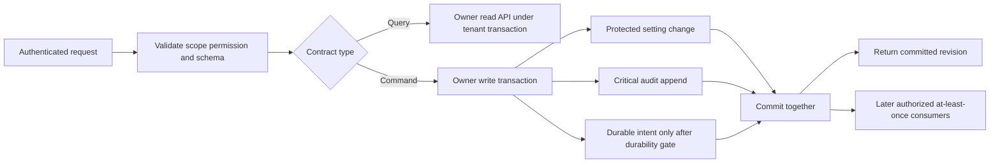

# Command, Query and Event Engine

**Document status: PROPOSED**  
**Capability status: NOT IMPLEMENTED — no dispatcher, handlers or event registry exists yet.**  
**Governance: N0 for contracts and transaction boundaries. Proposed owner: platform contract maintainer; approval authority: project owner.**

## 1. Purpose, source, scope and non-scope

Define the three communication semantics used by Authority Pro modules without introducing a universal service bus or business behavior. Locked principles derive from [MASTER-BLUEPRINT](../MASTER-BLUEPRINT.md), sections 2, 5, 6.1, 10, 24–26 and 29–30. Proposed mechanisms require owner approval under the [Core status convention](THUNDER-CORE.md).

Scope: in-process named application APIs, typed command/query contracts, versioned event facts and explicit transaction/error semantics. The first runnable socle may use direct typed application interfaces. A generic command bus or durable event engine is not a prerequisite merely because this document defines their contracts.

Non-scope: business commands, event sourcing, a broker deployment, remote RPC, distributed transactions, automatic dependency discovery by class name, reflective generic dispatch, or exposing module repositories through a query bus. Durable dispatch is gated by [Outbox, Inbox and Idempotency](OUTBOX-INBOX-IDEMPOTENCY.md).

## 2. Ownership and interaction model

| Message | Meaning | Owner / effect |
|---|---|---|
| Command | Request to perform an authorized change | Exactly one declared handler; may reject; commits owned state and critical audit atomically |
| Query | Request for an authorized view | Exactly one declared provider; no domain/configuration mutation or hidden event publication |
| Event | Versioned fact about a committed change | Publishing module owns schema; declared consumers may eventually react |

The provider owns semantics, DTOs and version compatibility. The runtime owns only the catalogue/dispatch metadata. Access evaluation belongs to the guarded application boundary. The audit module owns recording, not command execution. Each consumer owns its inbox/effect transaction.

Cross-module interaction uses explicitly named API exports from [Module Runtime](MODULE-RUNTIME.md). Contracts MUST NOT expose JPA entities, repositories, mutable internal objects or framework authentication/session classes. A registry declaration is not proof that a handler exists and does not grant authorization. Build-time validation must connect every provided command/query to one typed implementation and every required capability to a declared dependency.

Prefer direct typed calls for simple synchronous collaboration in the modular monolith. Do not add an extra dispatcher layer unless it provides approved validation, version routing or observability. Do not use events to enforce invariants that require a synchronous decision before commit. Critical audit is an in-transaction append, not a best-effort event listener.

## 3. Contract envelope and trust

The proposed logical envelope is a specification, not an implemented serializer:

| Element | Rule |
|---|---|
| Contract ID and version | Stable provider-owned name and explicit major-compatible schema; dispatch only known versions |
| Request/event ID | Server-controlled opaque identity, stable across retry where required |
| Correlation and causation IDs | Trace relationships; not permission or deduplication proof |
| Scope | Explicit control-plane or tenant; tenant context is verified by the server |
| Actor metadata | Derived from authenticated identity or approved service authority, never trusted from a body |
| Payload | Bounded allowlisted immutable schema; no credentials or arbitrary object/class serialization |
| Deadline / expected revision | Command/query admission and concurrency constraints where declared |
| Event aggregate identity / sequence | Required for streams that promise per-aggregate order |

HTTP clients may submit a scope selector, expected revision and, for supported commands, an idempotency key. They MUST NOT supply authoritative actor IDs, granted permissions or trusted execution scope. Adapters authenticate, validate CSRF for unsafe browser requests, resolve membership, authorize the resource and construct internal context before calling a handler.

An event's actor is historical attribution, not authority to impersonate that user later. A consumer must obtain its own current approved tenant-scoped execution authorization; a deserialized event cannot establish database privileges.

## 4. Concrete technical example: tenant settings

These are proposed contracts, not routes, business features or executable code:

| Contract | Input | Result / invariant |
|---|---|---|
| `platform.tenancy.settings.update`, command v1 | Authorized tenant, allowed typed setting changes, expected revision; optional idempotency key only once supported | New revision; applies only tenancy-owned permitted keys; critical audit joins the write transaction |
| `platform.tenancy.settings.get`, query v1 | Authorized tenant/company selector, allowed key set | Effective non-secret values, source scope and revision; no mutation |
| `platform.tenancy.settings.changed`, event v1 | Server-produced tenant/settings aggregate ID, committed revision, changed key names, event ID and sequence | Announces a fact; contains no settings values or session/PII copies |

The event is emitted only when durability is implemented and approved. Until then, the initial synchronous settings path MUST NOT claim durable publication or run a lossy event publisher as a substitute. Consumers read current authorized state through the owner API if needed, rather than importing the settings repository. An HTTP response from a successful command describes committed source state, not completion by asynchronous consumers.

The durable-intent branch is a future dependency, not a requirement to implement two durability systems or to defer critical audit outside the transaction.

## 5. Dispatch, transactions and compatibility

Commands validate shape and authorization before mutation, then recheck revision/critical authorization as required inside the transaction. A transaction must carry verified tenant/user context on its actual database connection. Absent scope fails closed. Nested owner APIs must not silently switch tenant or open unguarded autonomous transactions.

Queries use read-only application semantics, bounded pagination and allowlisted filters/sorts. They must not perform hidden writes such as changing user preferences or publishing domain events. Security-attempt telemetry is a separate controlled path, not query semantics. Views assembled from several modules use their published read APIs and document snapshot/consistency limitations; no cross-module repository joins.

Each public contract has a documented compatibility policy. Additive fields are allowed only when consumers demonstrably tolerate them; tightening required fields, changing meaning or exposing new data is not automatically backward-compatible. Unknown commands/versions are rejected; unknown durable event versions are parked for review rather than deserialized into arbitrary classes. Provider removal/deprecation needs dependent impact analysis and an approved migration window, not a promised universal current-and-previous-version guarantee.

## 6. Failure and security behavior

| Condition | Required behavior |
|---|---|
| Invalid payload or unsupported version | Reject with safe stable code and correlation ID |
| Unauthenticated, missing tenant or insufficient permission | Deny; do not probe alternate tenants or fall back to platform scope |
| Expected revision stale | Conflict; no partial write or success audit |
| Same idempotency key with different request | Conflict once idempotency is supported; never treat as successful replay |
| Handler/dependency/audit failure | Roll back protected transaction; no partial success response |
| Request timeout | Outcome may be unknown; resolve using operation identity, not blind retry of unsafe commands |
| Consumer failure after producer commit | Keep producer success; retry/park durable delivery according to its own contract |

Proposed HTTP mapping is 400 for invalid input, 401 for missing/expired authentication, a consistent non-enumerating 403/404 policy for denied resources, 409 for revision/key conflicts, 429 for admission limits and 503 for unavailable dependencies. Exact mapping belongs in approved OpenAPI schemas. Stack traces, SQL messages, internal class names and secrets are never response payloads.

Retry only operations whose contract supports it. Do not retry an entire non-idempotent command merely because a socket closed. Bound payload sizes, execution deadlines and query limits; enforce backend permissions even for internal trusted callers. RLS is mandatory defense in depth, not permission evaluation.

## 7. Observability, tests and acceptance

Metrics: per-contract/version latency, success/rejection/failure counts, revision conflicts and bounded timeout rates. Events additionally expose publish lag, consumer lag and retries as defined by the durability contract. Use bounded contract names as labels; no actor/tenant IDs or payloads in metrics. Restricted traces carry opaque operation/correlation identifiers and safe scope references.

Required future tests:

- Contract-schema and named-export tests reject unsupported versions, undeclared providers and entity/repository leakage.
- A tenant settings command commits state and audit together; stale revisions and audit faults leave no changes.
- Two-tenant and same-tenant company tests reject forged scope/actor metadata and absent membership.
- Queries cannot invoke write repositories or create events; pagination/filter limits are enforced.
- Timeout/retry tests prove declared idempotency semantics, not accidental duplicate mutation.
- Event commit/rollback, duplicate delivery and unknown-version behavior pass only after the durability engine is implemented.

Acceptance requires owner-approved command/query schemas, permission bindings, transaction boundaries, error mapping and version policy. The minimal runnable socle may accept direct typed APIs without a generic dispatcher; durable events must remain explicitly NOT IMPLEMENTED until their gate passes.

## Related contracts and gates

- [Thunder Core](THUNDER-CORE.md)
- [Module Runtime](MODULE-RUNTIME.md)
- [Outbox, Inbox and Idempotency](OUTBOX-INBOX-IDEMPOTENCY.md)
- [Configuration Engine](CONFIGURATION-ENGINE.md)
- [Identity and Access](../04-PLATFORM-ENGINES/IDENTITY-AND-ACCESS.md)
- [Audit Engine](../04-PLATFORM-ENGINES/AUDIT-ENGINE.md)

Outstanding approvals include contract naming/versioning, the direct-API versus dispatcher need, maximum payload/deadline limits, command idempotency rollout and any asynchronous consumer authority. This document selects no durable publication implementation.
