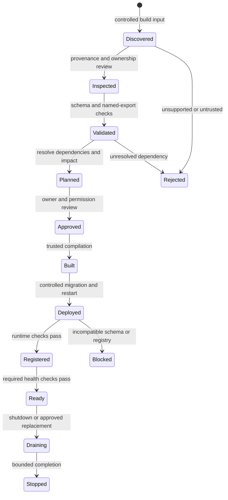

# Module Runtime

**Document status: Bounded L02 discovery/boundary design APPROVED; other contracts PROPOSED.**\
**Capability status: L02 five-root/zero-edge structure IMPLEMENTED / TESTED only; functional inventory and lifecycle remain NOT IMPLEMENTED.** See [execution evidence](../PACK-INVENTORY.md#l02-execution-evidence--2026-11-18).\
**Governance: N0. Proposed owner: runtime maintainer; approval authority: project owner.**

## 1. Purpose, source and scope

Define enforceable PBC boundaries and a deliberately small manifest for the Authority Pro foundation. Locked principles come from [MASTER-BLUEPRINT](../MASTER-BLUEPRINT.md), sections 2, 5, 6.1, 10, 24–27 and 29–30. The bounded L02 root/discovery and boundary-tool design is approved under [ADR-0002](../adr/ADR-0002-modular-monolith.md#l02-boundary-approval--2026-11-18) and has passed skeleton verification only. Manifest schema, lifecycle and functional inventory choices remain pending owner approval under the [Core status convention](THUNDER-CORE.md).

Scope: trusted first-party platform modules compiled into a single Spring Boot application; static contract discovery, dependency verification, immutable inventory, and a foundation JSON manifest contract.

Non-scope: business modules, runtime JAR loading, remote packages, scripts, marketplace, a universal future manifest, dynamic Angular components, a classloader sandbox, automatic migrations from manifests, or live install/uninstall. The schema version identifies a **Phase-0 documentation subset**, not a claim that a Phase-0 runtime exists. A later runnable socle must select which of these contracts it actually implements.

## 2. Module ownership and discovery

The [approved L02 application package](../adr/ADR-0002-modular-monolith.md#l02-boundary-approval--2026-11-18) is **`com.authoritypro.platform`**. Its five immediate module roots reserve the following ownership; the corresponding functional services are not implemented by declaring those roots:

| ID | Immediate root | Owns |
|---|---|---|
| `identity` | `com.authoritypro.platform.identity` | Global user and session lifecycle |
| `tenancy` | `com.authoritypro.platform.tenancy` | Tenant/company/site hierarchy, membership, scoped settings |
| `access` | `com.authoritypro.platform.access` | Permission definitions, grants, evaluation |
| `audit` | `com.authoritypro.platform.audit` | Audit append/read contracts and record persistence |
| `runtime` | `com.authoritypro.platform.runtime` | Catalogue, descriptor validation, readiness and lifecycle coordination |

Modulith 2.1.2 and ArchUnit 1.4.2 are approved and tested for L02 structural verification: discovery identifies exactly the five compiled `package-info` closed roots, the dependency graph has zero edges, and positive/negative boundary fixtures are exercised. No functional API exports are implemented; later consumed contracts need explicit approval. With default direct-subpackage discovery, placing the application at `com.authoritypro` would discover `platform` rather than automatically discover the five nested roots. That layout MUST NOT be assumed to work. Any deviation requires explicit discovery configuration and a test proving exactly the expected modules.

Inside each root, `domain`, `application`, `api` and `infrastructure` are layers of that module, not automatically independent modules. The domain MUST NOT depend on Spring MVC, JPA or infrastructure. An API contains named, deliberately exported interfaces, immutable DTOs and contract schemas; it does not expose JPA entities, repositories, `ApplicationContext`, security sessions, or arbitrary implementation classes.

Consumers MUST declare dependencies on **specific named API exports**, not wildcard access to an entire root or `api` package. The build must verify both Modulith dependencies and additional package/layer rules needed to enforce this. A capability declaration is metadata, not an instruction to resolve arbitrary bean names or reflectively invoke class names.

Pure tiny helpers do not automatically require their own module ID, manifest or governance board. They may be kept internal or in a narrowly tested utility library. A shared library MUST NOT own data, tenant context, authorization state, domain services or catch-all configuration. A new independently governed module requires an explicit owner and approved dependency edge.

## 3. Inputs, outputs and contract ownership

Inputs are compiled build descriptors, schema-valid manifests, explicit named-export mappings, and a release compatibility record. Outputs are a validated immutable catalogue and readiness decisions, never dynamically fetched executable code.

The runtime owns module IDs, catalogue assembly and duplicate detection. A provider owns each exported capability's request/result or event schema, version and semantics. Each data owner controls its own migrations and queries. The access module owns authorization evaluation; declaring a permission in a manifest does not grant it to anyone.

Module version, manifest schema version and capability contract version are distinct. This foundation subset accepts exact three-part release versions only. It does not implement version ranges, optional dependencies, prerelease identifiers, SDK negotiation or an automatic compatibility solver. A reviewed release record supplies the tested platform/framework combination; absence of compatibility fields in this subset MUST NOT be treated as universal compatibility.

## 4. Foundation manifest contract

[MODULE-MANIFEST.schema.json](../14-TEMPLATES/MODULE-MANIFEST.schema.json) uses JSON Schema draft 2020-12. Unknown fields are forbidden at every instance-object level. All eleven top-level fields are required:

| Field | Supported meaning |
|---|---|
| `schemaVersion` | Exact `0.1.0`, the proposed foundation dialect |
| `id` | Stable lowercase, hyphen-separated module ID |
| `version` | Exact `major.minor.patch`, without prerelease/build syntax |
| `kind` | Only `platform-module` |
| `trust` | Only `first-party`; a declaration, not a trust proof |
| `execution` | Only `compiled-first-party`; build and restart required |
| `dependencies` | Required module IDs and exact versions; empty permitted |
| `capabilities` | Explicit `provides` and `requires` lists of IDs, versions and command/query/event contract types |
| `permissions` | Permission IDs with `control-plane`, `tenant` or `company` scope; no implied grant |
| `dataOwnership` | Logical owned resources, each explicitly classified `tenant` or `control-plane`; empty means no persistence; no SQL or migration execution |
| `ui` | Static compiled navigation declarations only; empty permitted |

A provided command/query means an owned handling contract; a provided event means a published fact. A required command/query means a consumed provider API; a required event means subscription to a published fact. The runtime must link required capabilities to exactly one compatible provider in a declared dependency. Self-provided requirements and ambiguous providers are rejected in this subset. UI `routeKey` is a build-registered Angular route identifier, **not a URL, file path, HTML fragment or executable expression**. Each navigation entry names a declared permission; server-side authorization remains mandatory.

`dataOwnership.resources` is empty for a module with no persistence. Otherwise each entry declares a logical resource `name` and its `scope` (`tenant` or `control-plane`). This permits tenancy and audit to own separately classified resources without making tenant records globally readable. Duplicate resource names and ownership claims require semantic rejection even when their scopes differ. Resource-level policies and migrations still need separate complete contracts; data ownership is not a database privilege grant.

Publisher, integrity/signature metadata, resource budgets, migrations, configuration schemas, integrations, licensing, package URLs and future extension categories from source section 10 are deliberately **not supported here**. They need separately designed contracts and a versioned schema evolution. Reject them as unknown fields rather than pretending to support the full source catalogue. This narrowing requires owner approval before implementation.

### Two-stage validation

1. **Structural:** reject malformed JSON, duplicate JSON object keys, oversized manifests, unsupported dialects, extra properties, missing fields, invalid constants/types and malformed versions. The schema checks instance structure; duplicate-key rejection occurs in the parser before schema validation. Proposed parsing limits are 64 KiB per manifest and the schema's bounded arrays/strings.
2. **Semantic/build:** reject duplicate module/capability/permission IDs, self or circular dependencies, missing/exact-version-mismatched providers, undeclared API imports, duplicate resource ownership, invalid permission references, unresolved route keys, or descriptors without approved provenance. JSON Schema `uniqueItems` only catches identical array values; ID uniqueness across different values still needs semantic checks.

First-party trust MUST be established from the controlled source/build/release chain, not from the `trust` field. Schema validity does not authorize execution or imply that a module is approved.

### Fixtures

- [MODULE-MANIFEST-TEMPLATE.json](../14-TEMPLATES/MODULE-MANIFEST-TEMPLATE.json) is a **PROPOSED / NOT IMPLEMENTED** fictional `diagnostics-example` platform module. It describes a read-only `platform.diagnostics.snapshot` query at `0.1.0`, declares `platform.diagnostics.read`, owns no persistence and contributes no UI. It is a valid structural fixture, **not one of the five socle modules and not a deployable component**. A real implementation would still need a query schema, named export, authorization binding and release provenance.
- [MODULE-MANIFEST-INVALID.json](../14-TEMPLATES/MODULE-MANIFEST-INVALID.json) is also **PROPOSED / NOT IMPLEMENTED**, and intentionally fails validation for two independent reasons: missing required `id`, and `version` set to `preview` instead of a three-part release version. All other fields match the structural shape. A validator should report both where it supports collecting errors; fail-fast rejection is also valid. It must never enter the runtime catalogue.

The schema and fixtures are normative documentation artifacts owned by the runtime maintainer. They MUST NOT contain credentials, executable payloads, real customer data or permission grants. Their security/failure/observability/test/acceptance requirements are those of sections 4–8 of this document.

## 5. Lifecycle and enablement

Discovery/inspection/validation/planning are initially build/release activities. Dry-run means producing an impact plan: version and API changes, permission additions, affected dependents, owned data/migration impact, backup requirement, rollback feasibility, and company policies affected. It MUST have no state-changing side effects. Approval must precede deployment.

A compiled module is globally present in a deployment. **Company enablement is separate from module installation**: a company policy can make an already present optional capability unavailable, after tenant and company authorization, but cannot add code, remove tables, grant permissions, or disable mandatory identity/isolation/audit controls. Company enablement persistence and administration are deferred until approved; no fake enabled flags should stand in for them in the initial socle.

Update requires a new reviewed build and restart. Disablement must identify dependents and stop new work without discarding pending durable records. Rollback is allowed only if the previous binary remains schema/contract compatible; otherwise use the approved restore or roll-forward plan. Repair is reviewed replacement/recovery, not arbitrary runtime scripting. Uninstall is not a supported live operation. Future removal must preserve data and recovery evidence unless a separately authorized retention/deletion procedure applies.

Untrusted executable plugins, if later approved, run in a separately isolated process with narrow authenticated contracts and resource controls. A classloader is **not** a security sandbox. Declarative remote packages also need a future trust and validation model; this subset accepts neither form.

## 6. Security and failure behavior

| Failure | Required response |
|---|---|
| Required module or export missing | Fail build or startup readiness; no partial-success catalogue |
| Manifest malformed, invalid or untrusted | Reject before registration; record bounded reason and artifact digest |
| Unsupported future category/field | Reject rather than silently ignoring it |
| Dependency or contract version mismatch | Block the release; do not fetch dependencies at runtime |
| Tenant/company policy unavailable | Deny scoped capability, not enable by default |
| Migration incompatible with compiled module | Block serving; never run migrations under runtime credentials |
| Optional module unhealthy | Reject its operations, report explicit degraded availability, preserve isolation |

Named APIs must perform or require verified application authorization at every reachable entry point. The registry MUST NOT offer bypass invocation. Module isolation is an engineering boundary between trusted code, not a sandbox against a malicious first-party binary. RLS and the controls in [Identity and Access](../04-PLATFORM-ENGINES/IDENTITY-AND-ACCESS.md) still apply to all tenant work.

## 7. Observability and tests

Publish protected inventory views containing module ID/version, descriptor digest, supported capability versions, dependency edges, lifecycle/availability reason and build revision. Do not expose filesystem paths, secrets, tenant data or stack traces to catalogue viewers. Record validation counts, startup duration and required-module failures with bounded labels; administrative transitions require [Audit](../04-PLATFORM-ENGINES/AUDIT-ENGINE.md).

Required tests include valid/invalid fixtures, unknown top-level and nested fields, unsupported `kind`/`execution`, duplicate IDs, cyclic and absent dependencies, wrong versions, permission/route linkage, duplicate ownership, oversized input, and duplicate JSON keys. Architecture tests must prove discovery of exactly the five roots and reject an import of another module's repository, JPA entity, private application service or unnamed API. Restart/update tests must distinguish compiled presence from company enablement and prove no data loss on rejection.

## 8. Acceptance and approval gates

L02 has bounded compiled-root discovery and boundary-test evidence, not a functional registry. Later runtime acceptance requires an approved supported-subset decision, a named-export map, structural and semantic validators, and tests of the actual functional contracts. Fixture parsing or schema validation alone does not satisfy semantic validation. L02 evidence does not establish inventory, manifest processing or lifecycle capabilities.

Owner gates: root/package layout, precise dependency DAG, ownership/resources, permission catalogue, schema versioning policy and release compatibility record. Future package categories and untrusted execution require separate ADRs, not enum additions without a threat model.

## 9. Deferred workflow and automation contracts

**PROPOSED / NOT IMPLEMENTED — C17/C18, L3 only.** These constraints refine future generic execution, not the L1 manifest, five module roots or current implementation authorization. Runtime execution is a proposed responsibility; its eventual component boundaries require a separate approved dependency graph. No business process, table or demonstration module is introduced.

### Definition, instance and ownership

| Concept | Proposed contract |
|---|---|
| Definition | Stable owner/key, tenant scope, immutable published version and digest, definition dialect, allowed node types, typed input/output, required capability versions and permissions |
| Draft | Editable under an expected revision; validation and a side-effect-free preview precede an authorized publication decision tied to that exact revision/digest |
| Instance | Unique tenant-scoped identity, pinned definition version/digest, current execution revision, bounded typed variables, initiating attribution and a non-secret correlation reference |
| Human task | Instance/node identity, candidate assignment policy, current assignee, state/revision, pinned form schema and deadline policy; assignment is not an authorization grant |
| Timer or subscription | Instance/node reference, durable due time or correlation identity, delivery identity, current state and recovery policy; neither callbacks nor payloads establish tenant authority |
| Incident | Bounded failure category, affected revision, retry/reconciliation state and authorized recovery history; no raw variables or secret request bodies |

Published definitions are never edited in place. Activating a new version selects it for new starts only; suspension or retirement must explicitly distinguish admission of new instances from treatment of existing ones. Existing instances remain pinned. Migration of a running instance is a separately approved operation with a state/variable mapping, compatibility checks, reviewed impact and recovery evidence; changing its definition pointer is not a migration.

The execution component owns only its definitions and execution records. Referenced domain resources remain owned by their providing modules and are accessed only through declared commands/queries; this does not create business objects in the Core. Control-plane visibility grants no tenant access. Shared first-party definition templates, if selected later, need an explicit immutable publication/tenant-instantiation contract, not a nullable tenant exemption.

Every tenant-owned instance, task, variable, timer, subscription and incident must be protected under the restricted runtime role. Child records require tenant-safe parent references, RLS and tenant-qualified uniqueness; an instance ID alone is not permission to access its children. Correlation keys and deduplication identities include their approved tenant and contract scope. Variables have declared types, size limits, sensitivity and retention; history is not an unrestricted copy of all inputs/outputs.

### Bounded execution vocabulary

A candidate first workflow slice may evaluate start/end, a human task, a registered service command, an exclusive choice and a bounded wait/timer. This is a proposal for evaluation, not a selected DSL, full BPMN support or permission to implement it. Unsupported nodes must be rejected. Parallel/inclusive joins, subprocesses, multi-instance execution and arbitrary loops require separate semantics and tests rather than an assumption that one `current_state` field models concurrent tokens.

Conditions use an approved bounded declarative grammar over typed values; no class names, SQL, JavaScript or unrestricted Script Tasks. Automation references allowlisted capabilities and authenticated triggers. Validate missing targets, reachability, illegal transitions, cycles, fan-out and execution budgets before publication. A declared iteration limit is required wherever repetition is later supported; wall-clock, step and concurrency limits remain server-enforced.

Definition publication, start, task claim/completion, suspension, cancellation and incident recovery are distinct guarded contracts, not existing endpoints. Every request checks current tenant/company/site authority, expected resource revision and the applicable definition invariant. A UI or agent cannot force an arbitrary transition by naming a status. Any later exceptional override needs its own approved policy, reason, authorization and audit; it cannot bypass data ownership or RLS.

### Human tasks and deadlines

The proposed basic task lifecycle is `offered -> claimed -> completed`, with explicitly defined release, reassignment, cancellation and expiration paths. Candidate visibility, permission to claim and permission to complete are separate checks. Group membership and delegations are revalidated when acting, not copied into permanent authority at task creation. Reassignment requires a guarded revision change and preserves attribution.

Concurrent claim or completion attempts compare the current task/instance revision atomically; at most one conflicting transition may commit. A claimant whose membership or permission is revoked cannot complete using a stale form or cached grant. Release/reassignment and any claim expiry are explicit policies, not silent ownership theft. Task completion validates the pinned form and output contract server-side before changing state.

Deadlines distinguish a notification/escalation threshold from actual task expiration. Store an unambiguous due instant and the approved timezone/calendar policy used to derive it; define missed-timer behavior after downtime. Timer callbacks carry a retained delivery identity and expected execution state/revision. Completion-versus-expiration races have one committed outcome under the approved policy; late or repeated callbacks cannot reopen a terminal task.

Protected local transitions, task state, required critical audit and durable publication intent must commit together when that transition emits work. Human command idempotency and timer/event deduplication remain distinct contracts. Retries retain the logical operation identity, recheck current permissions and follow the retention rules in [Outbox, Inbox and Idempotency](OUTBOX-INBOX-IDEMPOTENCY.md). A timeout is an unknown outcome until resolved, not permission to execute a second transition.

### Recovery, compensation and engine authority

Persist execution progress and required timers/subscriptions before reporting durable acceptance. Recovery tests must cover restart, duplicate/out-of-order delivery, stale workers, unavailable providers, bounded retries and retained incidents. Jobs execute under explicitly approved current service authority; historical initiating-user metadata is attribution, not a permanent delegated credential. Neither an inbox nor a scheduler alone implements workflow state, human approval or compensation.

Cancellation stops new work according to the definition; it cannot promise to undo an already committed external effect. Compensation is a separately authorized, idempotent provider action with its own completion/failure record and reconciliation path, not a database rollback or generic inverse command. Interrupted or non-compensable effects remain visible for authorized resolution. Suspension/kill controls also distinguish work prevented from effects already in flight.

Before selecting an external orchestrator, document one authority for each fact: provider-owned resource state, orchestrator execution/history, and any local task index or read projection. Do not make both local instance tables and the engine independently writable authorities for the same execution state. Cross-boundary commands need durable intent, stable tenant-scoped IDs, authenticated callbacks, deduplication, versioned reconciliation and explicit unknown/pending outcomes; local SQL and a remote engine cannot be claimed to commit atomically. Read projections must expose staleness and cannot authorize transitions on their own.

Temporal, Camunda or an internal bounded executor are comparison candidates only. Evaluate Java/Spring integration, required process semantics, running-version compatibility, human tasks, isolation, data exposure, recovery, operating cost, licensing and engine exit/migration costs. An adapter does not make persisted histories, timers or definitions freely portable. No additional broker, cache, server or database is selected, and no existing PostgreSQL application may be altered for this evaluation.

Module updates must account for active instances pinned to capability/form versions. Stop new admission when required, preserve compatible providers until approved drain or migration, and expose blocked work rather than dropping it. Module removal never implicitly deletes definitions, execution history or retained data. A new definition version does not authorize new executable code or live module installation.

### Deferred acceptance

Before any workflow slice, approve the definition grammar, ownership/tenant model, assignment/deadline rules, version/migration policy, engine authority and external-effect protocol. Before automation, additionally approve trigger admission, budgets, cancellation and permitted capabilities. Agent-assisted drafts follow [agent authority contracts](../00-GOVERNANCE/SECURITY-GOVERNANCE.md#10-deferred-agent-authority-contracts); forms follow [schema-driven interfaces](../02-ARCHITECTURE/FRONTEND-ARCHITECTURE.md#deferred-schema-driven-interfaces).

The [deferred capability test matrix](../11-QUALITY-AND-TESTING/TEST-STRATEGY.md#deferred-capability-acceptance) is required evidence if these slices are selected. It uses inert technical fixtures only. None of these requirements closes L1 acceptance, selects an engine or authorizes adding fields to the current foundation manifest.

## 10. Future visual composition contracts

**PROPOSED / NOT IMPLEMENTED.** This refinement consolidates AP-ARCH-EVOL-001 and AP-MASTER-CONSTITUTION-001 under the [documentation-only authorization](../00-GOVERNANCE/DECISION-MANAGEMENT.md#visual-composition-documentation-authorization--2026-11-20), decisions O20–O25 and [coverage refinement](../PACK-INVENTORY.md#visual-composition-coverage-refinement). It does not expand current implementation scope. Section 9's workflow contracts, single-authority execution rule and provider ownership remain applicable; composition is not a second universal engine.

### Catalogue and node contracts

A future node is a typed, versioned reference to a provider-owned contract, not a Java class, arbitrary executable payload or new database table. A catalogue entry must describe:

| Contract part | Required meaning |
|---|---|
| Identity and provider | Stable node ID, owning provider/module, exact node and capability contract versions, compatible model dialect |
| Inputs and outputs | Typed schemas, named ports, direction, required/optional status and connection cardinality; no implicit coercion |
| Configuration | Bounded typed parameters, defaults, validation, sensitivity and allowed resource bindings; no secret values in definitions |
| Errors | Declared failure outcomes, retry/reconciliation semantics and unsupported-operation behavior |
| Authority | Required permissions and tenant/company/site scope; declarations never grant rights |
| Budgets | Size, time, steps, fan-out, concurrency and nesting limits enforced server-side |
| Provenance and documentation | Controlled source/build identity and integrity references, contract documentation, examples and deprecation information |
| Capabilities | Explicit provided/consumed capability identities and versions, mapped to reviewed named exports and declared dependencies |

The proposed catalogue has ten families: **Data, Trigger, Logic, Business, UI, Device, Integration, Output, AI and Governance**. These are classification labels, not ten engines, installed capabilities or new module roots. The Business family is for future separately authorized provider modules and is excluded from Core. No family authorizes arbitrary scripts, connectors, device access or AI effects.

### Parameterized composites and validation

A composite may encapsulate a versioned subgraph behind explicit typed inputs, outputs and parameters, exposing no private internals as public contracts. Nested composites pin exact child versions and preserve provider ownership, permissions and attribution. Reuse does not clone domain state or elevate authority. Encapsulation must not conceal required capabilities or resource costs from validation.

Before preview or publication, validate schemas, provider/version resolution, references, port types and cardinalities, reachability, cycles and recursive composite references. Reject unsupported cycles/recursion; any later permitted bounded repetition remains subject to section 9's separate execution semantics. Enforce nesting, expanded graph size, fan-out, time, step and concurrency budgets across the whole composition, not merely per node. Missing or incompatible providers, hidden privileged bindings and budget violations block publication rather than producing a partially valid graph.

### UAM revisions and coherent publication

The [UAM semantic model](../02-ARCHITECTURE/TARGET-ARCHITECTURE.md#future-semantic-application-model-and-clients) has its own application revision, distinct from node, module, capability contract and editor-layout versions. A publication bundle pins a coherent set of exact data-model/schema references, UI schemas/bindings, process definitions, composites and capability versions. Review must cover their joint compatibility, resource bindings, scope and migration prerequisites; independently valid fragments are insufficient.

Draft editing uses expected revisions. Preview is scoped and side-effect-free, not production execution. Approval binds the exact complete bundle digest and revision; any semantic or binding change invalidates that approval. Publication records an immutable snapshot with provenance and compatibility evidence. It must not expose a mixture of old/new component versions, mutate previously published snapshots or rewrite running instances' pins. A data-model reference neither supplies runtime DDL nor replaces the separately approved migration pipeline.

### Independent availability dimensions

| Dimension | Meaning; never an implied grant |
|---|---|
| Package present / installed | Reviewed compiled code is in the deployed build; no live installer is introduced |
| Enabled / active | Explicit scoped policy permits admission, subject to dependencies and mandatory controls |
| Licensed | Independently verified entitlement, if a future licensing contract is approved; no fabricated license state |
| Configured | Required typed values and resource bindings validate for the selected scope |
| Published | An exact approved immutable application snapshot exists; a draft is not a release |
| Executing | An actual admitted instance has observed execution state under current authority and pinned versions |

These dimensions must be reported independently with unavailable/unknown reasons, not collapsed into one green status. Present does not mean enabled, enabled does not mean licensed or configured, and published does not mean executing. Incompatible and deprecated versions need explicit compatibility/admission policies. Current authorization is checked for reads, publication and effects; publication approval is not perpetual execution authority.

All proposed node/UAM metadata belongs to future separately reviewed, versioned contracts. **The foundation manifest remains `0.1.0` with exactly its existing eleven fields and rejection of unknown fields.** No node, composite, licensing, budget, provenance, migration or UAM field is added or implicitly accepted. First-party compilation, build/restart lifecycle and the five approved module roots are unchanged.

Before implementation, approve model/catalogue ownership, dialects, budgets, compatibility rules, exact-digest publication and single-owner execution integration. The [visual-composition acceptance matrix](../11-QUALITY-AND-TESTING/TEST-STRATEGY.md#visual-composition-acceptance) is future required evidence, not a passed test or authorization to implement business fixtures.

## Related contracts

- [Thunder Core](THUNDER-CORE.md)
- [Thunder Control](THUNDER-CONTROL.md)
- [Command, Query and Event Engine](COMMAND-QUERY-EVENT-ENGINE.md)
- [Configuration Engine](CONFIGURATION-ENGINE.md)
- [ADR Template](../14-TEMPLATES/ADR-TEMPLATE.md)
