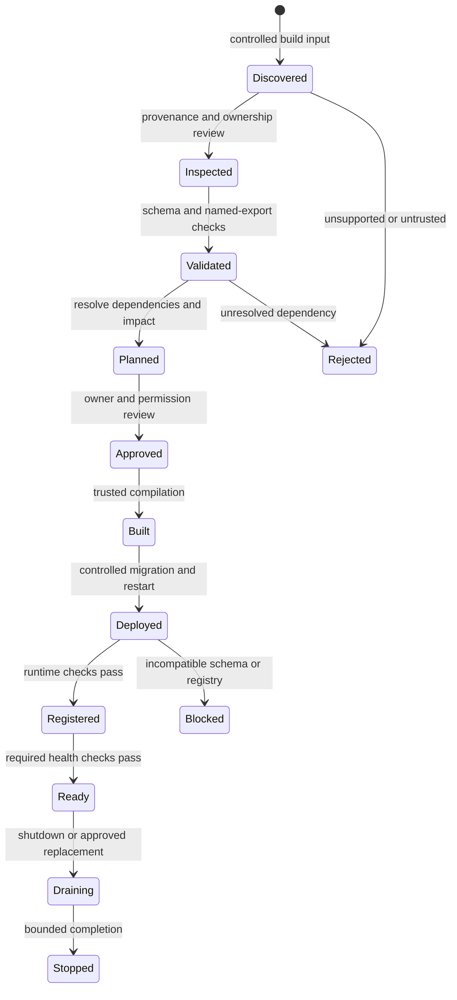

# Module Runtime

**Document status: PROPOSED**  
**Capability status: NOT IMPLEMENTED — specification and fixtures only.**  
**Governance: N0. Proposed owner: runtime maintainer; approval authority: project owner.**

## 1. Purpose, source and scope

Define enforceable PBC boundaries and a deliberately small manifest for the Authority Pro foundation. Locked principles come from [MASTER-BLUEPRINT](../MASTER-BLUEPRINT.md), sections 2, 5, 6.1, 10, 24–27 and 29–30. Concrete discovery, lifecycle and schema choices remain pending owner approval under the [Core status convention](THUNDER-CORE.md).

Scope: trusted first-party platform modules compiled into a single Spring Boot application; static contract discovery, dependency verification, immutable inventory, and a foundation JSON manifest contract.

Non-scope: business modules, runtime JAR loading, remote packages, scripts, marketplace, a universal future manifest, dynamic Angular components, a classloader sandbox, automatic migrations from manifests, or live install/uninstall. The schema version identifies a **Phase-0 documentation subset**, not a claim that a Phase-0 runtime exists. A later runnable socle must select which of these contracts it actually implements.

## 2. Module ownership and discovery

The proposed application package is **`com.authoritypro.platform`**. Its immediate module roots are:

| ID | Immediate root | Owns |
|---|---|---|
| `identity` | `com.authoritypro.platform.identity` | Global user and session lifecycle |
| `tenancy` | `com.authoritypro.platform.tenancy` | Tenant/company/site hierarchy, membership, scoped settings |
| `access` | `com.authoritypro.platform.access` | Permission definitions, grants, evaluation |
| `audit` | `com.authoritypro.platform.audit` | Audit append/read contracts and record persistence |
| `runtime` | `com.authoritypro.platform.runtime` | Catalogue, descriptor validation, readiness and lifecycle coordination |

Spring Modulith is proposed for discovery and structural verification, subject to a compatible Spring Boot/Modulith version spike. With default direct-subpackage discovery, placing the application at `com.authoritypro` would discover `platform` rather than automatically discover the five nested roots. That layout MUST NOT be assumed to work. Any deviation requires explicit discovery configuration and a test proving exactly the expected modules.

Inside each root, `domain`, `application`, `api` and `infrastructure` are layers of that module, not automatically independent modules. The domain MUST NOT depend on Spring MVC, JPA or infrastructure. An API contains named, deliberately exported interfaces, immutable DTOs and contract schemas; it does not expose JPA entities, repositories, `ApplicationContext`, security sessions, or arbitrary implementation classes.

Consumers MUST declare dependencies on **specific named API exports**, not wildcard access to an entire root or `api` package. The build must verify both Modulith dependencies and additional package/layer rules needed to enforce this. A capability declaration is metadata, not an instruction to resolve arbitrary bean names or reflectively invoke class names.

Pure tiny helpers do not automatically require their own module ID, manifest or governance board. They may be kept internal or in a narrowly tested utility library. A shared library MUST NOT own data, tenant context, authorization state, domain services or catch-all configuration. A new independently governed module requires an explicit owner and approved dependency edge.

## 3. Inputs, outputs and contract ownership

Inputs are compiled build descriptors, schema-valid manifests, explicit named-export mappings, and a release compatibility record. Outputs are a validated immutable catalogue and readiness decisions, never dynamically fetched executable code.

The runtime owns module IDs, catalogue assembly and duplicate detection. A provider owns each exported capability's request/result or event schema, version and semantics. Each data owner controls its own migrations and queries. The access module owns authorization evaluation; declaring a permission in a manifest does not grant it to anyone.

Module version, manifest schema version and capability contract version are distinct. This foundation subset accepts exact three-part release versions only. It does not implement version ranges, optional dependencies, prerelease identifiers, SDK negotiation or an automatic compatibility solver. A reviewed release record supplies the tested platform/framework combination; absence of compatibility fields in this subset MUST NOT be treated as universal compatibility.

## 4. Foundation manifest contract

[MODULE-MANIFEST.schema.json](../14-TEMPLATES/MODULE-MANIFEST.schema.json) uses JSON Schema draft 2020-12. Unknown fields are forbidden at every instance-object level. All eleven top-level fields are required:

| Field | Supported meaning |
|---|---|
| `schemaVersion` | Exact `0.1.0`, the proposed foundation dialect |
| `id` | Stable lowercase, hyphen-separated module ID |
| `version` | Exact `major.minor.patch`, without prerelease/build syntax |
| `kind` | Only `platform-module` |
| `trust` | Only `first-party`; a declaration, not a trust proof |
| `execution` | Only `compiled-first-party`; build and restart required |
| `dependencies` | Required module IDs and exact versions; empty permitted |
| `capabilities` | Explicit `provides` and `requires` lists of IDs, versions and command/query/event contract types |
| `permissions` | Permission IDs with `control-plane`, `tenant` or `company` scope; no implied grant |
| `dataOwnership` | Logical owned resources, each explicitly classified `tenant` or `control-plane`; empty means no persistence; no SQL or migration execution |
| `ui` | Static compiled navigation declarations only; empty permitted |

A provided command/query means an owned handling contract; a provided event means a published fact. A required command/query means a consumed provider API; a required event means subscription to a published fact. The runtime must link required capabilities to exactly one compatible provider in a declared dependency. Self-provided requirements and ambiguous providers are rejected in this subset. UI `routeKey` is a build-registered Angular route identifier, **not a URL, file path, HTML fragment or executable expression**. Each navigation entry names a declared permission; server-side authorization remains mandatory.

`dataOwnership.resources` is empty for a module with no persistence. Otherwise each entry declares a logical resource `name` and its `scope` (`tenant` or `control-plane`). This permits tenancy and audit to own separately classified resources without making tenant records globally readable. Duplicate resource names and ownership claims require semantic rejection even when their scopes differ. Resource-level policies and migrations still need separate complete contracts; data ownership is not a database privilege grant.

Publisher, integrity/signature metadata, resource budgets, migrations, configuration schemas, integrations, licensing, package URLs and future extension categories from source section 10 are deliberately **not supported here**. They need separately designed contracts and a versioned schema evolution. Reject them as unknown fields rather than pretending to support the full source catalogue. This narrowing requires owner approval before implementation.

### Two-stage validation

1. **Structural:** reject malformed JSON, duplicate JSON object keys, oversized manifests, unsupported dialects, extra properties, missing fields, invalid constants/types and malformed versions. The schema checks instance structure; duplicate-key rejection occurs in the parser before schema validation. Proposed parsing limits are 64 KiB per manifest and the schema's bounded arrays/strings.
2. **Semantic/build:** reject duplicate module/capability/permission IDs, self or circular dependencies, missing/exact-version-mismatched providers, undeclared API imports, duplicate resource ownership, invalid permission references, unresolved route keys, or descriptors without approved provenance. JSON Schema `uniqueItems` only catches identical array values; ID uniqueness across different values still needs semantic checks.

First-party trust MUST be established from the controlled source/build/release chain, not from the `trust` field. Schema validity does not authorize execution or imply that a module is approved.

### Fixtures

- [MODULE-MANIFEST-TEMPLATE.json](../14-TEMPLATES/MODULE-MANIFEST-TEMPLATE.json) is a **PROPOSED / NOT IMPLEMENTED** fictional `diagnostics-example` platform module. It describes a read-only `platform.diagnostics.snapshot` query at `0.1.0`, declares `platform.diagnostics.read`, owns no persistence and contributes no UI. It is a valid structural fixture, **not one of the five socle modules and not a deployable component**. A real implementation would still need a query schema, named export, authorization binding and release provenance.
- [MODULE-MANIFEST-INVALID.json](../14-TEMPLATES/MODULE-MANIFEST-INVALID.json) is also **PROPOSED / NOT IMPLEMENTED**, and intentionally fails validation for two independent reasons: missing required `id`, and `version` set to `preview` instead of a three-part release version. All other fields match the structural shape. A validator should report both where it supports collecting errors; fail-fast rejection is also valid. It must never enter the runtime catalogue.

The schema and fixtures are normative documentation artifacts owned by the runtime maintainer. They MUST NOT contain credentials, executable payloads, real customer data or permission grants. Their security/failure/observability/test/acceptance requirements are those of sections 4–8 of this document.

## 5. Lifecycle and enablement

Discovery/inspection/validation/planning are initially build/release activities. Dry-run means producing an impact plan: version and API changes, permission additions, affected dependents, owned data/migration impact, backup requirement, rollback feasibility, and company policies affected. It MUST have no state-changing side effects. Approval must precede deployment.

A compiled module is globally present in a deployment. **Company enablement is separate from module installation**: a company policy can make an already present optional capability unavailable, after tenant and company authorization, but cannot add code, remove tables, grant permissions, or disable mandatory identity/isolation/audit controls. Company enablement persistence and administration are deferred until approved; no fake enabled flags should stand in for them in the initial socle.

Update requires a new reviewed build and restart. Disablement must identify dependents and stop new work without discarding pending durable records. Rollback is allowed only if the previous binary remains schema/contract compatible; otherwise use the approved restore or roll-forward plan. Repair is reviewed replacement/recovery, not arbitrary runtime scripting. Uninstall is not a supported live operation. Future removal must preserve data and recovery evidence unless a separately authorized retention/deletion procedure applies.

Untrusted executable plugins, if later approved, run in a separately isolated process with narrow authenticated contracts and resource controls. A classloader is **not** a security sandbox. Declarative remote packages also need a future trust and validation model; this subset accepts neither form.

## 6. Security and failure behavior

| Failure | Required response |
|---|---|
| Required module or export missing | Fail build or startup readiness; no partial-success catalogue |
| Manifest malformed, invalid or untrusted | Reject before registration; record bounded reason and artifact digest |
| Unsupported future category/field | Reject rather than silently ignoring it |
| Dependency or contract version mismatch | Block the release; do not fetch dependencies at runtime |
| Tenant/company policy unavailable | Deny scoped capability, not enable by default |
| Migration incompatible with compiled module | Block serving; never run migrations under runtime credentials |
| Optional module unhealthy | Reject its operations, report explicit degraded availability, preserve isolation |

Named APIs must perform or require verified application authorization at every reachable entry point. The registry MUST NOT offer bypass invocation. Module isolation is an engineering boundary between trusted code, not a sandbox against a malicious first-party binary. RLS and the controls in [Identity and Access](../04-PLATFORM-ENGINES/IDENTITY-AND-ACCESS.md) still apply to all tenant work.

## 7. Observability and tests

Publish protected inventory views containing module ID/version, descriptor digest, supported capability versions, dependency edges, lifecycle/availability reason and build revision. Do not expose filesystem paths, secrets, tenant data or stack traces to catalogue viewers. Record validation counts, startup duration and required-module failures with bounded labels; administrative transitions require [Audit](../04-PLATFORM-ENGINES/AUDIT-ENGINE.md).

Required tests include valid/invalid fixtures, unknown top-level and nested fields, unsupported `kind`/`execution`, duplicate IDs, cyclic and absent dependencies, wrong versions, permission/route linkage, duplicate ownership, oversized input, and duplicate JSON keys. Architecture tests must prove discovery of exactly the five roots and reject an import of another module's repository, JPA entity, private application service or unnamed API. Restart/update tests must distinguish compiled presence from company enablement and prove no data loss on rejection.

## 8. Acceptance and approval gates

Acceptance requires an approved supported-subset decision, a compatible Spring Boot/Modulith version/discovery spike, a named-export map, structural and semantic validators, and executable boundary tests. Fixture parsing or schema validation alone does not satisfy semantic validation. Nothing in this document is evidence of those runtime capabilities.

Owner gates: root/package layout, precise dependency DAG, ownership/resources, permission catalogue, schema versioning policy and release compatibility record. Future package categories and untrusted execution require separate ADRs, not enum additions without a threat model.

## Related contracts

- [Thunder Core](THUNDER-CORE.md)
- [Thunder Control](THUNDER-CONTROL.md)
- [Command, Query and Event Engine](COMMAND-QUERY-EVENT-ENGINE.md)
- [Configuration Engine](CONFIGURATION-ENGINE.md)
- [ADR Template](../14-TEMPLATES/ADR-TEMPLATE.md)
