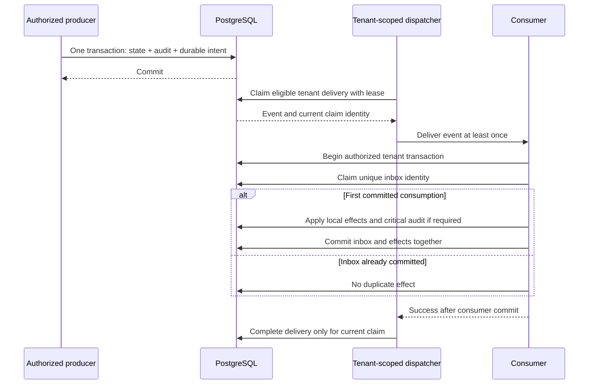

# Outbox, Inbox and Idempotency

**Document status: PROPOSED**  
**Capability status: NOT IMPLEMENTED — no durable publisher, consumer inbox, worker or idempotency store exists yet.**  
**Governance: N0. Proposed owners: runtime/persistence maintainers and reliability lead; approval authority: project owner.**

## 1. Purpose, source, scope and non-scope

Specify recoverable module event delivery and duplicate-safe platform operations without promising exactly-once transport or adding unnecessary infrastructure. Locked source principles are [MASTER-BLUEPRINT](../MASTER-BLUEPRINT.md), sections 5, 6.1, 10, 22–27 and 29–30. All mechanisms are proposed under the [Core status convention](THUNDER-CORE.md), pending owner approval.

Scope: one durable publication mechanism in PostgreSQL, at-least-once delivery, tenant-safe consumers, consumer inbox transactions, command idempotency, bounded retries and recovery. This is a follow-on platform capability, not a claim that the first runnable socle already needs or contains workers.

Non-scope: business event examples, event sourcing, Kafka/RabbitMQ deployment, distributed transactions, cross-tenant fan-out, arbitrary message scripts, a global RLS bypass, a generic scheduler product, or exactly-once delivery. External irreversible side effects need their own future idempotency/reconciliation contracts.

## 2. Ownership and the unresolved durability choice

A publishing module owns event semantics and the protected state change. Runtime owns dispatch/recovery infrastructure. Each consumer owns its inbox and resulting local effects. Audit owns critical audit records and remains in the protected transaction; it is not a durable publication mechanism.

Exactly **one durable publication mechanism** must be selected after a spike and owner-approved ADR:

| Option | Strength | Required proof / cost |
|---|---|---|
| Spring Modulith durable event publications | Framework-supported transactional publication tracking may reduce custom lifecycle code | Verify selected version, persistent registry behavior, listener transaction/recovery semantics, per-consumer completion, tenant context, RLS, retries, ordering and retention; do not assume framework defaults satisfy these requirements |
| Custom transactional outbox with per-consumer delivery tracking | Explicit ownership of schema, tenant keys, claim/lease rules and operational lifecycle | Team owns race conditions, recovery, schema migrations, dispatcher correctness, duplicate handling, retention and test burden |

Recommendation: evaluate the Spring Modulith option first to minimize custom infrastructure, but select it **only if the spike proves all N0 invariants**. Otherwise propose a custom outbox and document the failed criteria and maintenance cost. This recommendation is not a selection. A plain in-memory application event publisher is not a durable alternative.

Do not run a custom outbox and Spring Modulith durable publication registry for the same event path. Double durability creates competing acknowledgements, duplicate retention and unclear recovery. A consumer inbox is compatible with either choice because it protects local effects rather than serving as a second producer publication log. A broker, if ever added, does not replace the producer's atomic write boundary.

[ADR-0006](../adr/ADR-0006-outbox.md) records this unresolved choice as PROPOSED. The spike and explicit owner decision are implementation prerequisites.

## 3. Required spike and decision evidence

Use a technical tenant-settings-change scenario only. The spike must demonstrate:

1. Source state, critical audit and durable publication intent commit or roll back together in one PostgreSQL transaction.
2. Crash after commit and before dispatch does not lose the event; crash after consumer commit and before publisher acknowledgement causes a harmless duplicate.
3. At least two independent consumers maintain separate completion state; one consumer's success does not hide another's failure.
4. The runtime non-owner, non-superuser, `NOBYPASSRLS` role can process an authorized tenant while absent/wrong tenant context fails closed. Framework startup replay/global scans must not require a tenant bypass.
5. Concurrent workers, claim expiry, stale-worker completion, retry exhaustion, per-aggregate ordering, unknown schema handling and restart recovery satisfy sections 4–7.
6. Publication retention cannot outrun inbox retention or delete pending/parked deliveries. An upgrade/restore preserves IDs and recovery state.
7. Compatibility with chosen Spring Boot, Spring Modulith, JDBC transaction management and supported PostgreSQL versions is recorded with reproducible tests.

If a framework cannot expose safe per-tenant recovery or required ordering without unsupported internals, that is decision evidence against it, not permission to weaken RLS. No framework guarantee is assumed solely from its name.

## 4. Logical contracts and tenant-safe storage

Durable records need logical publication ID, event contract/version, publisher, verified tenant context, aggregate type/ID/sequence, server occurrence time, causation/correlation IDs and a bounded allowlisted payload. Delivery state is **per event and consumer** and includes attempt count, next eligible time, lease/fencing identity, last bounded error code and completion/parked status. These are requirements, not an instruction to create half-defined tables.

Tenant publications, delivery state, inbox and idempotency records require non-null `tenant_id`, forced RLS and appropriate tenant-qualified uniqueness. Logical inbox uniqueness is `(tenant, consumer, eventId)`. Tenant command idempotency uniqueness is `(tenant, authenticated actor, command contract, key)` plus stored company/site scope and canonical request fingerprint. Separate control-plane streams/stores require explicit authorization policy; a nullable tenant ID must not create an unrestricted stream.

Workers cannot sweep all tenant payloads using `app.platform_scope`. Proposed recovery enumerates only minimal approved work-scheduling metadata through a control-plane scheduler contract, then opens a fresh transaction for **one authorized tenant**. Any scheduler authority and service identity require separate owner approval; enumerating tenant IDs is not authorization to read their data. Until this authority model and RLS-safe scanning are implemented, durable background processing remains unavailable.

A consumer receives historical actor metadata for attribution but executes under its own approved current scope/permission policy. It validates the event schema, tenant, destination and aggregate identity before installing database context. It must not deserialize trusted classes or set tenant/user context directly from arbitrary payload text.

## 5. Producer and consumer transaction protocol

For each consumer, insertion/claim of the inbox identity and all local effects must share one database transaction. A concurrent duplicate must serialize on uniqueness or an equivalent proven atomic mechanism. A rollback leaves no successful inbox marker and no effects. A previously committed marker permits a safe no-op acknowledgement, not replay of the side effect.

Do not mark the inbox complete before the effect commits or use an independent transaction for the inbox. Do not acknowledge producer delivery before consumer success is committed. A crash between consumer commit and delivery completion is expected to redeliver; this is why the inbox exists.

Delivery is **at least once**. The inbox can make a defined transactional database effect occur once within its retained deduplication scope; this is not an exactly-once delivery guarantee and does not cover an email, remote API or file write outside the transaction. Future external effects must use an idempotent destination or an additional explicitly owned delivery workflow with reconciliation.

## 6. Retry, lease recovery and ordering

The exact mechanism may differ by selected option, but required behavior is:

- Claim only bounded batches of eligible work. Keep claim transactions short; do not hold database locks while performing slow external work.
- A delivery has one active lease/claim identity and deadline. A worker crash allows recovery after expiry. Completion/retry updates must compare the current lease identity (or equivalent fencing/version) so a stale worker cannot acknowledge a reassigned delivery.
- Consumer inbox uniqueness remains the final protection if an expired worker and its replacement both run. Limit concurrency by tenant and consumer; a noisy tenant must not occupy every slot.
- Retry transient failures with bounded exponential backoff and jitter. Proposed starting limits for evaluation are 8 attempts, 1-second initial delay, 5-minute delay cap and a lease tied to the handler deadline. These are **not operational defaults until approved and load-tested**. Leases must be renewable/fenced if the handler can exceed their duration.
- Invalid schemas, missing consumers/permissions and deterministic contract errors are not retried indefinitely. Park the delivery with a safe reason for authorized inspection.
- Exhausted deliveries enter a durable parked/dead-letter state. Recovery requires an authorized audited action, retains the original event identity, and must not silently reset attempt history or change payload meaning.

Ordering is only **per tenant, aggregate and consumer**, where promised by the contract. The producer assigns a monotonic aggregate sequence atomically with its state revision; timestamps are not an ordering mechanism. A later sequence cannot overtake an unresolved earlier delivery for that ordered stream. A retry or parked head blocks that stream until reviewed resolution; other aggregates may proceed. A skipped message requires an explicit audited policy and must not quietly violate a consumer invariant.

No global order across aggregates, tenants or different consumers is promised. New consumer registration needs an explicit starting-position/replay policy so it does not wait forever for historical sequences it was never assigned. The spike must prove whichever ordering primitive the chosen mechanism provides or the design must reject that option.

## 7. Command idempotency

For commands that opt into idempotency, authenticate and authorize **before every first execution and replay**. A cached result is not permission to access a previously available tenant after revocation.

The client provides a bounded opaque key; the server binds it to the logical identity in section 4 and a canonical request fingerprint including scope, contract version and allowed input. Same key/same request returns a minimal committed result; same key/different request is a conflict. Concurrent equal requests must not both mutate state. The winning command writes its effect, critical audit and committed idempotency result atomically. A database rollback releases the attempt; a timeout after commit can be resolved by replay.

Do not store full sensitive requests/responses. Store only the fingerprint, safe result reference/revision and lifecycle metadata required by the contract. A completed replay still uses the current user's permissions. A command requiring external work cannot claim transactional completion merely by persisting an in-progress marker; it needs a distinct asynchronous operation contract.

Key retention and client retry windows must be approved together. After expiration, duplicates may no longer be detectable; do not imply infinite deduplication. The API must document expiration behavior. Consumer inbox retention must exceed every allowed event redelivery/replay window, including restore and manual replay; pruning requires proof that producer state and recovery policy cannot resurrect the event without a reviewed plan.

## 8. Failure, security and observability

| Failure | Required result |
|---|---|
| Producer audit/publication write fails | Roll back source change |
| Dispatcher dies before delivery | Lease expiry makes pending delivery recoverable |
| Consumer rolls back | Inbox and effects absent; eligible retry remains |
| Consumer commits but acknowledgement is lost | Redelivery produces no duplicate local effect |
| Wrong/missing tenant or worker permission | Fail closed and park/alert as appropriate; no bypass scan |
| Poison message or unsupported version | Park safely; retain minimal evidence without raw payload logs |
| Backlog grows beyond budget | Apply admission/backpressure policy and alert; never silently drop durable facts |
| Restore reintroduces old deliveries | Inbox/retention recovery plan prevents duplicate effects or requires controlled reconciliation |

Observe pending count, oldest pending age, per-consumer lag, attempts, parked count, lease expiry/reclaim, stale completion rejection, inbox duplicate hits, idempotency conflicts, dispatcher saturation and per-aggregate blocking. Use bounded contract/consumer labels. Detailed tenant investigations require authorized views, not tenant IDs as unbounded metric labels or raw payload copies in logs.

## 9. Tests, acceptance and owner gates

Required future tests are the spike matrix plus concurrent idempotent commands, equal/different payload replays, expired keys, current-permission replay denial, two-tenant RLS tests, ordering under retries, poison-head behavior, fair scheduling, inbox-retention safety, upgrades and restore fault injection.

Acceptance requires: one approved durability mechanism and no competing producer log; an approved service/scheduler authority model; complete role/table/policy design; reproducible crash/race tests; bounded retry/retention settings; safe operational recovery; and truthful at-least-once API documentation. A successful happy-path event is insufficient.

Owner gates remain the durability ADR, framework versions, consumer authorization, per-stream ordering needs, lease/deadline budgets, retry thresholds, retention/replay windows and the increment in which this capability is implemented. No code, schema migration or worker is authorized by this document alone.

## Related contracts

- [Thunder Core](THUNDER-CORE.md)
- [Module Runtime](MODULE-RUNTIME.md)
- [Command, Query and Event Engine](COMMAND-QUERY-EVENT-ENGINE.md)
- [Identity and Access](../04-PLATFORM-ENGINES/IDENTITY-AND-ACCESS.md)
- [Audit Engine](../04-PLATFORM-ENGINES/AUDIT-ENGINE.md)
- [ADR Template](../14-TEMPLATES/ADR-TEMPLATE.md)
