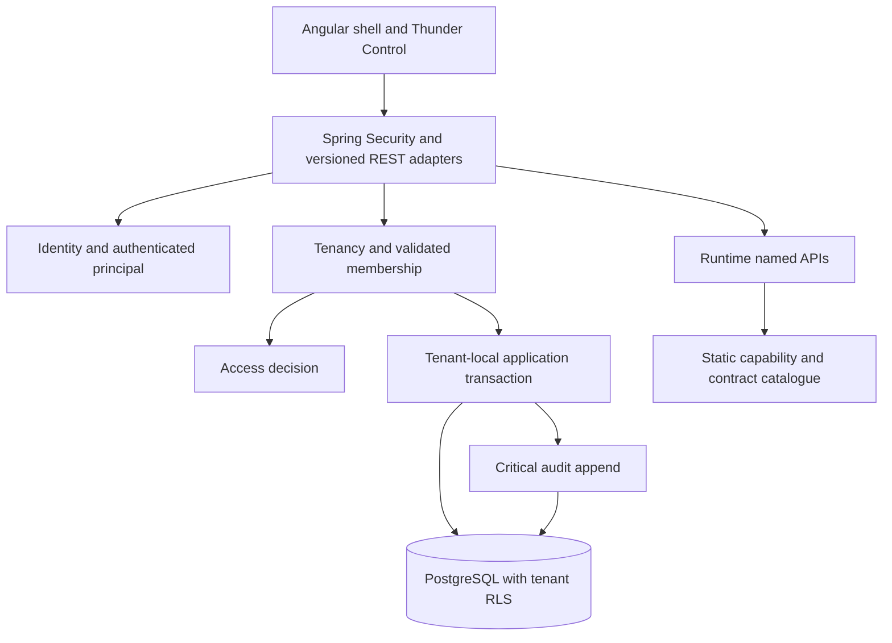

# Thunder Core

**Document status: Approved high-level orientations and bounded L02 skeleton design; other detailed contracts remain PROPOSED.**\
**Capability status: L02 no-database backend skeleton IMPLEMENTED / TESTED only; integrated Core capabilities remain NOT IMPLEMENTED.** See [execution evidence](../PACK-INVENTORY.md#l02-execution-evidence--2026-11-18).\
**Governance: N0. Proposed owner: platform architecture lead; approval authority: project owner.**

## 1. Purpose and authority

Thunder Core is the business-neutral technical foundation of **Authority Pro**, not a business application or a universal service containing every engine. This document establishes the proposed contracts and entry gates for a later runnable platform socle. Documentation completion is not implementation, testing, release, or owner approval.

Source principles in [MASTER-BLUEPRINT](../MASTER-BLUEPRINT.md), sections 2, 5–8, 10, 22–27 and 30–32, remain locked. The owner-confirmed baseline is the independent Authority Pro name, Angular and Spring Boot, a modular monolith using DDD, hexagonal architecture and Plugin-Based Components (PBC), a monorepo, and PostgreSQL `tenant_id` plus row-level security (RLS). The current scope is documentation first, then the runnable technical socle only, with **no business modules**. The archive's historical name and wider roadmap do not change that scope.

The [owner-confirmed foundation orientations](../00-GOVERNANCE/DECISION-MANAGEMENT.md#owner-confirmation-of-foundation-orientations) approve Spring Security/JDBC-backed cookie sessions with CSRF; first-administrator provisioning through a local operator CLI, not a public page; restricted PostgreSQL runtime privileges with RLS and verified transaction-local tenant context; atomic commit/rollback of critical sensitive changes and audit; compiled first-party components with explicit contracts, not arbitrary hot-loaded plugins; and `/api/v1` with controlled tenant selection and standardized errors. The [2026-11-18 bounded L02 approval](../00-GOVERNANCE/DECISION-MANAGEMENT.md#l02-skeleton-decisions--2026-11-18) additionally covers the skeleton root model, empty intermodule graph, boundary tools, local probes, error shape and test/build-only OpenAPI; [ADR-0010](../adr/ADR-0010-java-spring-versions.md) owns its pins. Other mechanisms and linked contract/JSON details remain **PROPOSED**, including exact schema/grants, expiry, tenant selector/codes, bootstrap guards and session/audit integration. MUST, MUST NOT and SHOULD express normative requirements, not implementation evidence; no blanket approval of this document or linked contracts is implied.

## 2. Scope and non-scope

The socle is intended to establish startup, identity, membership-based tenant context, backend authorization, strict persistence boundaries, critical audit, typed configuration, static module discovery and minimal protected administration. It must be possible to run and test these capabilities without a business module.

The delivered code is limited to the L02 no-database skeleton. It includes no migrations, deployed infrastructure, functional identity/audit/inventory, frontend, business workflows, marketplace installation, executable third-party plugins, automation, general-purpose queues, dynamic UI loading, licensing, AI, or offline synchronization. Durable events and command idempotency are specified here as follow-on platform contracts; they are not automatically part of the first runnable increment. A release MUST NOT claim these capabilities before their separate gates pass.

## 3. Ownership and dependencies

Thunder Core is an architectural concept, not a mandatory `core` package or a sixth omnibus module. The approved L02 single artifact uses `com.authoritypro.platform.AuthorityProApplication` with exactly the five immediate roots below; their capability ownership is not implementation evidence:

| Module | Owned capability and data | Boundary |
|---|---|---|
| `identity` | Global users, credentials, server-side sessions, initial operator provisioning | No implicit tenant access |
| `tenancy` | Organization/tenant, company, site, membership, typed tenant/company settings | Tenant is isolation and future billing root; billing behavior is excluded |
| `access` | Permission definitions, grants and deny-by-default evaluation | Grants remain tenant-scoped unless explicitly control-plane |
| `audit` | Append and read contracts, critical audit records, separate security-attempt recording | No dependency on protected modules' repositories |
| `runtime` | Compiled module descriptors, capability/contract catalogue, lifecycle readiness, technical configuration | No arbitrary SQL console or service locator |

Each root introduces private `domain`, `application` and `infrastructure` packages only as needed. The L02 intermodule graph is EMPTY; no fabricated API or service stands in for an implemented capability. Later named `api` exports and consumption need explicit approval. Only those named interfaces and declared contract types may then cross a module boundary. JPA entities, repositories, framework request/session objects and internal services MUST NOT be exported.

For later integration only, a proposed acyclic dependency direction is: `audit` accepts validated value metadata without importing identity/tenancy internals; `identity` uses the audit append API; `access` evaluates explicit subject/scope facts without calling tenancy; `tenancy` supplies membership facts and uses access/audit APIs; `runtime` orchestrates only published APIs. Exact edges and authorization entry points require architecture tests before approval. Audit read authorization belongs at a guarded application boundary, not in a cycle back through all producers. Tiny pure utilities may remain non-module code; `shared` and `config` MUST NOT become god-modules or containers for owned data.

This is a logical flow, not a declaration of Java imports. [Module Runtime](MODULE-RUNTIME.md) owns discoverability and export rules; [Identity and Access](../04-PLATFORM-ENGINES/IDENTITY-AND-ACCESS.md) owns the security boundary.

## 4. Capability contracts

The table describes integrated or later capabilities, not the delivered L02
startup/configuration/probe subset. L02 establishes no functional registry or
cross-module API; its readiness deliberately remains OUT_OF_SERVICE.

| Capability | Inputs and outputs | Dependency / proposed increment | Status |
|---|---|---|---|
| Startup/readiness | Validated environment and schema compatibility -> ready or blocked with reason | Deployment and runtime / socle | NOT IMPLEMENTED |
| Static registry | Compiled descriptors -> immutable module and contract inventory | Manifest validation / socle | NOT IMPLEMENTED |
| Tenant context | Authenticated principal and requested scope -> validated membership-bound context | Identity, tenancy, access / socle | NOT IMPLEMENTED |
| Critical audit | Protected operation metadata -> durable record in the write transaction | Audit / socle | NOT IMPLEMENTED |
| Configuration | Typed key and authorized scope -> effective value, source and revision | Runtime or tenancy owner / socle | NOT IMPLEMENTED |
| Commands and queries | Versioned requests -> typed results or safe errors | Owner application API / minimal socle interfaces | NOT IMPLEMENTED |
| Durable events and inbox | Committed versioned facts -> retryable, deduplicated effects | Durability spike and ADR / later platform increment | NOT IMPLEMENTED |
| Workers, scheduling and resource governance | Bounded work and quotas -> supervised execution | Separate design / deferred | NOT IMPLEMENTED |
| Feature flags and entitlements | Approved policy -> scoped enablement decision | No permissive fallback / deferred | NOT IMPLEMENTED |

No registry entry creates a permission or grants database access. A registry describes available compiled contracts; company enablement is a separate policy state. Extension points MUST be explicit and versioned, not reflective invocation of arbitrary classes.

## 5. Startup, shutdown and recovery

The sequence below is the integrated L03–L06 target, not L02 startup. Approved `skeleton-local` L02 has no database or identity/session/audit implementation: only loopback status probes, with liveness `UP` when live and readiness `503 OUT_OF_SERVICE` while the nucleus is incomplete ([HTTP boundary](../02-ARCHITECTURE/API-ARCHITECTURE.md#bounded-l02-http-design)). This is not a switch disabling production identity, RLS or audit protections. DB/Flyway/RLS belong to L03, audit L04, identity L05, protected inventory L06 and Angular L07; deferred workers/events still require separate approval. No startup or operational action is authorized by this documentation task.

1. Validate deployment configuration and secret references without printing secrets.
2. An explicitly controlled deployment step uses a **separate migration role** to apply reviewed migrations. The serving application MUST NOT hold that role's credentials or auto-elevate on startup.
3. The runtime, using a non-owner, non-superuser, `NOBYPASSRLS` database role, verifies schema compatibility and required RLS protections. A missing policy or a table owned by the runtime is a blocker.
4. Discover trusted compiled modules, validate descriptors, exports, dependencies and uniqueness, then construct the static registry. Boundary verification is required in the build/test pipeline; startup checks supplement it.
5. Establish identity/session storage and protected health surfaces. Start only approved workers after their durability contracts are verified. No default administrator or public bootstrap endpoint is created.
6. Mark readiness true only when the required capabilities can safely serve traffic. A process being alive is not proof of readiness.
7. On shutdown, stop accepting new work, drain requests within an approved deadline, finish or roll back transactions, release/expire worker leases, then close resources. Recovery replays only persisted, authorized work.

A failed migration is a failed deployment, not a signal to continue with a partially updated schema. Rollback requires a compatibility check and restore/recovery plan; automatic down-migrations are not promised.

## 6. Security invariants

- Tenant = organization; company belongs to one tenant; site belongs to one company. Company selection is not a new tenant boundary.
- Global identity/session records are control-plane data. They are not made readable through a global tenant-table exemption. A platform owner receives **no automatic tenant access**.
- Tenant operations use transaction-local tenant and user context derived from authenticated membership; absence, mismatch or expiration fails closed. There is **no `app.platform_scope` bypass**.
- Every tenant table requires non-null `tenant_id`, forced RLS, read/write policies, tenant-safe constraints and tests under the actual runtime role. RLS does not replace permission checks or same-tenant company/site restrictions.
- Approved browser authentication orientation: Spring Security/JDBC-backed cookie sessions with CSRF. Spring Session JDBC integration, exact cookie settings, expiry and same-origin configuration remain PROPOSED. Custom bearer tokens and browser `sessionStorage` credentials are excluded.
- Critical audit and protected writes commit together. Audit failure MUST NOT be swallowed. Administrative screens use the same guarded APIs as any other caller.

## 7. Failure and observability contracts

| Condition | Required behavior | Evidence |
|---|---|---|
| Invalid config, manifest, schema or unsafe runtime DB role | Block readiness/startup with a bounded reason | Redacted structured startup failure |
| Database unavailable | Fail readiness; reject dependent requests without pretending success | Dependency health and availability/error metrics |
| Missing tenant or insufficient membership | Deny before tenant access; DB remains fail-closed | Safe denial reason, no tenant data in response |
| Audit append fails | Roll back protected write | Audit failure counter and alert |
| Required module invalid | Block readiness, not `UNKNOWN`-but-serving | Module validation outcome |
| Optional deferred capability absent | Advertise NOT IMPLEMENTED, not healthy/active | Explicit registry availability |

Observability MUST separate control-plane and tenant views. Use bounded structured reason codes and trace/correlation identifiers; opaque tenant/actor identifiers are allowed only in access-controlled logs under retention policy. Never log session IDs, passwords, CSRF values, request bodies or configuration secrets. Metrics MUST avoid tenant/user IDs as unbounded labels. Public liveness discloses no topology; detailed diagnostics require authorization.

## 8. Tests and acceptance

Evidence is slice-specific: **L02 clean verification passed 65 unit tests and 4 packaged integration tests, with no failures or skips**. L02 exit is limited to the [backend skeleton gates](../02-ARCHITECTURE/BACKEND-ARCHITECTURE.md#observability-and-tests), including exact compiled five-root discovery and an empty graph; the offline clean repeat also passed. The following integrated evidence remains required as the corresponding capabilities arrive, not as a prerequisite to the no-database L02 skeleton:

- A fresh database and restart scenario verify schema compatibility with runtime credentials distinct from migration credentials.
- Architecture tests prove immediate-root discovery, named exports, no cycles, no repository/entity leakage and no business dependencies.
- Two tenants, two companies within one tenant, a multi-membership user and a platform-only operator prove application and database isolation, including connection reuse after errors.
- Authentication, CSRF, revocation, provisioning-disabled and inaccessible-bootstrap tests pass.
- Fault injection proves critical audit rollback, invalid configuration rejection and readiness failure on dependency loss.
- The first runnable increment exposes only the approved platform socle. No business module, fake installed module, or unsupported control is included.

Acceptance requires named owners, approved N0 ADRs, reproducible tests and operational evidence. Documentation alone satisfies none of the runtime acceptance criteria.

## 9. Approval gates and conflicts

Approvals are slice-specific: the [bounded L02 design is approved](../00-GOVERNANCE/DECISION-MANAGEMENT.md#l02-skeleton-decisions--2026-11-18) and its no-database skeleton is implemented/tested, not authorization for deployment or database operations. Next is qualified L03 facts/design and approval, not automatic implementation. Before each later slice, obtain approval for its concrete identity/session and provisioning design, membership/control-plane policy, new exports/dependency edges, configuration scopes, audit taxonomy/retention and acceptance boundary as applicable. L02 approves no event registry. Durable event implementation additionally requires the spike in [Outbox, Inbox and Idempotency](OUTBOX-INBOX-IDEMPOTENCY.md).

[ADR-0003](../adr/ADR-0003-multi-tenancy.md), [ADR-0005](../adr/ADR-0005-sessions.md) and [ADR-0006](../adr/ADR-0006-outbox.md) separate approved high-level choices from proposed mechanisms. Restricted runtime/RLS with verified transaction-local tenant context and framework JDBC-backed cookie sessions with CSRF are approved orientations. Exact role/grant/context and session/audit integration details, and the single durable-publication selection, remain PROPOSED and require approval and test evidence; orientation approval does not establish implementation or acceptance.

## Related contracts

- [Thunder Control](THUNDER-CONTROL.md)
- [Module Runtime](MODULE-RUNTIME.md)
- [Command, Query and Event Engine](COMMAND-QUERY-EVENT-ENGINE.md)
- [Outbox, Inbox and Idempotency](OUTBOX-INBOX-IDEMPOTENCY.md)
- [Configuration Engine](CONFIGURATION-ENGINE.md)
- [Identity and Access](../04-PLATFORM-ENGINES/IDENTITY-AND-ACCESS.md)
- [Audit Engine](../04-PLATFORM-ENGINES/AUDIT-ENGINE.md)
- [ADR Template](../14-TEMPLATES/ADR-TEMPLATE.md)
