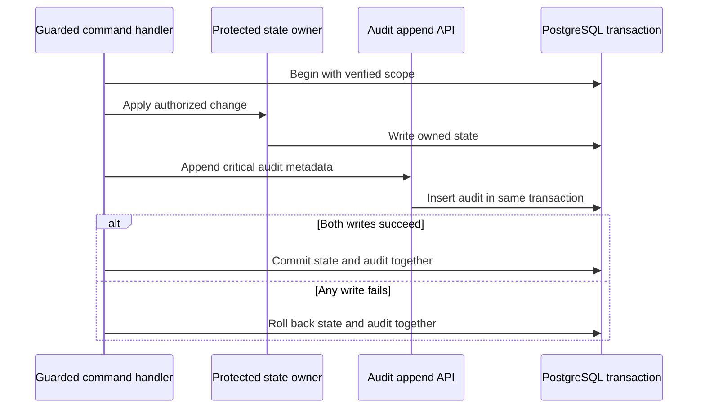

# Audit Engine

**Document status: Approved critical-change/audit atomicity; detailed L04 contract section 9 with D1–D6 APPROVED 2026-11-21; isolated test-database implementation VERIFIED 2026-11-21 (36 checks); main migration NOT AUTHORIZED.**\
**Capability status: NOT IMPLEMENTED — no audit store, writer or reader exists yet.**  
**Governance: N0. Proposed owners: audit maintainer and security lead; approval authority: project owner.**

## 1. Purpose, source, scope and non-scope

Provide durable evidence of protected platform changes without creating a cross-tenant information channel or copying sensitive payloads into logs. Locked principles derive from [MASTER-BLUEPRINT](../MASTER-BLUEPRINT.md), sections 5, 6, 8, 20, 23–26 and 30. The [owner-confirmed foundation orientations](../00-GOVERNANCE/DECISION-MANAGEMENT.md#owner-confirmation-of-foundation-orientations) approve the invariant that critical sensitive changes and their durable audit both commit or both roll back. Detailed transaction/session integration, schemas, grants, taxonomy, retention and failed-attempt handling remain **PROPOSED** under the [Core status convention](../03-CORE/THUNDER-CORE.md); approval of the invariant is not approval or delivery of every mechanism below.

Scope: atomic audit of critical identity/access, tenant settings and runtime administrative changes; scoped audit reading; and a distinct bounded path for failed authentication/security attempts.

Non-scope: business audit events, full request/response capture, a data warehouse, a SIEM implementation, proof of cryptographic non-repudiation, immutable external storage, arbitrary log search, or replacing operational metrics. Audit is not the event bus or an outbox surrogate.

## 2. Ownership and dependencies

`audit` owns its persistence, record vocabulary, append API and bounded read contract. Producers call its explicitly named API and never write audit tables directly. Audit accepts validated immutable actor/scope facts; it does not query another module's repositories or cause dependency cycles back into its producers.

A guarded application boundary authorizes reads and supplies verified scope. The audit engine does not grant tenant access to a platform operator. The [Identity and Access](IDENTITY-AND-ACCESS.md) contract supplies actor, membership and transaction context; the producer owns the protected operation and transaction boundary.

Proposed storage is separated by security boundary:

| Record family | Scope and ownership rule | Read authority |
|---|---|---|
| Tenant critical audit | Non-null `tenant_id`, optional company/site references, forced RLS and tenant-safe constraints | Explicit tenant/company audit permission |
| Control-plane critical audit | Global security/platform administration, no copied tenant data | Explicit control-plane audit permission |
| Failed security-attempt record | Minimal unauthenticated/denied-attempt metadata, separately bounded persistence path | Restricted security operations permission |

A nullable tenant field with an unconditional global-read policy is not an acceptable shortcut. Physical schema and retention jobs require a complete reviewed design; this document supplies no partially secured SQL tables.

## 3. Append and read contracts

A proposed critical audit record contains:

| Field | Meaning / constraints |
|---|---|
| `recordId` | Stable opaque record identity generated by the server |
| `occurredAt` | Server timestamp in UTC; not a client claim |
| `action` | Versioned allowlisted action, such as `tenant.settings.updated` |
| `actorId` / actor kind | Opaque authenticated actor or explicitly authorized provisioning/service actor; never credentials |
| `scope` | Exactly control-plane or verified tenant context; company/site optional within that tenant |
| `targetType` / `targetId` | Allowlisted resource category and opaque identifier; no descriptive PII |
| `outcome` | Committed protected change; failed/denied attempts belong to the separate attempt contract |
| `correlationId` / `operationId` | Traceability and command identity without session/token values |
| `schemaVersion` | Version of audit metadata contract |
| `metadata` | Allowlisted small typed facts, for example changed setting key names and old/new revision numbers |

Do not serialize arbitrary exception objects, request bodies, entity snapshots, before/after personal data or configuration values. A setting change records key names and revision transitions, not the old or new secret/value. Metadata fields require classification, size limits and tests. Proposed limits: 4 KiB encoded metadata and 20 allowlisted entries per record; final limits and vocabulary require approval.

The append API joins the **existing protected-write transaction** on the same database/transaction manager. It must not use an independent transaction, asynchronous fire-and-forget call, post-commit-only listener or swallowed exception for critical changes. The read API accepts validated scope, bounded cursor/page size, time range and allowlisted filters; it returns a safe DTO rather than raw database rows. Proposed maximum page size is 100, with no unbounded export in the socle.

## 4. Atomicity and failure semantics

Critical actions include initial operator creation, role/grant or membership changes, session revocation, tenant/company setting changes and approved security-sensitive runtime/configuration actions. The owner must approve the complete action taxonomy before coding. Durable event intent, when introduced, joins the same transaction; the outbox decision does not weaken critical-audit atomicity.

If audit cannot persist, the protected action MUST fail and roll back. The caller receives a safe infrastructure failure, never a success followed by a warning. Do not catch and ignore an audit exception, downgrade a critical action to best-effort, or retry only the audit append after its protected write has committed.

A rolled-back transaction cannot contain durable proof of its failed attempt. Where required, a separate post-rollback attempt record may describe the denial/failure using minimal metadata; it MUST NOT claim that the original change committed. Recovery retries must use the operation's approved idempotency contract so one committed operation does not generate misleading duplicate success records.

## 5. Failed authentication and security-attempt path

Failed authentication has no protected tenant write to join. It therefore uses an **independent, bounded security-recording path**, not a tenant transaction with invented context.

- Record server time, allowlisted reason, correlation ID and coarse request/source classification. Do not copy usernames, email addresses, submitted passwords, tokens, full IP/device payloads or request bodies. Any approved pseudonymous source fingerprint needs a privacy/retention review and a managed key.
- Bound request input, record size, per-source/global emission rate, queue capacity and storage retention. Proposed initial design uses rate-limited minimal records and aggregated counters; sustained floods must not create unbounded records or threads.
- On recording-store failure or saturation, authentication remains denied. Increment an independent operational counter/alert without recursively trying to audit the logging failure. Do not leak internal diagnostics to the caller.
- A bounded drop/aggregate policy is acceptable **only for this security-attempt stream**, with visible loss/suppression counts and owner approval. It is never acceptable for critical committed-change audit.
- Critical successful security changes remain atomic. If successful login recording is classified critical, the session must not become usable until the approved identity/session-plus-audit transaction succeeds; that framework integration requires a spike rather than an unsupported atomicity claim.

## 6. Security, retention and recovery

The runtime DB role is non-owner, non-superuser and `NOBYPASSRLS`; tenant audit reads/writes remain under transaction-local tenant context. An operator with control-plane audit access cannot read tenant audit. Company-restricted audit readers must also pass company/resource checks within the tenant.

Operational application paths are append-only for audit. Runtime privileges must exclude normal update/delete of audit records; retention uses a separately authorized, reviewed process and scope, never blanket application elevation. Administrative database ownership can still modify data, so this proposal does not claim tamper-proof storage. Stronger integrity chains or external immutable copies require a separate threat model and ADR.

Retention must be explicit for each record family, including backups, access logs and security-attempt aggregation. Legal/privacy requirements, retention durations and deletion evidence are owner/security decisions. No automatic purge or export is enabled merely because this document exists. Restores must preserve record/operation identities and avoid falsely replaying already committed audit actions.

## 7. Observability and tests

Metrics: critical append latency, append failures, atomic rollback count, rejected metadata, audit-read denials, security-attempt suppression/drop counts, storage growth and retention-job failures. Use bounded action/outcome labels, not actor or tenant IDs. Restricted logs contain correlation IDs and safe failure categories, never payload copies.

Required future tests:

- Audit insert failure rolls back tenant settings, role/grant changes and initial provisioning; protected-write failure leaves no committed success audit.
- Read tests under actual runtime credentials prove tenant isolation, platform-owner denial and company-level restrictions.
- An invalid metadata key, oversize record, token-like value or raw request payload is rejected/redacted according to the allowlist, not accepted blindly.
- Duplicate command delivery yields the approved single committed effect/audit behavior; concurrent requests and rollback retry are covered.
- Authentication floods and audit-store outages remain bounded, deny authentication correctly, expose suppression metrics and never recurse into audit failures.
- Runtime update/delete attempts fail; any later retention process is separately authorized and tested for scope safety and restore compatibility.

## 8. Acceptance and remaining approvals

Acceptance requires an approved action taxonomy, safe metadata schema, complete RLS/privilege design, same-transaction fault-injection evidence, approved retention policy and a tested bounded failed-authentication path. Session/audit coordination must be demonstrated against the chosen Spring Security/Session versions before claiming critical login atomicity.

Owner gates: critical-action classification (including login/session events), transaction integration, retention/destination/access policy, company audit visibility, record limits and security-attempt suppression thresholds. No critical audit capability is implemented or tested by publishing this proposal.

## 9. L04 detailed contract proposal — 2026-11-21

**Status: contract v1, with D1–D6 approved on 2026-11-21 and [isolated test-database implementation authorized](../00-GOVERNANCE/DECISION-MANAGEMENT.md#l04-isolated-implementation-authorization--2026-11-21). The main database, serving modes and deployment remain unauthorized.** This section still describes no executed capability; it converts the preceding sketches into one reviewable v1. Where this section is more specific than earlier sections, it refines them rather than creating a second contract.

### 9.1 Action taxonomy v1

All codes are versioned (`actionVersion` starts at 1). Unknown code/version, wrong target type or missing required metadata is rejected before any write. Codes are immutable; a semantic change requires a new version or a new code.

| Action code | Family | Target type | Required metadata keys |
|---|---|---|---|
| `identity.operator.provisioned` | Control-plane | `operator` | `operatorRef`, `revision` |
| `identity.session.revoked` | Tenant or control-plane | `session` | `sessionRef`, `reasonCode` |
| `identity.sessions.revoked_all` | Tenant | `subject` | `subjectRef` |
| `access.membership.created` | Tenant | `membership` | `membershipRef`, `companyRef`, `roleCode`, `revision` |
| `access.membership.updated` | Tenant | `membership` | `membershipRef`, `changedFields`, `revision` |
| `access.membership.revoked` | Tenant | `membership` | `membershipRef`, `revision` |
| `access.grant.created` | Tenant | `grant` | `grantRef`, `permissionCode`, `resourceType`, `revision` |
| `access.grant.revoked` | Tenant | `grant` | `grantRef`, `permissionCode`, `resourceType`, `revision` |
| `tenancy.company.created` | Tenant | `company` | `companyRef`, `revision` |
| `tenancy.company.updated` | Tenant | `company` | `companyRef`, `changedFields`, `revision` |
| `tenancy.settings.updated` | Tenant | `settings` | `changedKeys`, `fromRevision`, `toRevision` |
| `runtime.module.lifecycle.changed` | Control-plane | `module` | `moduleId`, `fromState`, `toState`, `descriptorDigest` |
| `security.configuration.changed` | Control-plane | `configuration` | `keyNames`, `fromRevision`, `toRevision` |
| `audit.retention.executed` | Control-plane | `retention` | `policyRevision`, `windowStart`, `windowEnd`, `removedCount` |

Rules:

- `changedFields`, `changedKeys`, `keyNames` contain bounded names only; never values, hashes of secrets, payloads or before/after personal data.
- `*Ref` values are opaque server identifiers, not names, emails or labels. `roleCode`, `permissionCode` and state values come from reviewed allowlists.
- Successful authentication, logout and session creation are deliberately **not** critical records in v1 (decision D3). Session revocation is critical.
- Adding or changing an action requires a taxonomy review; producers cannot invent metadata keys at runtime.

### 9.2 Logical record schema

Three separate families prevent a nullable-tenant shortcut:

| Family | Storage rule | Mandatory scope |
|---|---|---|
| A — Tenant critical | Non-null `tenant_id`; optional `company_id`/`site_id`; forced RLS; tenant-qualified constraints | Verified tenant membership |
| B — Control-plane critical | No `tenant_id` column and no copied tenant data; separate privileges | Explicit control-plane authority |
| C — Security attempts | Minimal pre-authentication records plus bounded aggregates | Restricted security operations |

Common fields for A and B:

| Field | Type / constraint |
|---|---|
| `recordId` | Server-generated UUID, primary key |
| `occurredAt` | `timestamptz`, server clock, UTC-normalized |
| `actionCode`, `actionVersion` | Allowlisted taxonomy code and positive integer |
| `actorId`, `actorKind` | Opaque UUID; `user`, `operator` or approved `service` only |
| `targetType`, `targetId` | Allowlisted type and opaque identifier |
| `operationId`, `correlationId` | Nullable UUIDs; traceability only, never authority |
| `schemaVersion` | Audit metadata contract version |
| `metadata` | Flat typed map, allowlisted keys only |
| `outcome` | Fixed `committed`; denied/failed attempts never enter A or B |

Family A adds non-null `tenant_id` and optional `company_id`, `site_id` with ancestry constraints. Family B omits tenant columns entirely. Both families are append-only: no `updated_at`, no optimistic version, no application update/delete path. Indexes support stable ordering: A on `(tenant_id, occurred_at DESC, record_id DESC)`, B on `(occurred_at DESC, record_id DESC)`.

Family C stores `attemptId`, `occurredAt`, `reasonCode`, `correlationId`, coarse `sourceClass` and no username, IP address, token, body or free-text detail. Aggregates count attempts by bounded window, reason and source class.

Metadata bounds (D6, approved 2026-11-21): 4 KiB encoded, at most 20 entries, flat values only (string, number, boolean, bounded string array); per-action required keys above.

### 9.3 Append contract

| Element | Contract |
|---|---|
| Logical operation | `appendCritical(record)` called by the owner of an already-authorized protected change |
| Required inputs | Action code/version, verified scope, actor context, target, operation/correlation IDs, allowlisted metadata |
| Output | `recordId` and `schemaVersion`; no other data leaves the transaction |
| Transaction | Joins the caller's existing transaction on the same `DataSource`/transaction manager; propagation `REQUIRED` |
| Success | Row is visible only if the protected state also commits |
| Failure | Throws a safe typed exception; the caller must let the transaction roll back and return an infrastructure failure |
| Forbidden | `REQUIRES_NEW`, independent connection, async/fire-and-forget, post-commit-only listener, swallowed exception, catch-and-log-then-succeed, retrying only the audit append |
| Validation | Taxonomy, scope, actor kind, target type, metadata allowlist and size are checked before insert; rejection is not a successful audit |

Idempotency: the command layer prevents re-executing a committed operation. A nullable `operationId` may carry a defense-in-depth unique constraint `(scope, operation_id, action_code)`; a duplicate-key outcome is a conflict to resolve through the operation status, not proof of a new effect. Audit does not implement command idempotency or replay business state.

Error categories (safe codes, no SQL/stack detail): `AUDIT_INVALID_ACTION`, `AUDIT_SCOPE_MISMATCH`, `AUDIT_METADATA_REJECTED`, `AUDIT_PERSISTENCE_FAILED`. HTTP mapping belongs to the owning command adapter; a persistence failure is an unavailable dependency, not a successful change with a warning.

### 9.4 Read contract

- Proposed permissions: `audit.read.tenant`, `audit.read.control_plane`, `security.attempts.read`. A control-plane reader gains no tenant access and vice versa.
- Inputs: verified scope, optional exact `actionCode` or bounded family, exact target type/id, exact actor ID (permission-gated), `from`/`to` time range, opaque cursor, page size ≤ 100.
- Ordering: `occurred_at DESC, record_id DESC`; cursor encodes the last tuple; no offset paging for mutable output.
- Output: safe DTO with the fields above, metadata limited to allowlisted keys for the action. No raw rows, SQL, secrets, tokens, payloads or inferred labels.
- No free-text search, wildcard actor search or unbounded export in L04. Denied reads use a consistent non-enumerating response; a company-restricted reader cannot infer foreign companies from counts or cursors.
- Read queries run read-only under the same tenant context; they publish no events and mutate nothing.

### 9.5 Actor, scope and trust

Actor identity, scope and permissions are derived from the authenticated boundary and verified server context, never from request bodies, metadata, events or correlation IDs. The local operator path supplies an explicit operator actor for control-plane provisioning. Service actors and cross-tenant workers remain deferred; until separately approved, no background process may sweep multiple tenants or write tenant audit without a validated single-tenant context.

### 9.6 Failed-attempt path

- Reason codes: `invalid_credentials`, `account_locked`, `session_expired`, `rate_limited`, `csrf_rejected` (adapter-level), `authorization_denied` (aggregate only).
- Limits (D5, approved 2026-11-21): per coarse source class 20 records/minute, global 600 records/minute, queue 2,000; excess is aggregated with visible suppression counters.
- On store failure or saturation, authentication/authorization remains denied; an independent operational counter/alerts, with no recursive audit write.
- Dropping/aggregating is permitted only for family C, never for committed critical records.
- No username, submitted secret, token, IP address or request body is stored. Any future pseudonymous fingerprint requires a separate privacy/retention decision and managed key.

### 9.7 Retention, privileges and recovery

| Family | Proposed retention | Access |
|---|---|---|
| A — Tenant critical | 24 months | Tenant/company-permitted audit readers; runtime INSERT/SELECT only |
| B — Control-plane critical | 24 months | Control-plane audit readers; runtime INSERT/SELECT only under control-plane authority |
| C — Security attempts | 30 days raw; aggregates 90 days | Restricted security operations |

Retention durations are proposals (decision D2); no automatic purge is enabled by this document. A separately approved retention role performs reviewed deletions, records `audit.retention.executed` evidence outside the purged window, and never receives blanket runtime elevation. Runtime roles have no UPDATE/DELETE on A or B. Restores preserve `recordId`, `operationId` and timestamps and must not replay already committed actions. Administrative database ownership can still alter data; no tamper-proof claim is made.

### 9.8 HTTP and UI boundary

L04 may expose no public audit screen. The first consumer may be an internal read contract plus tests; an Angular audit page belongs to L07 under existing permission and accessibility rules. Audit failure responses never include SQL, class names, metadata or stack traces. An activity feed, logs or notifications cannot substitute for family A/B.

### 9.9 Owner decisions before implementation

| ID | Decision | Status |
|---|---|---|
| D1 | Taxonomy v1 codes and metadata keys; additions reviewed separately | **APPROVED 2026-11-21**: tables in §9.1 as written |
| D2 | Retention durations, legal hold and deletion evidence | **APPROVED 2026-11-21**: 24 months A/B; 30 days raw and 90 days aggregate for C; purge remains deferred and separately authorized |
| D3 | Successful login/logout/session creation criticality | **APPROVED 2026-11-21**: not critical in L04; session revocation is critical; revisit with a session-transaction spike |
| D4 | Company-level audit visibility | **APPROVED 2026-11-21**: tenant-wide readers see all companies; company-restricted readers only their company |
| D5 | Failed-attempt thresholds, aggregation and suppression visibility | **APPROVED 2026-11-21**: §9.6 values (20/min per source class, 600/min global, queue 2,000) |
| D6 | Metadata/page limits, permission names and retention role | **APPROVED 2026-11-21**: 4 KiB, 20 entries, 100 rows, §9.4 permission names |

### 9.10 Future acceptance matrix

| Case | Expected |
|---|---|
| Audit insert fails during settings/membership/provisioning change | Protected state rolls back; no success audit; safe failure code |
| Protected write fails after audit insert | Transaction rolls back both; no success record |
| Audit called with invalid action/version/metadata/scope | Rejected before insert; no partial row |
| Duplicate command delivery with same operation ID | One committed effect/record; conflict resolved, no misleading duplicate |
| Two-tenant read matrix under runtime role | Only own-tenant rows; malformed/missing context denies; control-plane reader denied |
| Company-restricted reader | Sees only permitted company; cannot infer others from counts/cursors |
| Runtime UPDATE/DELETE on A/B | Denied by privilege and policy |
| Control-plane record inspection | Contains no tenant data or tenant identifiers |
| Failed-auth flood and store outage | Bounded records/aggregates, suppression counters, authentication still denied |
| Restore in isolated destination | Identities/timestamps preserved; no replay; retention state consistent |
| Pagination/filter bounds | Page >100, unbounded export and free-text search rejected |
| Secrets/PII probe in metadata | Token-like, oversize and unknown keys rejected or redacted per allowlist |

These are future tests, not executed evidence. Fault injection must use the actual transaction manager and restricted role, not mocks alone, before any G4 claim.

### 9.11 Isolated implementation evidence — 2026-11-21

The authorized isolated scope is implemented in the existing technical `audit` root; no business module, Orders/Inventory/invoicing table or endpoint was introduced.

| Element | Location |
|---|---|
| Flyway V2 (audit schema, three families, RLS + FORCE on family A, append-only grants) | `backend/src/main/resources/db/migration/V2__audit_foundation.sql` |
| Domain (taxonomy v1, events, metadata allowlist, query bounds, failed-attempt limiter) | `backend/src/main/java/com/authoritypro/platform/audit/domain/` |
| Application port and JDBC adapter (append joins caller transaction, bounded cursor read) | `backend/src/main/java/com/authoritypro/platform/audit/application/`, `.../audit/infrastructure/persistence/` |
| Isolated executable qualifier | `backend/src/test/java/com/authoritypro/persistence/AuditQualification.java` |
| Guard and evidence runner (`npm run audit:l04`) | `tools/l04-audit.mjs`, output under `tmp/l04-audit/` |

Observed evidence: backend unit/slice suite 89 tests green; the qualifier executed against the dedicated `authority_pro_l04_audit_test` database and printed `AUDIT_QUALIFICATION_OK checks=36`, covering migration/ownership, runtime schema validation, append/read in the caller transaction, tenant and company isolation, cross-tenant and non-member denial, rollback of protected write plus audit, duplicate-operation conflict, control-plane records without tenant data, cursor pagination and page bound, minimal failed-attempt records, and runtime UPDATE/DELETE/TRUNCATE/RLS/history denials. The runner verified the main `authority_pro` database (V1 history, four empty tenancy tables), every other database and the protected container snapshot unchanged before and after the run.

Still open: the main-database V2 migration, L05 consumers (identity/access wiring), the HTTP/UI boundary, purge/retention execution, and any G3/G4 or production claim remain unauthorized. L03 tooling `migrate-main`/`recover-main` must not be rerun, and its V1-only qualification phases are now expected to fail against a V2 database.

## Related contracts

- [Thunder Core](../03-CORE/THUNDER-CORE.md)
- [Identity and Access](IDENTITY-AND-ACCESS.md)
- [Command, Query and Event Engine](../03-CORE/COMMAND-QUERY-EVENT-ENGINE.md)
- [Outbox, Inbox and Idempotency](../03-CORE/OUTBOX-INBOX-IDEMPOTENCY.md)
- [Configuration Engine](../03-CORE/CONFIGURATION-ENGINE.md)
- [ADR Template](../14-TEMPLATES/ADR-TEMPLATE.md)
