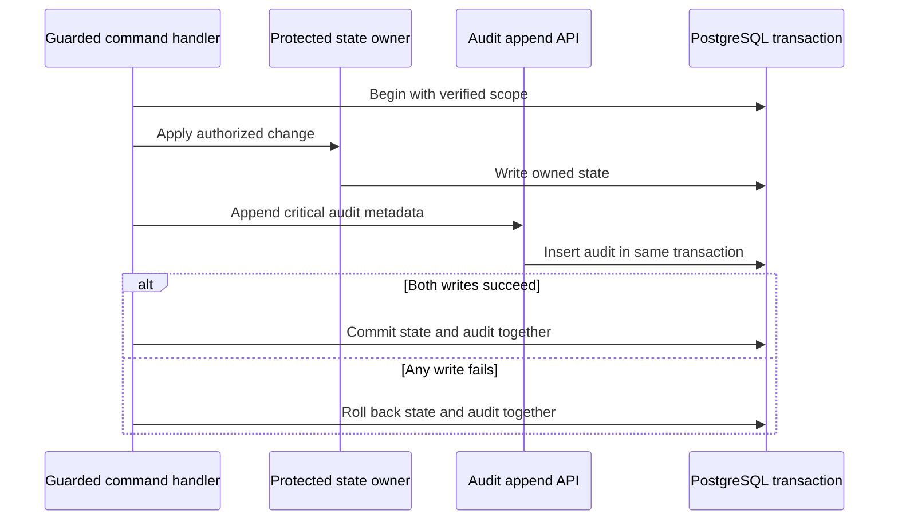

# Audit Engine

**Document status: Approved critical-change/audit atomicity; detailed contracts remain PROPOSED.**\
**Capability status: NOT IMPLEMENTED — no audit store, writer or reader exists yet.**  
**Governance: N0. Proposed owners: audit maintainer and security lead; approval authority: project owner.**

## 1. Purpose, source, scope and non-scope

Provide durable evidence of protected platform changes without creating a cross-tenant information channel or copying sensitive payloads into logs. Locked principles derive from [MASTER-BLUEPRINT](../MASTER-BLUEPRINT.md), sections 5, 6, 8, 20, 23–26 and 30. The [owner-confirmed foundation orientations](../00-GOVERNANCE/DECISION-MANAGEMENT.md#owner-confirmation-of-foundation-orientations) approve the invariant that critical sensitive changes and their durable audit both commit or both roll back. Detailed transaction/session integration, schemas, grants, taxonomy, retention and failed-attempt handling remain **PROPOSED** under the [Core status convention](../03-CORE/THUNDER-CORE.md); approval of the invariant is not approval or delivery of every mechanism below.

Scope: atomic audit of critical identity/access, tenant settings and runtime administrative changes; scoped audit reading; and a distinct bounded path for failed authentication/security attempts.

Non-scope: business audit events, full request/response capture, a data warehouse, a SIEM implementation, proof of cryptographic non-repudiation, immutable external storage, arbitrary log search, or replacing operational metrics. Audit is not the event bus or an outbox surrogate.

## 2. Ownership and dependencies

`audit` owns its persistence, record vocabulary, append API and bounded read contract. Producers call its explicitly named API and never write audit tables directly. Audit accepts validated immutable actor/scope facts; it does not query another module's repositories or cause dependency cycles back into its producers.

A guarded application boundary authorizes reads and supplies verified scope. The audit engine does not grant tenant access to a platform operator. The [Identity and Access](IDENTITY-AND-ACCESS.md) contract supplies actor, membership and transaction context; the producer owns the protected operation and transaction boundary.

Proposed storage is separated by security boundary:

| Record family | Scope and ownership rule | Read authority |
|---|---|---|
| Tenant critical audit | Non-null `tenant_id`, optional company/site references, forced RLS and tenant-safe constraints | Explicit tenant/company audit permission |
| Control-plane critical audit | Global security/platform administration, no copied tenant data | Explicit control-plane audit permission |
| Failed security-attempt record | Minimal unauthenticated/denied-attempt metadata, separately bounded persistence path | Restricted security operations permission |

A nullable tenant field with an unconditional global-read policy is not an acceptable shortcut. Physical schema and retention jobs require a complete reviewed design; this document supplies no partially secured SQL tables.

## 3. Append and read contracts

A proposed critical audit record contains:

| Field | Meaning / constraints |
|---|---|
| `recordId` | Stable opaque record identity generated by the server |
| `occurredAt` | Server timestamp in UTC; not a client claim |
| `action` | Versioned allowlisted action, such as `tenant.settings.updated` |
| `actorId` / actor kind | Opaque authenticated actor or explicitly authorized provisioning/service actor; never credentials |
| `scope` | Exactly control-plane or verified tenant context; company/site optional within that tenant |
| `targetType` / `targetId` | Allowlisted resource category and opaque identifier; no descriptive PII |
| `outcome` | Committed protected change; failed/denied attempts belong to the separate attempt contract |
| `correlationId` / `operationId` | Traceability and command identity without session/token values |
| `schemaVersion` | Version of audit metadata contract |
| `metadata` | Allowlisted small typed facts, for example changed setting key names and old/new revision numbers |

Do not serialize arbitrary exception objects, request bodies, entity snapshots, before/after personal data or configuration values. A setting change records key names and revision transitions, not the old or new secret/value. Metadata fields require classification, size limits and tests. Proposed limits: 4 KiB encoded metadata and 20 allowlisted entries per record; final limits and vocabulary require approval.

The append API joins the **existing protected-write transaction** on the same database/transaction manager. It must not use an independent transaction, asynchronous fire-and-forget call, post-commit-only listener or swallowed exception for critical changes. The read API accepts validated scope, bounded cursor/page size, time range and allowlisted filters; it returns a safe DTO rather than raw database rows. Proposed maximum page size is 100, with no unbounded export in the socle.

## 4. Atomicity and failure semantics

Critical actions include initial operator creation, role/grant or membership changes, session revocation, tenant/company setting changes and approved security-sensitive runtime/configuration actions. The owner must approve the complete action taxonomy before coding. Durable event intent, when introduced, joins the same transaction; the outbox decision does not weaken critical-audit atomicity.

If audit cannot persist, the protected action MUST fail and roll back. The caller receives a safe infrastructure failure, never a success followed by a warning. Do not catch and ignore an audit exception, downgrade a critical action to best-effort, or retry only the audit append after its protected write has committed.

A rolled-back transaction cannot contain durable proof of its failed attempt. Where required, a separate post-rollback attempt record may describe the denial/failure using minimal metadata; it MUST NOT claim that the original change committed. Recovery retries must use the operation's approved idempotency contract so one committed operation does not generate misleading duplicate success records.

## 5. Failed authentication and security-attempt path

Failed authentication has no protected tenant write to join. It therefore uses an **independent, bounded security-recording path**, not a tenant transaction with invented context.

- Record server time, allowlisted reason, correlation ID and coarse request/source classification. Do not copy usernames, email addresses, submitted passwords, tokens, full IP/device payloads or request bodies. Any approved pseudonymous source fingerprint needs a privacy/retention review and a managed key.
- Bound request input, record size, per-source/global emission rate, queue capacity and storage retention. Proposed initial design uses rate-limited minimal records and aggregated counters; sustained floods must not create unbounded records or threads.
- On recording-store failure or saturation, authentication remains denied. Increment an independent operational counter/alert without recursively trying to audit the logging failure. Do not leak internal diagnostics to the caller.
- A bounded drop/aggregate policy is acceptable **only for this security-attempt stream**, with visible loss/suppression counts and owner approval. It is never acceptable for critical committed-change audit.
- Critical successful security changes remain atomic. If successful login recording is classified critical, the session must not become usable until the approved identity/session-plus-audit transaction succeeds; that framework integration requires a spike rather than an unsupported atomicity claim.

## 6. Security, retention and recovery

The runtime DB role is non-owner, non-superuser and `NOBYPASSRLS`; tenant audit reads/writes remain under transaction-local tenant context. An operator with control-plane audit access cannot read tenant audit. Company-restricted audit readers must also pass company/resource checks within the tenant.

Operational application paths are append-only for audit. Runtime privileges must exclude normal update/delete of audit records; retention uses a separately authorized, reviewed process and scope, never blanket application elevation. Administrative database ownership can still modify data, so this proposal does not claim tamper-proof storage. Stronger integrity chains or external immutable copies require a separate threat model and ADR.

Retention must be explicit for each record family, including backups, access logs and security-attempt aggregation. Legal/privacy requirements, retention durations and deletion evidence are owner/security decisions. No automatic purge or export is enabled merely because this document exists. Restores must preserve record/operation identities and avoid falsely replaying already committed audit actions.

## 7. Observability and tests

Metrics: critical append latency, append failures, atomic rollback count, rejected metadata, audit-read denials, security-attempt suppression/drop counts, storage growth and retention-job failures. Use bounded action/outcome labels, not actor or tenant IDs. Restricted logs contain correlation IDs and safe failure categories, never payload copies.

Required future tests:

- Audit insert failure rolls back tenant settings, role/grant changes and initial provisioning; protected-write failure leaves no committed success audit.
- Read tests under actual runtime credentials prove tenant isolation, platform-owner denial and company-level restrictions.
- An invalid metadata key, oversize record, token-like value or raw request payload is rejected/redacted according to the allowlist, not accepted blindly.
- Duplicate command delivery yields the approved single committed effect/audit behavior; concurrent requests and rollback retry are covered.
- Authentication floods and audit-store outages remain bounded, deny authentication correctly, expose suppression metrics and never recurse into audit failures.
- Runtime update/delete attempts fail; any later retention process is separately authorized and tested for scope safety and restore compatibility.

## 8. Acceptance and remaining approvals

Acceptance requires an approved action taxonomy, safe metadata schema, complete RLS/privilege design, same-transaction fault-injection evidence, approved retention policy and a tested bounded failed-authentication path. Session/audit coordination must be demonstrated against the chosen Spring Security/Session versions before claiming critical login atomicity.

Owner gates: critical-action classification (including login/session events), transaction integration, retention/destination/access policy, company audit visibility, record limits and security-attempt suppression thresholds. No critical audit capability is implemented or tested by publishing this proposal.

## Related contracts

- [Thunder Core](../03-CORE/THUNDER-CORE.md)
- [Identity and Access](IDENTITY-AND-ACCESS.md)
- [Command, Query and Event Engine](../03-CORE/COMMAND-QUERY-EVENT-ENGINE.md)
- [Outbox, Inbox and Idempotency](../03-CORE/OUTBOX-INBOX-IDEMPOTENCY.md)
- [Configuration Engine](../03-CORE/CONFIGURATION-ENGINE.md)
- [ADR Template](../14-TEMPLATES/ADR-TEMPLATE.md)
