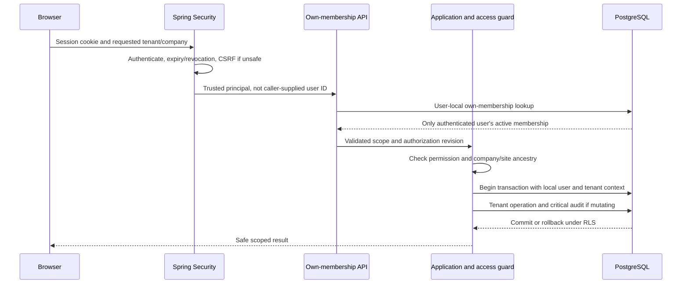

# Identity and Access

**Document status: Approved high-level orientations; detailed L05 contract section 10 with D1–D6 APPROVED 2026-11-21; isolated V3 schema and read-only identity/access foundations VERIFIED 2026-11-21 (29 checks); HTTP/session implementation NOT AUTHORIZED.**\
**Capability status: NOT IMPLEMENTED — schema-only foundation exists in an isolated test database; no identity service, session store or tenant policy is deployed.**  
**Governance: N0. Proposed owners: identity/access maintainers and security lead; approval authority: project owner.**

## 1. Purpose, source, scope and non-scope

Establish authenticated, revocable and scope-aware access to the Authority Pro technical socle without granting platform administrators implicit access to tenants. Locked source principles are [MASTER-BLUEPRINT](../MASTER-BLUEPRINT.md), sections 2, 5, 8, 23–26 and 30–32. The owner-approved baseline includes Angular/Spring Boot and PostgreSQL `tenant_id` plus RLS. The [owner-confirmed foundation orientations](../00-GOVERNANCE/DECISION-MANAGEMENT.md#owner-confirmation-of-foundation-orientations) also approve Spring Security/JDBC-backed cookie sessions with CSRF, first-administrator provisioning through a local operator CLI rather than a public page, restricted PostgreSQL runtime privileges with RLS and verified transaction-local tenant context, and critical-change/audit atomicity. Detailed session configuration/expiry, bootstrap guards, schema/grants, policy and session/audit integration remain **PROPOSED**, under the [Core status convention](../03-CORE/THUNDER-CORE.md).

Proposed initial scope: controlled initial operator provisioning, login/logout, server-side session expiry/revocation, own-membership discovery, validated tenant/company selection, explicit RBAC permissions and isolated application transactions.

Non-scope: public self-registration, public administrator bootstrap, business identities/workflows, social login, MFA implementation, device fingerprinting, API bearer identities, service accounts, arbitrary role inheritance, general ABAC, invitation/email delivery, password-reset implementation or support impersonation. These source ambitions are deferred, not silently considered supported. Before any production rollout, the owner/security lead must decide whether MFA and an account-recovery capability are mandatory release prerequisites.

## 2. Ownership and hierarchy

| Owner | Owned records and contracts | Rule |
|---|---|---|
| `identity` | Global user identifiers, password credentials, login state, server-side sessions, operator provisioning | Global control-plane security data, not tenant business records |
| `tenancy` | Organization/tenant, company, site, membership directory and scope resolution | Tenant is organization, isolation root and future billing root; no billing behavior is implemented |
| `access` | Permission declarations, role/grant records and policy evaluation | Explicit scopes and deny-by-default decisions |
| `audit` | Committed identity/access changes and isolated security-attempt records | No secret/token payload capture |
| `runtime` | Guarded administration adapters and deployment readiness | Cannot create a global tenant bypass |

A company belongs to exactly one tenant; a site belongs to exactly one company. All tenant-owned relationships must preserve that ancestry. Tenant-scoped storage uses tenant-qualified keys/constraints where needed to prevent cross-tenant references. Company/site authorization additionally limits access within a tenant; tenant RLS alone does not implement company permissions.

A global user may have memberships in multiple tenants with distinct company/site grants. A platform-owner/operator role is a **control-plane role only**. It neither implies tenant membership nor overrides permissions. Future support access requires a separate grant that is explicit, scoped, time-limited, audited and revocable; no impersonation shortcut is part of the socle.

## 3. Browser authentication contract

### Recommendation and alternatives

Approved orientation: **Spring Security with JDBC-backed cookie sessions and CSRF protection**. Spring Session JDBC integration, same-origin deployment and exact lifecycle/cookie configuration remain PROPOSED. This direction reuses framework session lifecycle and CSRF primitives instead of writing a token protocol. Custom bearer tokens duplicate lifecycle/security work and encourage browser storage of credentials; JWT introduces revocation and key/refresh complexity that the initial socle does not require. Neither alternative is authorized by this proposal.

The application must use framework session identifiers, not invent its own opaque bearer scheme or assume that Spring Session hashes session IDs at rest. Session tables are sensitive credential material and require restricted database access, encrypted backups and retention controls.

### Required behavior

- Serve UI/API on the same HTTPS origin. Configure a host-only session cookie with **HttpOnly**, **Secure**, **SameSite=Lax** proposed, and a narrowly reviewed path. Cookie name/path, idle and absolute expiry require owner-approved deployment settings. A development TLS arrangement must be explicit; insecure cookie defaults must not leak into production.
- The browser sends the session cookie automatically. Angular MUST NOT read or persist session credentials in `sessionStorage`, localStorage, URLs or JavaScript-managed bearer headers.
- Retain Spring Security CSRF protection for all unsafe requests, including login/logout. Establish a CSRF token through an approved same-origin flow. If a readable CSRF cookie is used for Angular's header integration, **only that anti-CSRF token**, not the session credential, may be JavaScript-readable. CSRF tokens must not be logged or persisted in browser storage.
- SameSite is defense in depth, not a replacement for CSRF validation. Cross-origin credentialed CORS is disabled by default. Reject unexpected origins; exact trusted proxy/HTTPS handling is deployment configuration, not trust in arbitrary forwarded headers.
- Rotate the session identifier on authentication and privilege-sensitive transitions. Invalidate the server session on logout, user disablement and administrative revocation. Enforce both idle and absolute timeout; verify required behavior against the selected Spring Session version rather than assuming all settings exist by default.
- A session identifies a user, not a durable grant to a tenant. Revalidate current membership and permission on each protected request. Do not serialize long-lived role/membership authority into a session and trust it after revocation.
- Use Spring Security's adaptive password hashing with approved algorithm/work factor and no plaintext logging. Generic authentication errors and bounded per-account/per-source throttling reduce enumeration and brute-force exposure. Inputs are size-limited before expensive verification.

## 4. Controlled initial operator provisioning

First-administrator provisioning is approved as a **local operator CLI operation**, not a public page or unauthenticated setup route. Detailed deployment controls, disabled-default enablement and the single-use guard below remain PROPOSED. It is not a default account, a startup side effect, or a reusable bootstrap token.

The operator must explicitly enable the one-shot provisioning profile/process through an authorized deployment procedure. Credentials are supplied through a protected interactive input or approved secret source, never command-line plaintext arguments, source files or logs. Provisioning uses a narrowly scoped runtime/provisioning identity role, not the migration/superuser role and not a tenant RLS bypass.

The operation must atomically check initial-operator state, create the global identity/control-plane role assignment and append critical audit. Concurrent attempts must allow at most one initial creation. If already provisioned, it must refuse to create another privileged identity; routine operator management requires an authenticated, separately authorized operation. Failure must roll back and emit a bounded non-secret diagnostic. Disable/remove the provisioning execution mode after completion. Account recovery/reset and emergency access require separate review, not rerunning bootstrap indiscriminately.

The first operator receives no tenant membership. Creating a tenant or granting tenant access needs its own approved, audited contract; possession of deployment access is not a support-data consent mechanism.

## 5. Own-membership discovery and tenant context

### Control-plane lookup without a tenant bypass

Global user/session persistence is deliberately separate from tenant records. Before authentication, only narrowly defined identity operations may resolve a credential or server session; there is no general public user/session lookup. Identity repository access is private, parameterized and protected by database privileges and application entry points.

After authentication, the server establishes transaction-local **authenticated user context** for own-membership discovery. The proposed authoritative membership directory is tenancy-owned **control-plane authorization metadata**: user, tenant, allowed company/site references, status and authorization revision. It is not a repository of tenant business data. Its own-membership SELECT policy must constrain rows to the authenticated user. A caller cannot provide another subject ID to broaden this query. Return only the minimal tenant/company labels and identifiers needed for selection through a curated API, not by opening general tenant tables before selection.

Membership administration uses a separate explicit contract with tenant context, permission checks, tenant-matching write checks and critical audit; it MUST NOT be enabled by the own-read policy. Any materialized membership projection must preserve authoritative revocation semantics. This policy split and its precise schema need an N0 spike; no incomplete SQL policy is prescribed here.

### Tenant operation pipeline

A header or path tenant/company ID is an untrusted selector. The server must authenticate first, verify active membership and ancestry, and construct an immutable internal context. Authentication claims, request body values or arbitrary event payloads must not directly set database context.

Every tenant transaction must install tenant/user context **transaction-locally on the same connection before tenant SQL**, including queries, audit reads, background consumers and retries. The proposed logical setting names are `app.tenant_id` and `app.user_id`. They are never session-level pooled-connection state. On commit/rollback, context must expire; pool reuse, async dispatch and error paths must not inherit an old tenant. Do not rely on a request ThreadLocal alone or allow lazy database access after the guarded transaction closes.

Permission/membership validation must be fresh at transaction entry. Proposed revocation contract: transactions admitted before a revocation commits may finish within their bounded deadline; new transactions must observe revocation. Security-critical membership/grant changes require a stronger revision/locking strategy where stale admission would violate an invariant. The owner must approve this concurrency boundary and its tests, rather than claiming impossible instantaneous cancellation of all in-flight work.

## 6. Database security contract

- The serving application and its workers use a **non-owner, non-superuser, `NOBYPASSRLS`** role, separate from the migration/table-owner role. They must not be members of or able to assume an elevated role. Serving configuration never contains migration credentials.
- Tenant-owned tables have non-null `tenant_id`, RLS enabled and forced, and complete read/write policies: visibility checks for reads/deletes and both existing-row and new-row checks for updates/inserts. Missing, empty, malformed or mismatched context must deny or safely error, never expose rows. Any safe-context conversion must avoid treating an invalid setting as a wildcard.
- There is **no global `app.platform_scope` bypass**, no unconditional privileged policy, no blanket `SECURITY DEFINER` escape and no RLS-disable command available to runtime code. Control-plane identity operations do not change tenant-table policy.
- Tenant-safe unique keys and foreign keys must prevent cross-tenant references; company/site ancestry must be enforced as well as tenant equality. RLS filters do not repair a foreign key that points into another tenant.
- Membership directory policy is a narrowly scoped user-bound control-plane read, not a precedent for tenant-table exemptions. Schema and policy reviews must classify every resource explicitly.
- Internal background work runs one validated tenant at a time under a separately approved service authorization context. Such service identities are deferred; until designed, no cross-tenant worker or global queue sweep is implicitly authorized.
- RLS defends against missing tenant predicates in trusted application code; it does not sandbox malicious compiled code that controls the database connection. Parameterized SQL, injection prevention, protected context setters and first-party provenance remain mandatory.

No executable or half-defined SQL examples are included. A later migration design must define complete roles, privileges, tables, constraints, policies and downgrade/recovery behavior together and prove them using the actual runtime role.

## 7. Application contracts and failure behavior

| Contract | Required behavior |
|---|---|
| Authenticate / logout / revoke session | Framework-managed credentials, CSRF where applicable, bounded outcomes; no token exposure |
| List own memberships | Trusted subject only, own-row policy, minimal bounded result |
| Resolve tenant/company/site | Return verified context or deny; no fallback tenant |
| Evaluate permission | Explicit permission and resource scope; missing/unknown permissions deny |
| Change membership/grant | Expected authorization revision, scoped authorization, atomic audit |
| Provision initial operator | Explicit local execution, disabled default, single initial creation, atomic audit |

Unauthenticated requests receive a safe authentication-required response; unauthorized scopes return a consistent non-enumerating denial. Malformed input is rejected, not normalized into a broader scope. Database/session-store failure fails closed; no cached privileged session fallback. Audit failure rolls back protected changes. Failed authentication logging uses the separate bounded path in [Audit Engine](AUDIT-ENGINE.md) so an attacker cannot force unbounded log writes or obtain access through logging failures.

## 8. Observability, tests and acceptance

Metrics include login success/failure/throttle counts, session expiry/revocation, scope denials, context-install failures and database policy failures with bounded labels. Restricted structured logs may contain opaque actor/tenant IDs, reason codes and correlation IDs under retention policy, but never passwords, session/CSRF values, credential hashes or copied PII/request payloads. Security alerts distinguish repeated denials from infrastructure failures.

Required future tests cover:

1. Login fixation resistance, secure cookie flags, logout/login CSRF, unexpected origins, idle/absolute expiry and server-side revocation.
2. Disabled provisioning, absent unauthenticated bootstrap, concurrent provisioning attempts, audit failure rollback and no implicit tenant membership for the operator.
3. Own-membership lookup with no tenant context returns only the authenticated user's permitted directory entries; forged user IDs and anonymous context fail.
4. Direct database reads/inserts/updates/deletes under runtime credentials deny absent/malformed/foreign tenant context. Runtime role attributes, membership and table ownership are verified.
5. Two tenants, several companies/sites and a multi-membership user prove ancestry, grant isolation, own-directory policy and platform-owner denial.
6. Connection-pool reuse after rollback, nested transactions, parallel requests and async scheduling do not leak context. Stale revocation and race tests enforce the approved admission boundary.
7. Tenant-scoped caches/diagnostics/audit never reuse another scope's data; missing authorization or policy rejects startup/release.

Acceptance requires owner-approved session/provisioning/RLS decisions, reviewed complete schema and migrations, a threat model, passing security/integration tests and controlled recovery procedures. **No capability is implemented by this document.**

## 9. Approval gates and related contracts

Approve session/cookie/CSRF configuration, timeout and revocation policy, password policy/throttling, initial-operator workflow, membership-directory policy, permission catalogue, production MFA/recovery requirements and any future service/support identities. [ADR-0003](../adr/ADR-0003-multi-tenancy.md) and [ADR-0005](../adr/ADR-0005-sessions.md) distinguish approved high-level session, local CLI provisioning and restricted-runtime/RLS/context orientations from these proposed details; the remaining detailed decisions still require owner approval before implementation.

- [Thunder Core](../03-CORE/THUNDER-CORE.md)
- [Thunder Control](../03-CORE/THUNDER-CONTROL.md)
- [Configuration Engine](../03-CORE/CONFIGURATION-ENGINE.md)
- [Audit Engine](AUDIT-ENGINE.md)
- [ADR Template](../14-TEMPLATES/ADR-TEMPLATE.md)

## 10. L05 detailed contract proposal — 2026-11-21

This section turns the approved orientations of sections 3–9 into one reviewable contract. It introduces no business module: no Orders, Inventory, invoicing or other domain table, route or fixture. Nothing here is implemented; decisions D1–D6 require owner approval before any code, dependency, migration or database-role change.

### 10.1 Scope of the L05 slice

In scope: closed first-operator provisioning (local CLI), login/logout/CSRF/own-profile HTTP contracts, server-side cookie sessions with expiry and revocation, own-membership discovery with pre-selection labels, validated tenant/company selection, explicit permission evaluation, administrative membership/role changes with critical audit, and the database roles and policies those paths require.

Not in scope: public registration, browser bootstrap page, invitation/email, password reset, MFA, OIDC/federation, support impersonation, machine-to-machine identities, dynamic roles, general ABAC, or any business capability. The Angular screens belong to L07.

### 10.2 Proposed logical schema

| Relation | Purpose | Key rules |
|---|---|---|
| `identity.users` | Global account | `user_id` uuid key; unique normalized login; status `active`/`disabled`; `authorization_revision` integer; no tenant columns |
| `identity.password_credentials` | Credential | One row per user; hash + scheme name + change timestamp; never selected by tenant code paths; no plaintext column |
| `identity.spring_session`, `identity.spring_session_attributes` | Framework session store | Created by migration, not by application auto-initialization; readable/writable only by the runtime role; session identifiers treated as credential material |
| `identity.provisioning_guard` | Single-use bootstrap guard | One row maximum; `provisioned_at`, `operator_ref`, `revision`; insert-only success path |
| `tenancy.memberships` (extended) | User–tenant membership | Existing table plus `authorization_revision` and `disabled_at`; unique `(user_id, tenant_id)` preserved; no company grants stored here |
| `access.roles`, `access.role_permissions` | Explicit role catalogue | Named roles and named permissions only; no wildcard, no inheritance chain |
| `access.membership_roles` | Grants within a tenant | Membership, role, optional company/site restriction, `authorization_revision`; ancestry enforced by foreign keys |

Company/site restrictions use tenant-qualified foreign keys, so a grant cannot reference another tenant's company or a site outside its company. All tenant relations keep RLS enabled and forced; identity relations are control-plane and carry no tenant column.

### 10.3 Authentication and session policy

- Cookies: one host-only session cookie (proposed name `AUTHORITY_PRO_SESSION`), `HttpOnly`, `Secure`, `SameSite=Lax`, `Path=/`; a separate JavaScript-readable CSRF cookie (proposed `XSRF-TOKEN`) carrying only the anti-CSRF value.
- Rotation: new session identifier on login, logout, privilege-sensitive change and administrative revocation.
- Expiry: proposed idle timeout 30 minutes and absolute lifetime 8 hours; at most 3 concurrent sessions per user (oldest invalidated). Values are configuration, not code constants.
- CSRF: enabled for every unsafe request including login and logout; logout is an authenticated POST. Same-site is defense in depth only.
- Passwords: adaptive hash through Spring Security (`PasswordEncoder`), scheme recorded per row so it can be migrated later; inputs bounded (proposed 256 UTF-8 bytes) before verification; generic authentication errors.
- Throttling: per-account lock (proposed 5 failures in 15 minutes, 15-minute lock) plus the already-approved bounded failed-attempt path (20/minute per source class, 600/minute global) writing only reason codes to `audit.security_attempts`.
- Session attributes carry only the internal user identifier and opaque references; membership and permissions are re-evaluated per request, never trusted from a long-lived session snapshot.

### 10.4 Controlled first-operator provisioning

A dedicated packaged mode (proposed `provision-local`) replaces any HTTP bootstrap. It reads the operator login and password from stdin under the existing bounded UTF-8 line rules, uses a dedicated non-owner role (proposed `authority_pro_provisioner`, connection limit 1), and performs one transaction: verify the guard is absent, insert the guard, create the user and credential, append the `identity.operator.provisioned` control-plane audit record. A unique guard constraint makes concurrent attempts fail with at most one success. Replays refuse; no overwrite of an existing administrator; no tenant membership is created; no migration or superuser credential is reused. Failure rolls back guard, user and audit together and returns an opaque `PROVISIONING_REFUSED` diagnostic.

### 10.5 HTTP contracts (browser, same origin)

| Method and path | Behavior |
|---|---|
| `GET /api/v1/auth/csrf` | 204 with CSRF cookie; never creates a session or returns user data |
| `POST /api/v1/auth/login` | Framework authentication after CSRF; bounded body; rotates session; generic 401 on failure; 429 when throttled |
| `POST /api/v1/auth/logout` | CSRF-protected; invalidates the session server-side; 204 |
| `GET /api/v1/auth/me` | Authenticated user, opaque user id, display name, language/theme preferences, memberships with tenant/company identifiers and labels, effective roles/permissions for the selected scope only |

Tenant-scoped routes accept an untrusted selector header (proposed `X-Authority-Tenant`, optional `X-Authority-Company`/`X-Authority-Site`) that is validated against a fresh membership and ancestry check; auth routes never accept it. Errors remain RFC 9457 with stable codes: `AUTHENTICATION_REQUIRED`, `SESSION_EXPIRED`, `AUTHORIZATION_DENIED`, `CSRF_REJECTED`, `AUTHENTICATION_THROTTLED`, `SCOPE_INVALID`, `SESSION_STORE_UNAVAILABLE`. No response reveals whether a login exists, which permission is missing or whether another tenant/company exists.

### 10.6 Own-membership discovery and pre-selection labels

V1 already grants the runtime role `SELECT` on `tenancy.memberships` with the `own_membership_read` policy keyed on `app.user_id`, so the authenticated user's own memberships are readable without tenant context. Labels live in `tenancy.tenants`/`companies`, whose policies require tenant context. The proposal is to add SELECT-only policies gated by an active membership of the current user (tenant label) and by that membership plus company equality (company label). No INSERT/UPDATE/DELETE path is added by these policies; administrative writes still require tenant context, permission and critical audit. `/auth/me` returns only the caller's own entries, bounded to the configured maximum (proposed 25 memberships).

### 10.7 Permission evaluation and administrative changes

Evaluation is deny-by-default on an explicit named permission and a resolved scope. Proposed v1 permission names: `audit.read.tenant`, `audit.read.control_plane`, `security.attempts.read`, `tenancy.settings.manage`, `access.membership.manage`. Proposed roles: `TENANT_OWNER` (all tenant permissions), `TENANT_AUDITOR` (all three read permissions within the tenant), `TENANT_ADMIN` (settings and membership management). Membership, role and grant changes carry an expected `authorization_revision`; stale revisions fail with `AUTHORIZATION_REVISION_CONFLICT`; every successful change appends the matching L04 `access.*` critical record in the same transaction.

**L06 extension approved 2026-11-24:** one permission is added, `platform.inventory.read`, with control-plane scope and a `TENANT_OWNER`-only grant; the five codes above stay unchanged and the catalogue remains explicit (no wildcard or inheritance). See the [decision register](../00-GOVERNANCE/DECISION-MANAGEMENT.md#l06-protected-inventory-decisions-approved--2026-11-24). It is implemented in V5 and enforced by a dedicated `/api/v1/platform/inventory` authorization chain that records refusals in `audit.security_attempts`; the isolated qualification passed 12 checks, with evidence in [PACK-INVENTORY](../PACK-INVENTORY.md#l06-protected-inventory-evidence--2026-11-24).

### 10.8 Failure and operational semantics

Database or session-store unavailability fails closed with `SESSION_STORE_UNAVAILABLE`; never a cached privileged session. Audit failure rolls back membership/role changes. Anonymous login failures use the bounded attempt path and never prevent a legitimate denial. Metrics cover login success/failure/throttle, session expiry/revocation, scope denial and context-install failure with bounded labels; logs never contain passwords, hashes, session or CSRF values.

### 10.9 Future acceptance matrix

| Case | Expected |
|---|---|
| Login CSRF missing/invalid; logout CSRF missing | Rejected 403, no session change |
| Session fixation / login rotation | Pre-login identifier unusable after authentication |
| Idle and absolute expiry | 401 `SESSION_EXPIRED`; server session removed |
| Administrative revocation | Subsequent requests denied; revocation audited (`identity.session.revoked`) |
| Provisioning concurrency and replay | One success maximum; second attempt `PROVISIONING_REFUSED`; no tenant membership |
| Provisioning audit failure | Guard, user and credential roll back |
| Own-membership lookup | Only caller's active rows; forged user selector has no effect |
| Cross-tenant selector | 403 non-enumerating denial; no foreign label leak |
| Company restriction | Company-scoped member cannot read another company's labels or data |
| Stale authorization revision | Change rejected; no partial grant |
| Permission catalogue | Unknown permission denies; no wildcard or implicit admin |
| Session-store outage | 503 fail-closed; no fallback |

### 10.10 Owner decisions before implementation

| ID | Decision | Status |
|---|---|---|
| D1 | Password hashing algorithm and work factor | **APPROVED 2026-11-21**: Spring Security BCrypt strength 12; Argon2id deferred to a dependency/benchmark review |
| D2 | Idle/absolute expiry and concurrent sessions | **APPROVED 2026-11-21**: 30 minutes idle / 8 hours absolute / 3 sessions per user, rotated on privilege change |
| D3 | Pre-selection tenant/company labels | **APPROVED 2026-11-21**: SELECT-only membership-gated policies on `tenancy.tenants` and `tenancy.companies`; no administrative write path |
| D4 | Logout audit criticality | **APPROVED 2026-11-21**: normal logout invalidates without a blocking critical append; administrative revocation appends `identity.session.revoked` atomically |
| D5 | Provisioning execution | **APPROVED 2026-11-21**: `provision-local` mode, dedicated `authority_pro_provisioner` role (connection limit 1), single-use guard, control-plane audit in the same transaction |
| D6 | Permission catalogue and roles v1 | **APPROVED 2026-11-21**: the five named permissions and three roles in §10.7; no wildcard, inheritance or default administrator tenant grant |
| D7 | Browser CSRF token strategy | **DECIDED 2026-11-23 (implementation)**: the session-less L02 boundary keeps the XOR request handler; the authenticated chain renders XOR tokens but accepts the plain cookie value in `X-XSRF-TOKEN`, with the shared `XSRF-TOKEN` cookie readable by the SPA (`HttpOnly` off, `SameSite=Lax`, `Path=/`); the session cookie stays `HttpOnly` and no token is exposed in HTML |
| D8 | Own-profile content | **DECIDED 2026-11-23 (implementation)**: `GET /auth/me` returns the caller's identity, active memberships and their companies; language and theme are deferred because no reviewed column exists (no silent V5 migration) |
| D9 | Permission enumeration in the profile | **DECIDED 2026-11-23 (implementation)**: permissions are resolved server-side at each protected operation through `AccessDecision`; `/auth/me` does not enumerate grants, avoiding a cached-privilege surface |
| D10 | Failed-attempt containment | **DECIDED 2026-11-23 (implementation)**: per-source admission (5 failures per 15 minutes, bounded 1024 sources, in-memory) returns `AUTHENTICATION_THROTTLED` 429; a durable per-account lock is deferred because it needs a schema/storage decision, and unknown, wrong-password, disabled and non-BCrypt paths share one generic 401 with a dummy hash comparison |
| D11 | Absolute session lifetime without schema change | **DECIDED 2026-11-23 (implementation)**: idle 30 minutes is enforced by Spring Session; the 8-hour absolute bound is checked against `getCreationTime()` on every authenticated request and invalidates with `SESSION_EXPIRED`; the 3-session cap evicts the oldest sessions through the indexed principal name |
| D12 | Local cookie transport | **DECIDED 2026-11-23 (implementation)**: `AUTHORITY_PRO_SESSION` is `HttpOnly`, `SameSite=Lax`, `Path=/` and `Secure=false` for local plain-HTTP qualification; any TLS deployment must re-enable `Secure` before exposure |

### 10.11 Remaining gates after approval

The implementation gates listed on 2026-11-21 are closed as of 2026-11-23:

- Spring Session JDBC 4.1.1 is present in the offline repository, wired explicitly because Spring Boot 4 does not auto-configure it; the L02 packaged-artifact baseline was amended to require `spring-session-core` and `spring-session-jdbc`.
- The dedicated `authority_pro_provisioner` role (connection limit 1, DPAPI secret, matching environment assertions) is provisioned and exercised by `provision-local`.
- `V4__session_store_and_provisioning.sql` adds the `identity.spring_session` table with runtime-only grants and the provisioning guard used by the single-use operator flow.
- The §10.5 HTTP surface is implemented and only exists when the runtime datasource is installed; in `skeleton-local` the closed L02 boundary remains unchanged.

Remaining gates: L07 for any browser UI; the main-database migration and production deployment remain separate authorizations. Commit and push to the owner's repository were authorized on 2026-11-23.

### 10.12 Isolated schema evidence — 2026-11-21

`V3__identity_access_foundation.sql` was applied with Flyway to `authority_pro_l05_identity_test` (V1→V3, three successful history rows) through the migrator role with effective role `authority_pro_owner`. Evidence: `tmp/l05-identity/run-81e8bba0-aace-4ac1-9bca-e41268c98af9.json`. The executable qualifier `com.authoritypro.persistence.IdentityQualification` reported `IDENTITY_QUALIFICATION_OK checks=29`.

Verified properties: five non-system schemas owned by `authority_pro_owner`; fourteen relations with exact ownership, `relkind` and RLS flags (tenancy and `audit.tenant_records` forced; identity/access relations and control-plane audit tables without RLS); the tenancy membership gained `disabled_at` and `authorization_revision`; identity/access tables expose no PUBLIC grants, no default-ACL grants to PUBLIC or runtime, and no runtime write privilege; runtime reads only `identity.users`, `identity.password_credentials`, `access.roles`, `access.role_permissions`, `access.membership_roles`, and is denied `SELECT` on `identity.provisioning_guard`; the role catalogue seeds three roles and ten grants (5/2/3). Behavior checks: BCrypt cost-12 hashes accepted and plain-text or cost-10 hashes rejected; the `CredentialAuthenticator`/`SpringPasswordVerifier` pair authenticates a database-loaded bcrypt hash with the right password and returns `INVALID_CREDENTIALS` otherwise; the single-row provisioning guard rejects a second insertion; `membership_roles` rejects a site without company (`23514`), an unknown role (`23503`) and a missing membership (`23503`); label policies expose only the tenant and companies of the membership matching `app.user_id`, hide everything when the setting is absent, and hide labels once `disabled_at` is set; runtime insert/alter/history changes are denied. The pure domain (`LoginName` normalization, `SessionPolicy` 30 min/8 h/3, five-permission/three-role catalogue and deny-by-default `PermissionEvaluator`, plus `AccessDecision`/`MembershipSelection` scope resolution) is unit-tested, and the JDBC read foundations (`JdbcIdentityDirectory.findCredential`, `JdbcAuthorizationCatalog.catalogue`/`assignments`) are exercised by the qualifier: credential lookup by normalized login, a database-loaded catalogue of 3 roles/10 grants, and assignments that disappear once the membership is disabled. The qualifier also resolves effective permissions from the database-loaded assignments: a company-scoped owner role applies at its company and sites but not at tenant level, a sibling company or a stale authorization revision, while a tenant-wide auditor role grants `audit.read.tenant` but not `tenancy.settings.manage`. Main database, other databases and protected containers were fingerprinted before and after and are unchanged; the backend suite now holds 109 tests.

### 10.13 Isolated implementation evidence — 2026-11-23

Within the 2026-11-21 isolated authorization, L05 is now implemented end to end against `authority_pro_l05_identity_test`: `V4__session_store_and_provisioning.sql` extends the qualified V3 foundation (V1→V4), the identity/access roots gained the application and adapter layers, and the §10.5 HTTP surface is served only in `data-local` mode. The executable qualifier reported `IDENTITY_QUALIFICATION_OK checks=36`; evidence is `tmp/l05-identity/run-8bf7c9af-8b5b-46d2-9137-61febcddf21e.json` and the earlier schema-only run `run-81e8bba0-aace-4ac1-9bca-e41268c98af9.json` remains intact.

Implemented and verified: credential lookup and verification through the restricted runtime role (BCrypt cost 12 only); provisioning through `provision-local` with the single-use guard and atomic control-plane audit, including a refused replay; `identity.spring_session` readable/writable by runtime with no history or DDL privilege; label reads gated by `app.user_id`; runtime denial of every unapproved write on identity, access, provisioning and history objects. The backend suite holds 128 unit/HTTP/architecture tests and seven packaged-JAR integration tests, all green offline.

The HTTP contract of §10.5 is covered at three levels: domain/application unit tests (`AuthenticationServiceTest`, `LoginThrottleTest`), controller tests with fakes (`AuthControllerTest`: CSRF 204 with a JS-readable `SameSite=Lax` `Path=/` cookie and no session, session rotation and principal-name indexing at login, generic 401, 429 throttling, 503 store failure, authenticated `/me`, 401 without authentication, session invalidation at logout), and the packaged `HttpBoundaryTest` proving that `skeleton-local` keeps the closed L02 boundary byte-for-byte. Decisions D7–D12 in §10.10 record the implementation choices; `SCOPE_INVALID` remains defined for future scope selection because no selection endpoint exists in v1.

The qualifier verified the main `authority_pro` database (V1 history, four empty tenancy tables), every other database, the protected containers and all earlier evidence unchanged before and after the run; `databaseRetained=true`. No real-browser acceptance, L06 read surface or main-database migration is claimed.
