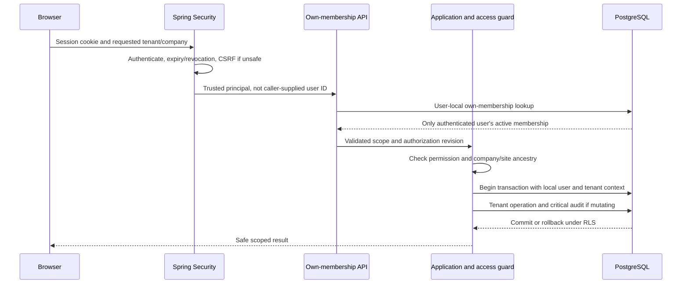

# Identity and Access

**Document status: PROPOSED**  
**Capability status: NOT IMPLEMENTED — no identity service, session store or tenant policy is deployed.**  
**Governance: N0. Proposed owners: identity/access maintainers and security lead; approval authority: project owner.**

## 1. Purpose, source, scope and non-scope

Establish authenticated, revocable and scope-aware access to the Authority Pro technical socle without granting platform administrators implicit access to tenants. Locked source principles are [MASTER-BLUEPRINT](../MASTER-BLUEPRINT.md), sections 2, 5, 8, 23–26 and 30–32. The owner-approved baseline includes Angular/Spring Boot and PostgreSQL `tenant_id` plus RLS. Concrete session, provisioning and policy mechanisms below are **PROPOSED, pending owner approval**, under the [Core status convention](../03-CORE/THUNDER-CORE.md).

Proposed initial scope: controlled initial operator provisioning, login/logout, server-side session expiry/revocation, own-membership discovery, validated tenant/company selection, explicit RBAC permissions and isolated application transactions.

Non-scope: public self-registration, public administrator bootstrap, business identities/workflows, social login, MFA implementation, device fingerprinting, API bearer identities, service accounts, arbitrary role inheritance, general ABAC, invitation/email delivery, password-reset implementation or support impersonation. These source ambitions are deferred, not silently considered supported. Before any production rollout, the owner/security lead must decide whether MFA and an account-recovery capability are mandatory release prerequisites.

## 2. Ownership and hierarchy

| Owner | Owned records and contracts | Rule |
|---|---|---|
| `identity` | Global user identifiers, password credentials, login state, server-side sessions, operator provisioning | Global control-plane security data, not tenant business records |
| `tenancy` | Organization/tenant, company, site, membership directory and scope resolution | Tenant is organization, isolation root and future billing root; no billing behavior is implemented |
| `access` | Permission declarations, role/grant records and policy evaluation | Explicit scopes and deny-by-default decisions |
| `audit` | Committed identity/access changes and isolated security-attempt records | No secret/token payload capture |
| `runtime` | Guarded administration adapters and deployment readiness | Cannot create a global tenant bypass |

A company belongs to exactly one tenant; a site belongs to exactly one company. All tenant-owned relationships must preserve that ancestry. Tenant-scoped storage uses tenant-qualified keys/constraints where needed to prevent cross-tenant references. Company/site authorization additionally limits access within a tenant; tenant RLS alone does not implement company permissions.

A global user may have memberships in multiple tenants with distinct company/site grants. A platform-owner/operator role is a **control-plane role only**. It neither implies tenant membership nor overrides permissions. Future support access requires a separate grant that is explicit, scoped, time-limited, audited and revocable; no impersonation shortcut is part of the socle.

## 3. Browser authentication contract

### Recommendation and alternatives

Recommend **Spring Security plus Spring Session JDBC**, same-origin Angular and backend, and framework-managed cookie sessions. This reuses session lifecycle and CSRF primitives instead of writing a token protocol. Custom bearer tokens duplicate lifecycle/security work and encourage browser storage of credentials; JWT introduces revocation and key/refresh complexity that the initial socle does not require. Neither alternative is authorized by this proposal.

The application must use framework session identifiers, not invent its own opaque bearer scheme or assume that Spring Session hashes session IDs at rest. Session tables are sensitive credential material and require restricted database access, encrypted backups and retention controls.

### Required behavior

- Serve UI/API on the same HTTPS origin. Configure a host-only session cookie with **HttpOnly**, **Secure**, **SameSite=Lax** proposed, and a narrowly reviewed path. Cookie name/path, idle and absolute expiry require owner-approved deployment settings. A development TLS arrangement must be explicit; insecure cookie defaults must not leak into production.
- The browser sends the session cookie automatically. Angular MUST NOT read or persist session credentials in `sessionStorage`, localStorage, URLs or JavaScript-managed bearer headers.
- Retain Spring Security CSRF protection for all unsafe requests, including login/logout. Establish a CSRF token through an approved same-origin flow. If a readable CSRF cookie is used for Angular's header integration, **only that anti-CSRF token**, not the session credential, may be JavaScript-readable. CSRF tokens must not be logged or persisted in browser storage.
- SameSite is defense in depth, not a replacement for CSRF validation. Cross-origin credentialed CORS is disabled by default. Reject unexpected origins; exact trusted proxy/HTTPS handling is deployment configuration, not trust in arbitrary forwarded headers.
- Rotate the session identifier on authentication and privilege-sensitive transitions. Invalidate the server session on logout, user disablement and administrative revocation. Enforce both idle and absolute timeout; verify required behavior against the selected Spring Session version rather than assuming all settings exist by default.
- A session identifies a user, not a durable grant to a tenant. Revalidate current membership and permission on each protected request. Do not serialize long-lived role/membership authority into a session and trust it after revocation.
- Use Spring Security's adaptive password hashing with approved algorithm/work factor and no plaintext logging. Generic authentication errors and bounded per-account/per-source throttling reduce enumeration and brute-force exposure. Inputs are size-limited before expensive verification.

## 4. Controlled initial operator provisioning

Provisioning is proposed as a **local, deployment-controlled CLI operation**, disabled by default. It is not a public unauthenticated HTTP route, a default account, a startup side effect, or a reusable bootstrap token.

The operator must explicitly enable the one-shot provisioning profile/process through an authorized deployment procedure. Credentials are supplied through a protected interactive input or approved secret source, never command-line plaintext arguments, source files or logs. Provisioning uses a narrowly scoped runtime/provisioning identity role, not the migration/superuser role and not a tenant RLS bypass.

The operation must atomically check initial-operator state, create the global identity/control-plane role assignment and append critical audit. Concurrent attempts must allow at most one initial creation. If already provisioned, it must refuse to create another privileged identity; routine operator management requires an authenticated, separately authorized operation. Failure must roll back and emit a bounded non-secret diagnostic. Disable/remove the provisioning execution mode after completion. Account recovery/reset and emergency access require separate review, not rerunning bootstrap indiscriminately.

The first operator receives no tenant membership. Creating a tenant or granting tenant access needs its own approved, audited contract; possession of deployment access is not a support-data consent mechanism.

## 5. Own-membership discovery and tenant context

### Control-plane lookup without a tenant bypass

Global user/session persistence is deliberately separate from tenant records. Before authentication, only narrowly defined identity operations may resolve a credential or server session; there is no general public user/session lookup. Identity repository access is private, parameterized and protected by database privileges and application entry points.

After authentication, the server establishes transaction-local **authenticated user context** for own-membership discovery. The proposed authoritative membership directory is tenancy-owned **control-plane authorization metadata**: user, tenant, allowed company/site references, status and authorization revision. It is not a repository of tenant business data. Its own-membership SELECT policy must constrain rows to the authenticated user. A caller cannot provide another subject ID to broaden this query. Return only the minimal tenant/company labels and identifiers needed for selection through a curated API, not by opening general tenant tables before selection.

Membership administration uses a separate explicit contract with tenant context, permission checks, tenant-matching write checks and critical audit; it MUST NOT be enabled by the own-read policy. Any materialized membership projection must preserve authoritative revocation semantics. This policy split and its precise schema need an N0 spike; no incomplete SQL policy is prescribed here.

### Tenant operation pipeline

A header or path tenant/company ID is an untrusted selector. The server must authenticate first, verify active membership and ancestry, and construct an immutable internal context. Authentication claims, request body values or arbitrary event payloads must not directly set database context.

Every tenant transaction must install tenant/user context **transaction-locally on the same connection before tenant SQL**, including queries, audit reads, background consumers and retries. The proposed logical setting names are `app.tenant_id` and `app.user_id`. They are never session-level pooled-connection state. On commit/rollback, context must expire; pool reuse, async dispatch and error paths must not inherit an old tenant. Do not rely on a request ThreadLocal alone or allow lazy database access after the guarded transaction closes.

Permission/membership validation must be fresh at transaction entry. Proposed revocation contract: transactions admitted before a revocation commits may finish within their bounded deadline; new transactions must observe revocation. Security-critical membership/grant changes require a stronger revision/locking strategy where stale admission would violate an invariant. The owner must approve this concurrency boundary and its tests, rather than claiming impossible instantaneous cancellation of all in-flight work.

## 6. Database security contract

- The serving application and its workers use a **non-owner, non-superuser, `NOBYPASSRLS`** role, separate from the migration/table-owner role. They must not be members of or able to assume an elevated role. Serving configuration never contains migration credentials.
- Tenant-owned tables have non-null `tenant_id`, RLS enabled and forced, and complete read/write policies: visibility checks for reads/deletes and both existing-row and new-row checks for updates/inserts. Missing, empty, malformed or mismatched context must deny or safely error, never expose rows. Any safe-context conversion must avoid treating an invalid setting as a wildcard.
- There is **no global `app.platform_scope` bypass**, no unconditional privileged policy, no blanket `SECURITY DEFINER` escape and no RLS-disable command available to runtime code. Control-plane identity operations do not change tenant-table policy.
- Tenant-safe unique keys and foreign keys must prevent cross-tenant references; company/site ancestry must be enforced as well as tenant equality. RLS filters do not repair a foreign key that points into another tenant.
- Membership directory policy is a narrowly scoped user-bound control-plane read, not a precedent for tenant-table exemptions. Schema and policy reviews must classify every resource explicitly.
- Internal background work runs one validated tenant at a time under a separately approved service authorization context. Such service identities are deferred; until designed, no cross-tenant worker or global queue sweep is implicitly authorized.
- RLS defends against missing tenant predicates in trusted application code; it does not sandbox malicious compiled code that controls the database connection. Parameterized SQL, injection prevention, protected context setters and first-party provenance remain mandatory.

No executable or half-defined SQL examples are included. A later migration design must define complete roles, privileges, tables, constraints, policies and downgrade/recovery behavior together and prove them using the actual runtime role.

## 7. Application contracts and failure behavior

| Contract | Required behavior |
|---|---|
| Authenticate / logout / revoke session | Framework-managed credentials, CSRF where applicable, bounded outcomes; no token exposure |
| List own memberships | Trusted subject only, own-row policy, minimal bounded result |
| Resolve tenant/company/site | Return verified context or deny; no fallback tenant |
| Evaluate permission | Explicit permission and resource scope; missing/unknown permissions deny |
| Change membership/grant | Expected authorization revision, scoped authorization, atomic audit |
| Provision initial operator | Explicit local execution, disabled default, single initial creation, atomic audit |

Unauthenticated requests receive a safe authentication-required response; unauthorized scopes return a consistent non-enumerating denial. Malformed input is rejected, not normalized into a broader scope. Database/session-store failure fails closed; no cached privileged session fallback. Audit failure rolls back protected changes. Failed authentication logging uses the separate bounded path in [Audit Engine](AUDIT-ENGINE.md) so an attacker cannot force unbounded log writes or obtain access through logging failures.

## 8. Observability, tests and acceptance

Metrics include login success/failure/throttle counts, session expiry/revocation, scope denials, context-install failures and database policy failures with bounded labels. Restricted structured logs may contain opaque actor/tenant IDs, reason codes and correlation IDs under retention policy, but never passwords, session/CSRF values, credential hashes or copied PII/request payloads. Security alerts distinguish repeated denials from infrastructure failures.

Required future tests cover:

1. Login fixation resistance, secure cookie flags, logout/login CSRF, unexpected origins, idle/absolute expiry and server-side revocation.
2. Disabled provisioning, absent unauthenticated bootstrap, concurrent provisioning attempts, audit failure rollback and no implicit tenant membership for the operator.
3. Own-membership lookup with no tenant context returns only the authenticated user's permitted directory entries; forged user IDs and anonymous context fail.
4. Direct database reads/inserts/updates/deletes under runtime credentials deny absent/malformed/foreign tenant context. Runtime role attributes, membership and table ownership are verified.
5. Two tenants, several companies/sites and a multi-membership user prove ancestry, grant isolation, own-directory policy and platform-owner denial.
6. Connection-pool reuse after rollback, nested transactions, parallel requests and async scheduling do not leak context. Stale revocation and race tests enforce the approved admission boundary.
7. Tenant-scoped caches/diagnostics/audit never reuse another scope's data; missing authorization or policy rejects startup/release.

Acceptance requires owner-approved session/provisioning/RLS decisions, reviewed complete schema and migrations, a threat model, passing security/integration tests and controlled recovery procedures. **No capability is implemented by this document.**

## 9. Approval gates and related contracts

Approve session/cookie/CSRF configuration, timeout and revocation policy, password policy/throttling, initial-operator workflow, membership-directory policy, permission catalogue, production MFA/recovery requirements and any future service/support identities. [ADR-0003](../adr/ADR-0003-multi-tenancy.md) and [ADR-0005](../adr/ADR-0005-sessions.md) distinguish the approved isolation strategy from these proposed mechanisms; owner approval remains required before implementation.

- [Thunder Core](../03-CORE/THUNDER-CORE.md)
- [Thunder Control](../03-CORE/THUNDER-CONTROL.md)
- [Configuration Engine](../03-CORE/CONFIGURATION-ENGINE.md)
- [Audit Engine](AUDIT-ENGINE.md)
- [ADR Template](../14-TEMPLATES/ADR-TEMPLATE.md)
