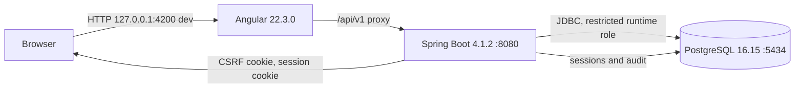

# Dependency and Boundary Map

**Decision status:** N/A — read-only audit output.
**Delivery status:** PHASE 0 OUTPUT describing the current build, not a target design.
**Document validation status:** DRAFT — awaiting Gate G0 owner approval.

## 1. Runtime topology (observed)

One Spring Boot process, one Angular build, one dedicated PostgreSQL instance. No
Redis, Kafka, broker, container orchestrator or cloud dependency is present. Sessions
are stored in PostgreSQL through spring-session-jdbc; CSRF uses a readable cookie plus
request header.

## 2. Backend module boundaries

Today the Modulith contract is intentionally empty: five closed roots with zero
allowed dependencies.

| Root | Owns | Migrations |
|---|---|---|
| `tenancy` | tenants, companies, sites, memberships | V1 |
| `audit` | tenant records, control-plane records, security attempts | V2 |
| `identity` | users, credentials, session store, provisioning | V3, V4 |
| `access` | roles, role permissions, membership roles, scoped grants | V5 |
| `inventory` | compiled component descriptors and protected read model | consumes V5 permission |

Support packages outside the roots: `runtime` (application shell, configuration
validation, datasource bootstrap, HTTP problem advice), `persistence`, `openapi`
(test scope), `launch` (startup refusal and packaged boundary).

Enforcement: `PlatformArchitectureTest` asserts exact root names, `CLOSED` module type,
explicit empty `allowedDependencies`, no named interfaces, no cross-root bytecode
edges, private package ownership and inward layer direction. Adding any inter-module
edge today requires an approved ADR and a deliberate test change.

## 3. HTTP surface

| Route | Method | Owner | Notes |
|---|---|---|---|
| `/api/v1/auth/csrf` | GET | identity | Anonymous, emits CSRF token |
| `/api/v1/auth/login` | POST | identity | 204/401/429 |
| `/api/v1/auth/logout` | POST | identity | Authenticated |
| `/api/v1/auth/me` | GET | identity | Profile and memberships |
| `/api/v1/access/bootstrap` | GET | access | Requires `X-Authority-Tenant` and `X-Authority-Company`; 401/403/422 |
| `/api/v1/platform/inventory` | GET | inventory | Requires `platform.inventory.read` |
| `/api/v1/audit/tenant-records` | GET | audit | Cursor paging, permissioned |
| `/actuator/health/liveness` | GET | runtime | Only probe exposed |
| `/actuator/health/readiness` | GET | runtime | 503 until the nucleus is complete |

Errors follow a bounded problem model with `no-store` and `nosniff` headers.

## 4. Data ownership and migration chain

| Migration | Owner | Main database |
|---|---|---|
| V1 `tenancy_foundation.sql` | tenancy | Applied; four empty technical tables |
| V2 `audit_foundation.sql` | audit | Not applied |
| V3 `identity_access_foundation.sql` | identity/access | Not applied |
| V4 `session_store_and_provisioning.sql` | identity | Not applied |
| V5 `platform_inventory_permission.sql` | access | Not applied |

This gap is risk X-01 in the [open risks](OPEN-RISKS-AND-UNKNOWNs.md). The application
code already expects V2–V5 whenever it runs with a data-capable mode.

Database roles: `authority_pro_owner` (migration target via `SET ROLE`),
`authority_pro_migrator` (no runtime use), `authority_pro_runtime` (no DDL),
`authority_pro_provisioner`, `authority_pro_operator` (bootstrap only).

## 5. Frontend boundaries

| Area | Responsibility |
|---|---|
| `core/auth` | session state, login/logout, route guards |
| `core/scope` | tenant/company selection, scope headers, late-response protection |
| `core/inventory`, `core/audit` | typed API clients |
| `core/i18n` | FR/EN/IT/AR catalogues, locale direction |
| `core/preferences` | theme, density, language persistence |
| `features/*` | shell, login, tenants, overview, inventory, audit, preferences, not-found |

The frontend consumes the HTTP surface above through a dev proxy. No generated OpenAPI
client exists; request and response shapes are hand-typed and covered by unit tests.

## 6. External dependencies

| Dependency | Version / pin | Verification |
|---|---|---|
| Java | Temurin 21.0.13+9 portable | Wrapper and checksum |
| Maven | 3.9.16, SHA-256 pinned | Wrapper |
| Spring Boot | 4.1.2 | Maven build |
| PostgreSQL | 16.15, image digest pinned | Environment tooling |
| Node.js | 24 (engines `>=24 <25`) | `package.json` |
| npm | 11.17.0 (frontend `packageManager`) | `frontend/package.json` |
| Angular | 22.3.0 | `frontend/package.json` |
| GitHub Actions | `checkout@v4`, `setup-node@v4` unpinned; `setup-java` pinned by SHA | `foundation.yml` |

## 7. Boundary risks

- The empty dependency graph protects boundaries but also blocks legitimate reuse;
  Phase 2 must define named exports deliberately rather than open modules.
- Table ownership is enforced by naming and grants, not by a machine-checked map;
  Phase 2 should publish an ownership matrix that ArchUnit or a migration lint can read.
- The frontend has no generated contract types, so API drift is caught only by unit
  tests with fixtures.

## Related documents

- [Target architecture](../02-ARCHITECTURE/TARGET-ARCHITECTURE.md)
- [API architecture](../02-ARCHITECTURE/API-ARCHITECTURE.md)
- [Database architecture](../02-ARCHITECTURE/DATABASE-ARCHITECTURE.md)
- [Baseline file inventory](BASELINE-FILE-INVENTORY.md)
