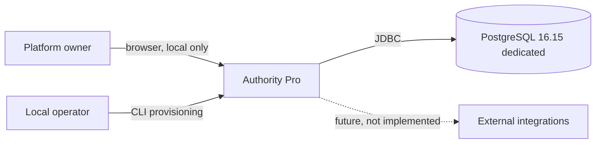
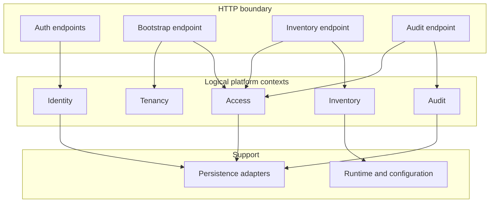

# Phase 2 — Target Blueprint

**Decision status:** PROPOSED. No architecture decision in this folder is approved until Gate G2.
**Delivery status:** DESIGN ONLY. Nothing here is implemented beyond the capabilities marked OBSERVED.
**Document validation status:** DRAFT.

## 1. Purpose

Define the target foundation architecture and contracts before adding any engine, so the
existing modular monolith evolves in place rather than being rebuilt. Every element is
marked OBSERVED (exists at `27e9b14`), PROPOSED (design), or DEFERRED (not in this
programme).

## 2. Legacy and target in one sentence

A single Spring Boot executable and a single Angular application, with five closed
Modulith roots today (tenancy, audit, identity, access, inventory), a dedicated
PostgreSQL database per deployment, and logical platform contexts that stay in one
process until measurements justify separation.

## 3. C4 level 1 — system context

Actors: the platform owner (browser), the local operator (offline provisioning CLI).
No external identity provider, mail, message broker or third-party API is part of the
implemented foundation.

## 4. C4 level 2 — containers

| Container | Technology | Status | Responsibility |
|---|---|---|---|
| Web application | Angular 22.3.0, zoneless, standalone | OBSERVED | Login, scope selection, overview, inventory, audit, preferences |
| Platform process | Spring Boot 4.1.2, Java 21 | OBSERVED | HTTP boundary, sessions, authorization, audit, inventory |
| Database | PostgreSQL 16.15, image digest pinned | OBSERVED | Tenancy, audit, identity, access, session store |
| Migration tooling | Flyway core + PostgreSQL | OBSERVED | V1–V5, separate migrator role |
| Local environment tooling | Node.js 24 scripts, DPAPI secrets | OBSERVED | Container lifecycle and qualification |
| Worker / outbox | Not built | DEFERRED | Future durable work only on measured need |
| Reverse proxy / TLS | Not configured | PROPOSED (ADR-0013) | Production HTTP profile |

## 5. C4 level 3 — components inside the platform process

Today the bytecode forbids every edge between the five Modulith roots; the arrows above
are conceptual responsibilities inside one process, implemented through adapters that
live in each root. Any real inter-root dependency must be introduced as an approved
named export (ADR-0014).

## 6. Deployment profiles

| Profile | Status | Characteristics |
|---|---|---|
| `skeleton-local` (no database) | OBSERVED | Loopback 127.0.0.1:8080, probes only, everything else denied |
| `data-local` (dedicated database) | OBSERVED | Loopback HTTP, non-secure cookie, local TLS absent |
| `production` | PROPOSED | TLS termination, secure cookie, CSP/HSTS, operator-owned secrets, RPO/RTO decided (DEC-006) |

Never run the main database in a production-like claim without closing X-01 (schema
level) and ADR-0013 (HTTP profile).

## 7. Design rules for this foundation

1. One deployable process until a measured need justifies a worker.
2. PostgreSQL first for state, sessions, audit and (later) outbox; no broker by default.
3. Deny by default: every protected route needs authentication plus a server-side
   permission or scope decision.
4. Tenant selection is never authorization; membership and grant checks decide.
5. Contracts are versioned and explicit; no dynamic executable extensions.
6. Migrations are forward-only, owner-reviewed, never rewritten once applied.
7. Every capability claim carries an evidence level.

## 8. What this blueprint does not include

Business modules, workflow, reporting, documents, search, notifications, marketplace,
script execution, Kubernetes, Redis, Kafka and multi-region deployment. Their absence
is deliberate, not an oversight.

## Related documents

- [Module ownership matrix](01-MODULE-OWNERSHIP-MATRIX.md)
- [Contract catalogue](02-CONTRACT-CATALOGUE.md)
- [Database and migration map](03-DB-OWNERSHIP-AND-MIGRATION-MAP.md)
- [Security threat model](05-SECURITY-THREAT-MODEL.md)
- [Acceptance and packages](07-ACCEPTANCE-AND-PACKAGES.md)
